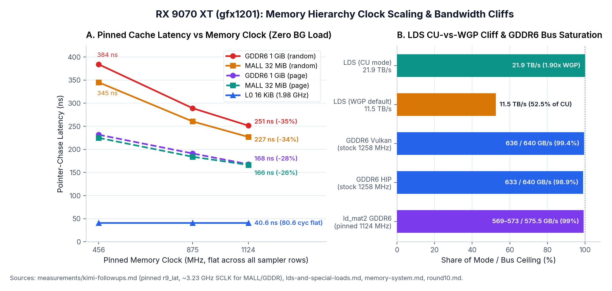
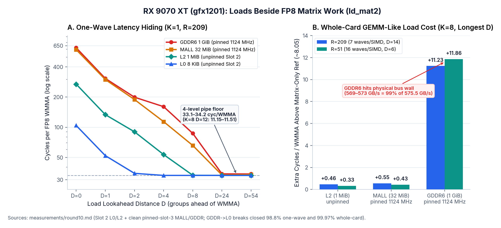
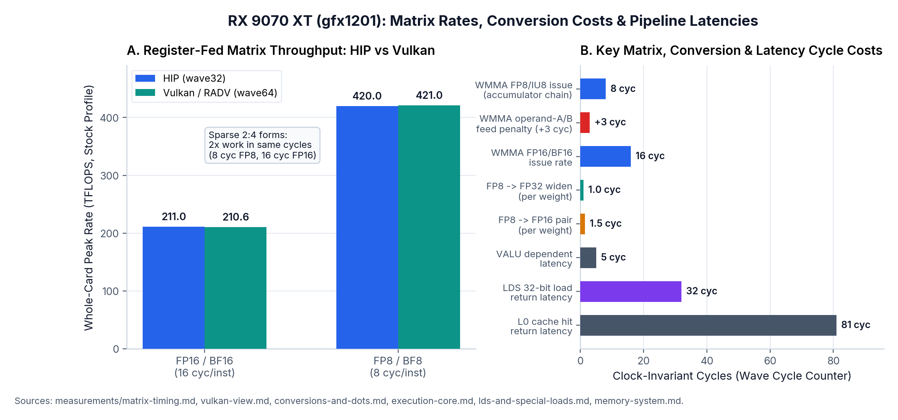
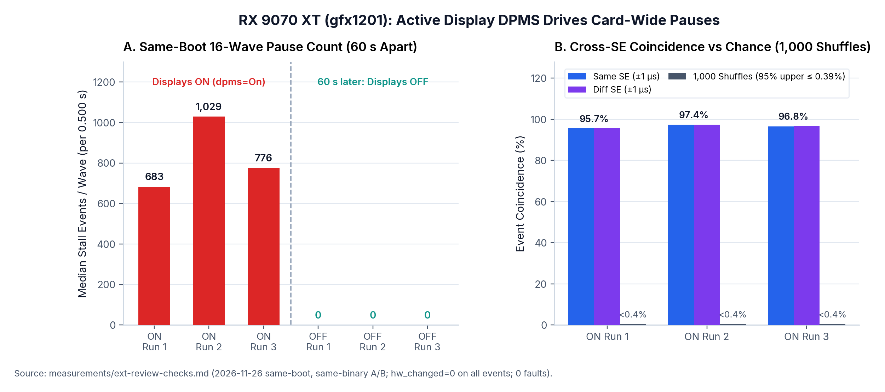
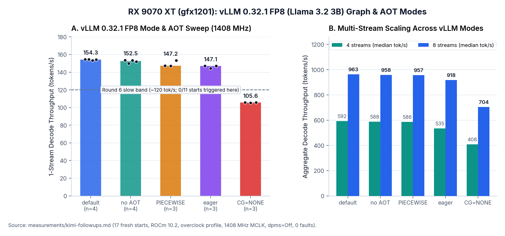
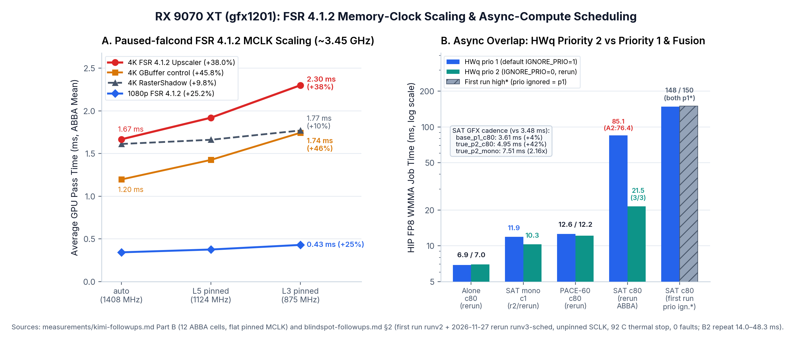
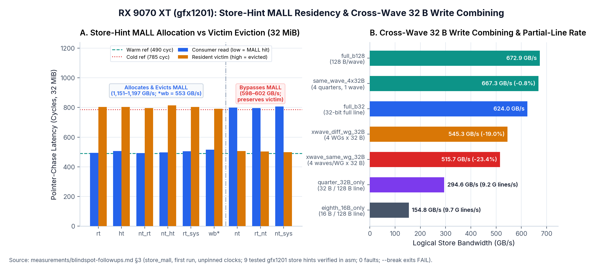
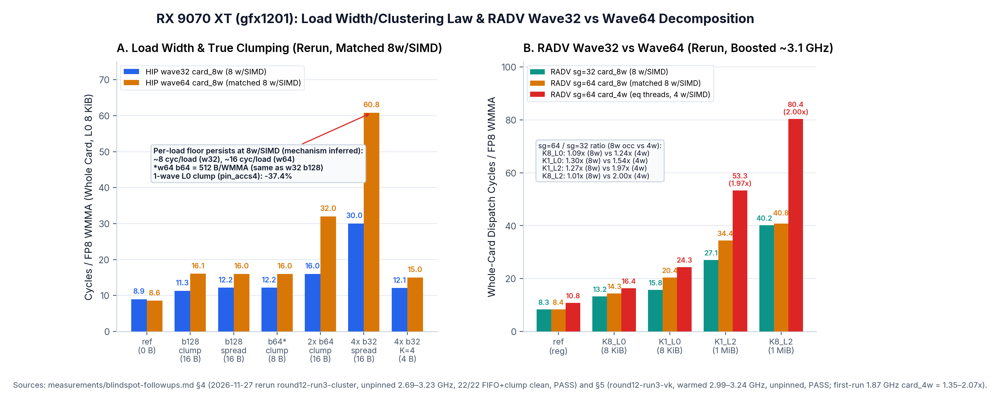

# RDNA 4 measurement study: the AMD RX 9070 XT (gfx1201)

This repository measures the AMD Radeon RX 9070 XT (gfx1201), using small probes to time or inspect one part of the card at a time and workload studies to see how those hardware rules appear in real programs. The goal is to understand the hardware, not to optimize a program. Each measurement file starts with a plain-language summary, then gives the tables, method, and rerun commands. Results use the **MEASURED**, **READ**, and **INFERRED** convention defined in [Methodology and running the probes](#methodology-and-running-the-probes).

## At a glance

Wall-clock rates describe this card in the named configuration, not a stock card. The linked files give the evidence, spreads, and limits.

| Area | Current result | Configuration and evidence |
|---|---|---|
| FP16 and BF16 WMMA | 16 cycles per instruction; about 211 TFLOPS with register-only dense operands. | Stock `Testing`, 317 W cap, 1258 MHz memory: [matrix-timing.md](measurements/matrix-timing.md). |
| FP8, BF8, and 8-bit integer WMMA | 8 cycles per instruction; about 420 TFLOPS or TOPS with register-only dense operands. | Stock `Testing`, 317 W cap, 1258 MHz memory: [matrix-timing.md](measurements/matrix-timing.md). |
| Sparse SWMMAC | Twice the dense work in the same time; 422 TFLOPS for sparse FP16, 842 for sparse FP8, and 839 TOPS for sparse 8-bit integer work, dense-equivalent. | Stock `Testing`, 317 W cap: [matrix-timing.md](measurements/matrix-timing.md). |
| L0, L2, MALL, and GDDR6 latency | L0 81 cycles; L2 230 to 255; MALL 360 to 390 in page order and 420 to 500 random; GDDR6 485 to 545, or 700 to 820 random after a long walk. | Original hierarchy at 1258 MHz: [memory-system.md](measurements/memory-system.md). Later pinned-clock scaling: [kimi-followups.md](measurements/kimi-followups.md). |
| GDDR6 bandwidth at 1258 versus 1408 MHz | Read 633 versus 700.3 GB/s, write 581 versus 638.7, copy 547 versus 608.9. The original 1258 MHz bus limit was 640 to 644 GB/s. | 1258 MHz: [memory-system.md](measurements/memory-system.md). Dynamically reached 1408 MHz on the overclocked `Default` profile: [round7.md](measurements/round7.md). |
| LDS bandwidth | A 32-bit load returns after 32 cycles; the whole card reads 11.5 TB/s in HIP's default WGP mode and 21.9 TB/s in CU mode. | [lds-and-special-loads.md](measurements/lds-and-special-loads.md). |
| Dual-issue VALU | Every dual-issue pair allowed by the guide runs at two operations per cycle; most vector instructions issue once per cycle and have a 5-cycle dependent latency. | [execution-core.md](measurements/execution-core.md). |
| Card-wide periodic pauses | Earlier displays-on runs read 380 to 1,023 pauses/s and about 0.6 to 1.4 us per pause, around 1.1 us in the regular-pause characterization. The 2026-11-26 rerun read 683 to 1,029 median events per 0.500 s, about 1,366 to 2,058/s; blanking both displays stopped them. | [scheduling-and-clocks.md](measurements/scheduling-and-clocks.md), [ext-review-checks.md](measurements/ext-review-checks.md). |

### Figures

All figures are generated reproducibly by `scripts/make_figures.py` using values transcribed from the committed measurement tables (PNG + SVG in `figures/`).

















## Key findings

### Matrix unit and numerical behavior

- **Matrix instruction time depends on input type, not data.** FP16 and BF16 inputs take 16 cycles; FP8, BF8, and 8-bit integer inputs take 8. Chaining through the accumulator adds no time, while feeding a result back as a multiplicand adds 3 cycles. Whole-card rates are about 211 TFLOPS for FP16 and BF16 and 420 TFLOPS for FP8 and 8-bit integer work; sparse forms do twice the work in the same time. A 256-byte load landing while one wave runs FP8 matrix work adds about 25 cycles: the measured extras for one load per 1, 4, and 8 matrix instructions are 25.6, 6.3, and 3.3 to 3.4 cycles at L2, and 25.0, 6.3, and 3.1 at the 8 KiB span. This is independent of whether every instruction waits or only the first in a group waits; the per-landing-load reading is INFERRED, and arrival timing and issue cost were not separated. ([matrix-timing.md](measurements/matrix-timing.md), [round9.md](measurements/round9.md))
- **The bit-exact matrix-arithmetic model covers all 11 dense and all 11 sparse forms and agrees bit for bit with AMD's `rocjitsu`.** The card adds 16-bit-input products in 4 steps of 4 and 8-bit-input products in 2 steps of 8; each fixed-point step cuts low bits toward minus infinity, then rounds the sum to FP32, so a small term next to a large one can vanish. AMD's `rocjitsu` emulator (2026-10-22) and a separate public report (2026-10-31) describe the same FP8 structure. The CPU-only `rocjitsu` comparison covered all 11 dense forms with about 1 million outputs each and 9 of the 11 sparse forms, excluding the two 4-bit ones, with valid indices. Both models also match all 278,635 recorded card outputs. They differ only for the 8-bit integer sparse form with invalid indices on AMD's SIMD code paths, which AMD's header calls unspecified. AMD's `rocjitsu` code is in ROCm/rocm-systems under the MIT licence. ([matrix-arithmetic.md](measurements/matrix-arithmetic.md), [ext-review-checks.md](measurements/ext-review-checks.md))
- **The matrix adder's error rarely survives rounding to FP8.** Only 2 of 1,446,000 model-shaped outputs differed from the exact sum after E4M3 rounding. With FP8 weights, FP16 output differed in 0.004 % of cases at K = 16 and 0.18 % at K = 4096. ([errors-after-quantizing.md](measurements/errors-after-quantizing.md))
- **FP8 and BF8 conversions are exact, with explicit saturation and infinity edge cases.** Widening to FP32 is exact for every code. Narrowing rounds to nearest even over all 2^32 FP32 inputs; a NaN always becomes 0xFF for FP8 or 0xFE for BF8, overflow gives NaN for FP8 and infinity for BF8, and with saturation enabled infinity still gives NaN for FP8 or infinity for BF8. Widening costs 1.0 cycle per weight to FP32 and 1.5 cycles to FP16 pairs. Dot instructions use the matrix adder rather than an exact dot product. In wave64, dot4 still costs one cycle and does twice the lane work, reaching 99.1 against 50.1 T MAC/s in wave32, so the matrix unit's lead falls from 4x to 2x; FP8/BF8 conversions instead cost 2.00 cycles in wave64 and gain no throughput per cycle. ([conversions-and-dots.md](measurements/conversions-and-dots.md), [round7.md](measurements/round7.md))

### Execution core, memory, and LDS

- **Most vector instructions issue once per cycle, but a dependent instruction waits 5 cycles.** Every dual-issue pair allowed by the guide runs at two operations per cycle. FP64 operations take 32 cycles. Branches cost 9 cycles when not taken and 15 when taken. ([execution-core.md](measurements/execution-core.md))
- **Streaming reads nearly fill the memory bus, and the cache levels are distinct.** At 1258 MHz, plain reads reach 633 GB/s against a 640 GB/s bus limit regardless of data content. The card has a 32 KB first-level cache per compute unit, 8 MB of L2 emptied at each kernel launch, a 64 MB memory-side cache, and 16 GB of GDDR6. A first-level hit takes 81 cycles; a GDDR6 read takes 485 to 545. ([memory-system.md](measurements/memory-system.md))
- **The current memory clock ramps with streaming load instead of remaining at the earlier 1258 MHz lock.** Loads from 0.05 s to 20 s reached 1408 MHz within one to three of the driver's 10 ms table refreshes. Stable 1408 MHz passes read 700.3 GB/s, wrote 638.7, and copied 608.9, about 10 to 11 % above the 1258 MHz results; the older memory-bound numbers are about 10 % low, and each table states its own clock. After a load the clock reached 772 MHz within about 0.15 s and only sometimes continued to 456 MHz; why it remains at 772 is untested. Round 9 independently measured 705.1 to 705.9 GB/s at the 1408 label, within 0.8 % of Round 7's 700.3. ([round7.md](measurements/round7.md), [round9.md](measurements/round9.md))
- **Cross-dispatch cache behavior remains an observation, and `s_wait_loadcnt` retires the tested loads in order.** Through HIP, data written by one launch was read by the next no faster than untouched data. Through Vulkan, the next dispatch read at same-kernel speed with no barrier or an execution-only barrier and more than 200 cycles per load slower with the five other barrier kinds. Only 18 of 23 controls passed, so no cache level is assigned and the cross-dispatch question is not answered. For the tested load types and widths, no early `s_wait_loadcnt` return appeared in 195,840 checks, with 0 wrong words. ([memory-system.md](measurements/memory-system.md), [round9.md](measurements/round9.md))
- **Loads beside FP8 matrix work hide latency but retain a landing cost and can saturate GDDR6.** Round 10 measured one-wave and whole-card loads across L0, L2, MALL, and GDDR6 on the overclock profile. `L0` and `L2` were unpinned; `MALL`, `GDDR`, and Item 3 Step 1 were pinned flat at `1124 MHz` across 108 `ld_mat2` plus 1,139 Item 3 sampler rows through `pin_mclk.sh --level 5`, returning `RESTORE-OK` with 0 faults. References landed at `8.043–8.096` cycles per WMMA. In one wave, deep lookahead hid even a roughly 620-cycle GDDR6 round trip down to the pipe floor: `K=1 D=54` gave `L0 33.07`, `L2 33.13`, `MALL 33.69`, `GDDR 34.17`; `K=8 D=12` gave `11.15`, `11.15`, `11.49`, and `11.51` cyc/mm. Across the whole card at `K=8`, loads added `+0.33 to +0.46` cyc/mm from `L0` and `L2` and `+0.43 to +0.55` cyc/mm from 32 MiB `MALL`. One GiB `GDDR6` at `1124 MHz` (`R=209 K=1`) saturated the bus at `569–573 GB/s`, `98.9%–99.6%` of 575.5 GB/s, with `57.15–57.59 ns/mm` and `0.03%–0.33%` burst spread in ns. The `c10` and `c11` cycle controls tripped because unpinned SCLK ramped `2.43–3.21 GHz`. Deliberate `GDDR->L0` aim breaks closed `98.8%` of the one-wave gap and `99.97%` of the whole-card gap. ([round10.md](measurements/round10.md))
- **Pinned memory-clock scaling separates cache latency from core-clock drift, but one Vulkan leg remains open.** In the 2026-11-26 follow-up, `pin_mclk.sh` held `456`, `875`, and `1124 MHz` flat across all sampler rows and returned `RESTORE-OK` with 0 faults; `L0` at 16 KiB stayed at `80.6 cycles`. At matched `~3.23 GHz` SCLK, random `MALL` at 32 MiB changed `345.1 -> 260.4 -> 226.9 ns` and random `GDDR6` at 1 GiB changed `384.0 -> 289.1 -> 251.3 ns`. In Round 10 Item 3 Step 1, two repeats had `CONTROLS FAILED` on `verdict_line`, `repeats`, `hip_base_cold_r`, and `vk_base_cold_r`: `hip-base-p` read `163.6 ns` in r1 (`cell_clock PASS`) and `164.9 ns` in r2 (`cell_clock FAIL`) against `vk-base-p` `254.4–295.0 ns`, so no causal reading is claimed. Adding `warm=150` to `r10_cl3` fixed the HIP SCLK drift, giving `<0.1%` spread across 3 pinned `1124 MHz` repeats, `251.2–252.4 ns` random and `167.7–169.1 ns` page. The Vulkan leg missed `VKG_SPV` and stays open. ([round10.md](measurements/round10.md), [kimi-followups.md](measurements/kimi-followups.md))
- **Shared memory answers 2.5 times faster than the first-level cache.** A 32-bit LDS load issues in one cycle per wave and returns data after 32 cycles. HIP's default work-group-processor mode halves bandwidth per compute unit: the whole card reads 11.5 TB/s in that mode and 21.9 TB/s in compute-unit mode. ([lds-and-special-loads.md](measurements/lds-and-special-loads.md))
- **Store hints select different MALL behavior, and narrow cross-wave stores lose write-combining throughput.** Across all 9 tested `gfx1201` store hints at `32 MiB`, `rt`, `ht`, `nt_rt`, `nt_ht`, and `rt_sys` allocate and evict in MALL (`493–505 cyc`, `1,151–1,197 GB/s`); `nt`, `rt_nt`, and `nt_sys` bypass MALL and preserve victims (`797–807 cyc`, `598–602 GB/s`); `wb` allocates yet drops consumer bandwidth to `553 GB/s`. Cross-wave 32 B quarter stores lose `19–23%` against same-wave 128 B stores, `516–545` versus `667–673 GB/s`. ([blindspot-followups.md](measurements/blindspot-followups.md))
- **Load width and true SIMD clustering change the cost of loads beside FP8 WMMA.** On `load_cluster` (`round12-run3-cluster` `PASS`, with `pin_accs4` enforcing true clumping), every `global_load_*` costs `~7.5–8 cyc/SIMD` in wave32 and `~15–16` in wave64, even at matched 8 waves/SIMD (`card_8w`) and equal `512 B/WMMA` tile bytes. The `b64` wave64 case read `16.01–16.02` against `b128` wave32 `11.33` and `12.83`; equal-byte `b32` was `2.65x` slower, `30.02` against `11.33 cyc/mm` for L0 card. True clumping saved `7–11%` card-wide and `22–37%` single-wave. ([blindspot-followups.md](measurements/blindspot-followups.md))
- **PCIe copies reach about 55 to 60 GB/s, with separate pageable and alignment penalties.** A 1 GiB pinned copy moved at 55.3 GB/s host-to-device, 56.5 GB/s device-to-host, and 59.8 GB/s both ways. Card-timed ping-pong is 1.56 us round trip. With SDMA off, a 1 GiB pageable buffer offset by one byte drops to 44.9 and 35.0 GB/s. The copy job's `gpu_metrics` link field stayed at 2.5 GT/s. ([round11.md](measurements/round11.md))
- **RADV ray-query rates depend strongly on coherence, with clock and control limits stated.** Queries miss at the root near 106 Grays/s, fall from 47.6 to 19.6 Grays/s across a coherent triangle sweep (closest hit, long tMax), and reach 13.0 Grays/s shuffled at 262,144 triangles. The ray-hit controls and breaks passed, but 60 of 68 rate cells ran at a drifting unpinned clock, and the printed PASS is legacy pre-fix output; current `r11_rt` qualifies it. A dependent chain runs from 677 ns/ray to 1731 ns/ray, with 1731 at 32,768 triangles and 1612 at 262,144. ACO emits `image_bvh8_intersect_ray` and `ds_bvh_stack`. The ray-tracing job's memory clock stayed at 96 MHz. ([round11.md](measurements/round11.md))
- **The video job passed; both graphics runs have explicit limits or failed controls.** Slot 1's full graphics run stopped at the 95 C guard. Slot 2's video job passed 72 of 72 cells and 12 of 12 controls, with sampler hotspot peak 48 C; `--break-device` was not run. Slot 2's graphics job finished under 87 C on the probe's own line (sampler peak 86 C) and is a FAIL: `fill_RGB10A2` passed, the 4x MSAA occlusion count is wrong, three bursts ran past 250 ms, and the 512 MiB random write printed 855.3 GB/s above the probe's bus ceiling. Those fill rates are not results. ([round11.md](measurements/round11.md))

### Compilers, drivers, clocks, and profiling

- **Matrix instructions ignore the lane mask, and compilers can omit a required non-inlined call-boundary `V_NOP`.** All lanes are read and written in wave32 and wave64 across 20 tested forms, so a matrix builtin inside a per-lane `if` can give wrong results. Listing-only checks found no `V_NOP` between a non-inlined callee's final WMMA and the caller's next WMMA that reads the result. The gap remains in ROCm 10.1, ROCm 10.2 at `-O3` and `-O1`, and upstream Fedora clang 22.1.8 once `threadIdx.x`'s incidental `-nogpulib` helper call is replaced with `__builtin_amdgcn_workitem_id_x()`, across `gfx1201`, `gfx1200`, `gfx1151`, and `gfx1150`. On 2026-11-26 the study probes ran on this RX 9070 XT under ROCm 10.2 at `-O3` and `-O1`: 64 of 256 results were wrong, bit-identical to no-`V_NOP` assembly, and the per-lane `if` was wrong at the same counts. The companion RDNA 3 study measured 44 of 256 wrong on an RX 7900 XT (`gfx1100`). Standalone upstream-draft packages for all three compiler issues, call boundary, per-lane `if` and EXEC, and IR sinking of `permlane` `fetch_inactive` sources, live in [bugreports/README.md](bugreports/README.md). ([compiler-and-hazards.md](measurements/compiler-and-hazards.md), [leftovers-c-b.md](measurements/leftovers-c-b.md), [ext-review-checks.md](measurements/ext-review-checks.md))
- **Vulkan reaches the same hardware limits as HIP.** Register-fed matrix work measured 210.6 TFLOPS for FP16 and 421.0 for FP8 through Vulkan, against 211 and 420 through HIP. Vulkan read 636 GB/s against HIP's 633. RADV uses wave64 for compute shaders with 64 or more invocations, which costs nothing for register-fed matrix code. ([vulkan-view.md](measurements/vulkan-view.md))
- **RADV launches compute shaders in CU mode, but wave64 can still hurt load-heavy cooperative-matrix work.** Mesa RADV `27.0.0-devel` launched with `WGP_MODE = 0`; `round12-run3-wgp` reported `PASS inferred=CU_MODE`, with true `0–48 KiB` LDS verified in ACO stats, `33–47 cyc` 4 to 8 wave barriers, `delta_8w = 27.38`, and whole-card LDS read `10.68 TB/s`, equal to `93.9 B/cyc/CU` at `~1.78 GHz` and `1.47x` the WGP ceiling. The first run read `12.62 TB/s` and `104.3 B/cyc/CU`, but its raw log was not kept. Under RADV `coopMatMulAdd` at matched boosted `2.99–3.24 GHz` SCLK (`round12-run3-vk` `PASS`), wave64 slowed `1.24–2.00x` at equal thread count (`card_4w`). Matching wave occupancy (`card_8w`, 8 waves/SIMD) eliminated the `K8_L2` gap, `40.79` against `40.21` or `1.01x`, and narrowed load-heavy `K1_L0` and `K1_L2` to `1.30x` and `1.27x`; `K8_L0` was `1.09x`. ([blindspot-followups.md](measurements/blindspot-followups.md))
- **The whole card pauses hundreds of times a second while displays are active, and the pauses stop when displays blank.** The rate changes from run to run: 380 to 1,023 pauses per second in the earlier runs read here and 683 to 1,029 median events per 0.500 s, approximately 1,366 to 2,058/s, in the 2026-11-26 displays-on rerun. Thus "about every 2.8 ms" fits only the quieter runs. A spinning wave loses about 0.6 to 1.4 us per pause (`hw_changed=0`, stalled in place), and 96 % to 97.5 % of stall events coincide within ±1 us across waves on all 4 shader engines. The cycle counter keeps running during the pause, so timing code needs short regions or medians. ([scheduling-and-clocks.md](measurements/scheduling-and-clocks.md))
- **The pause coincidence is far above the chance controls.** In the two saved two-wave runs, 98.8 % and 97.9 % of stall events coincided against about 0.15 % after 1,000 random circular shifts, with 95 % upper bounds 0.6 % and 1.9 %. On 2026-11-26 a same-boot, same-binary A/B check closed both the 16-wave chance control and the display-DPMS hypothesis. With both displays on (`dpms=On`), three 0.500 s 16-wave runs logged 683, 1,029, and 776 median events/wave, with 95.70 % to 97.46 % same-SE and 95.71 % to 97.42 % different-SE coincidence against 0.23 % to 0.27 % after 1,000 random circular shifts; the 95 % upper bound was at most 0.39 %, and the same-offset break passed. Sixty seconds later, after the screensaver blanked both outputs (`dpms=Off`), three runs of the exact same binary logged 0 events across all 16 waves, matching the earlier unattended `dpms=Off` Slot 1 run, also 0 events. ([ext-review-checks.md](measurements/ext-review-checks.md))
- **Game-style work starts at a lower clock through Vulkan than through HIP on `Testing`, and steps up only when idle gaps are short.** The same loop starts at 1.7 to 1.8 GHz through Vulkan and 2.7 to 2.8 through HIP. An upscaler's neural network took about 2.8 ms per frame at the low clock and 1.6 ms at full clock. On the game route's graphics queue, gaps of 2.1 ms or less always allowed a step up, while gaps of 3 ms or more always stayed low. These were headless tests, not a measurement of a running game. On `Default`, the same Vulkan probe starts at 2.8 GHz with or without an idle HIP process. The kernel skips workload-profile requests for graphics rings when overdrive is enabled, while HIP's queue creation requests COMPUTE; what moves the start clock between `Testing` and `Default` is open. ([gaming-route.md](measurements/gaming-route.md), [gaming-probes.md](measurements/gaming-probes.md), [round5.md](measurements/round5.md))
- **A fixed 60 Hz-class cadence exposes low-clock Vulkan dispatches that a median hides.** With one short dispatch every 16.7 ms, the shader saw 2960 MHz through HIP and 2022 MHz through Vulkan, steady to 0.2 to 0.5 % between the 5th and 95th percentile at planned lengths of 0.3 to 1.7 ms, measured 0.34 to 1.73 ms. Six of seven Vulkan runs also had dispatches near 1180 MHz, including 50 of 1,197 in one run and 20 in another. `profile_standard` held 1623 MHz with no such dips in the six runs that started, but also ran memory at 1124 MHz in every sample while `auto` mostly read 456 MHz, so this is not a core-clock-only comparison. ([round9.md](measurements/round9.md))
- **Explicit HIP stream priority changes FP8 WMMA starvation beside saturated Vulkan graphics.** Beside saturated Vulkan 1440p graphics, the first run (`runv2`) saw no effect from `hipStreamCreateWithPriority` only because ROCm defaults to `DEBUG_HIP_IGNORE_STREAM_PRIORITY=1`. With `DEBUG_HIP_IGNORE_STREAM_PRIORITY=0` (`async_overlap/runv3-sched`, `HWq priority 2` verified, thermal stop raised `85 -> 92 C`), real high priority cut 80-dispatch FP8 WMMA starvation from `76.4–85.1 ms`, with `0/3` and `0/1` full before thermal stop, to `21.49 ms` p50 with `3/3` full; the repeat was `14.03–48.34 ms` with `2/3` full. Graphics frame cadence slowed `3.48 -> 4.95 ms` (`+42%`), with repeat `4.14 ms` (`+19%`). A monolithic `chain=1` kernel at priority 2 held HIP to `10.30 ms` (`1.08x`) while pushing graphics cadence to `7.51 ms` (`2.16x`). Round 12 closed five hardware blind spots and refined four of them; its 2026-11-27 fix-pass rerun had 0 faults. ([blindspot-followups.md](measurements/blindspot-followups.md))
- **`rocprofv3` counter availability depends on the power state, not the ROCm version, and small reported kernel overlaps are timestamp artifacts in the probe.** Only 4 of 13 counter sets returned numbers under ROCm 10.1 and 10.2 with performance level `auto`; memory-side and instruction counters read zero. With `profile_standard`, 15 counters on 10.1 and 14 on 10.2 count; checked against known work, 7 and 6 are exact, 7 and 7 plausible, and `VALUBusy` is 4 times too high. An in-kernel 100 MHz clock showed no overlap in 323,982 kernel pairs, comprising 162,000 dependent and 161,982 neighbours, while two kernels that really ran at the same time overlapped on both clocks. The profiler reported 3 overlaps of 465 to 8,040 ns, so not all under a microsecond, but the in-kernel clock placed the kernels 3.4 us apart. Llama.cpp's overlaps were not retimed, so applying the artifact finding to them remains INFERRED. Round 4's much larger trace overlaps, PyTorch and vLLM with up to 1,393 pairs, are not explained by this finding. ([llm-workload-2.md](measurements/llm-workload-2.md), [llm-workload-3.md](measurements/llm-workload-3.md), [round5.md](measurements/round5.md))

### Real workloads: LLMs and FSR 4

- **Llama.cpp's FP8 prompts are slower because of the code path, not the FP8 format.** FP8 cannot use the integer matrix kernel available to Q8_0, so llama.cpp first widens each weight matrix to FP16. In a 3B prompt of 512 tokens, the matrix operations took 26.9 ms for FP8 and 25.6 ms for Q8_0. The 17.8 ms gap came from the extra memory passes for widening, activation conversion, and scaling. Q8_0 forced through the same path was as slow as FP8. ([llm-workload.md](measurements/llm-workload.md))
- **Decode reads the model's weights exactly once per token in every format tested.** With profiler counters working, the matrix kernels of llama.cpp (Q8_0, FP8, and FP8 with a bf16 head) and vLLM (FP8 and bf16) fetch 1.000 to 1.001 times the weight bytes of the model file per token. Llama.cpp's FP8 reads 5 % fewer bytes than Q8_0 but needs 2.1 times the vector instructions. Its attention kernel appears to fetch the key/value cache for 256 positions at a context of about 152, which is INFERRED. Cycle counts there are at a fixed 1.65 GHz core and a lower memory clock, so they rank kernels and are not real speed (2026-11-20). ([round6.md](measurements/round6.md))
- **Generation leaves part of the memory bus unused, and FP8 decode has a real power cost.** Generation streamed 71 to 83 % of the read rate at a 1408 MHz memory clock. Prompt loops sat at the 317 W reported cap. Patched FP8 generation used 56 to 57 W more than Q8_0 at nearly the same bandwidth. Matched test kernels, run at 659 to 692 GB/s against about 584 GB/s in real decode, drew 30 to 33 W more for the FP8 instruction mix and block shape. That shows the mix costs power, but the test kernels do not run under the real conditions, so how much of the real 57 W they account for is open. Round 4 saw the gap, 294 against 240 W, with no power throttle flag, so the power cap is not needed to produce it. The real FP8 decode kernel loop alone draws +47 W over Q8_0 at the 374 W cap, cache-resident, so that is a lower bound. ([llm-workload.md](measurements/llm-workload.md), [llm-workload-3.md](measurements/llm-workload-3.md), [round5.md](measurements/round5.md))
- **Against the true 3B weights, llama.cpp's FP8 and Q8_0 files have similar error.** Mean KL divergence from the 16-bit reference was 3.7e-3 for FP8 and 4.3e-3 for Q8_0, against 2e-5 for llama.cpp's own 16-bit file. The earlier, much larger ratio compared both files with the exact FP8 checkpoint weights, not with the true model. ([llm-runtimes.md](measurements/llm-runtimes.md), [llm-workload-2.md](measurements/llm-workload-2.md))
- **PyTorch and vLLM use the FP8 matrix instruction for prompts, but the PyTorch FP8 hangs are parked.** Their large matrix products run hipBLASLt kernels containing `v_wmma_f32_16x16x16_fp8_fp8`, reaching 236 to 259 TFLOPS on the overclocked profile. vLLM's one-token decode instead uses the FP8 dot product on the vector unit. The overclocked GPU hung four times during PyTorch FP8 jobs, and the jobs are parked. A fifth reset on 2026-11-19, with no study job running, named an ordinary desktop app as the guilty process on the same profile (+150 MHz, -50 mV), so the overclock and undervolt are as likely a cause as PyTorch's FP8 path. On 2026-11-20 the command of one of the hangs ran clean 3 times of 3 on the stock profile, which points at the overclock profile with small numbers. It did not test the NaNs, and nothing ran on PyTorch FP8 under ROCm 10.2. ([llm-runtimes.md](measurements/llm-runtimes.md), [round5.md](measurements/round5.md))
- **The overclock profile computed correctly in every bit-exact check, which makes the undervolt a less likely cause of the resets but does not exclude it.** The checks comprised 522 jobs of arithmetic and conversion checks at two clock states, three heavy bursts beside a GPU-resident bit check with 3.0 x 10^10 matrix instructions, and a 2 s whole-card run. There were zero mismatches and identical results from run to run. These are short exact-value checks; a sustained heavy load was not tested. ([round5.md](measurements/round5.md))
- **ROCm 10.2 gives the same results as 10.1, and vLLM's FP8 decode speed comes in two levels that the ROCm version does not explain.** FP8 perplexity is identical to the last digit, 9.725647880183923. vLLM bf16 speed and all 16 hipBLASLt GEMM speeds are within about 2 %, and hipBLASLt picks the same tiles under renamed kernels. vLLM FP8 decode ran at about 159 or about 120 tokens/s at one stream depending on engine start, in both versions with the same clocks; the cause is unknown. The vLLM version changed with ROCm, 0.29.1 against 0.32.1.dev0, so ROCm alone is not isolated (2026-11-20). A public ROCm/TheRock issue from 2026-06-11 reports the same kind of split, fixed at process start, for vLLM on an R9700; its cause is open there too. ([round6.md](measurements/round6.md), [llm-runtimes.md](measurements/llm-runtimes.md))
- **A 17-start vLLM sweep separates the main graph modes from one slow compile configuration.** Across 17 fresh vLLM `0.32.1` FP8 3B starts at `1408 MHz` MCLK with `dpms=Off` and 0 faults, `default` (`153.3–154.5 tok/s`), `no_aot_nocache` (`149.8–153.6`), and `PIECEWISE` (`147.0–153.3`) clustered cleanly, with 0/11 hitting Round 6's roughly 120 band. `VLLM_COMPILE + CG=NONE` dropped to `105.3–105.7 tok/s` (-31%), while plain `--eager` ran `144.3–147.1 tok/s`. ([kimi-followups.md](measurements/kimi-followups.md))
- **vLLM's 32-against-128-token decode gap did not reproduce.** In one warmed engine the step time was 6.82 ms at every context length, 151.5 and 147.7 tokens/s by the old method, which differs only by how it counts steps. The engine-busy sampler used for outside-view measurements reads 0.04 to 0.13 ms per frame high and does not see HIP work. ([round5.md](measurements/round5.md), [llm-runtimes.md](measurements/llm-runtimes.md))
- **FSR 4.1.2 Quality costs about 0.35, 0.65, and 1.66 ms at 1080p, 1440p, and 4K in the current outside timing grid.** With frame generation off and core clock near 3.4 GHz, the measured Quality values are 0.346, 0.652, and 1.663 ms; other presets are within about 10 %. Round 7 used FSR 4.1.1 with inferred presets and low small-size clocks; its clock-scaled estimates of 0.22 to 0.30 ms at 1080p and 1.47 to 1.58 ms at 4K are explicitly withdrawn because they assumed inverse core-clock scaling. Round 7 and Round 8 Quality costs agree within 1.5 %, but version, frame generation, and backend changed together, and the attempted fixed-low-core-clock test did not take hold, so core-clock dependence remains open. Five slow grid cells and one slow clock-pair cell at 1124 instead of 1408 MHz memory ran 13 to 17 % slower at the same core clock. The clock state was observed, not set, and the five grid cells were selected after the run, so the cause is INFERRED; one other disturbed cell at 1408 MHz is unexplained. ([fsr4-predictions.md](measurements/fsr4-predictions.md), [round7.md](measurements/round7.md), [round8.md](measurements/round8.md))
- **ACO already schedules the FSR 4 model loads without PR 57's serialized-wait pattern.** The unchanged PR 57 scan found 0 serialized load waits in all 36 ACO model-pass rows, covering 12 passes at 3 sizes. PR 57's Windows counts are 24 to 39 in five passes in its 4.1.1 table and 110 in pass 9 in its 4.1.2 example, with 113 for pass 9 in the 4.1.1 table. The exact load-reorder rewrite matched all 12 picture fingerprints. On the noisy Linux timing-kit session it lowered means by 2.2 to 4.1 % in Balanced and 0.1 to 2.4 % at Ultra Performance, against PR 57's reported 7.2 to 9.6 % lower moving Balanced times on a Windows 9070 XT at stable clocks. The smaller Linux gain fitting ACO's lack of serialized waits is INFERRED, not proven; ACO also uses more registers, and pass 9 has a static limit of 12 waves per SIMD against PR 57's 16. ([round8.md](measurements/round8.md))
- **FSR 4.1.2's 28-dispatch breakdown comes from one instrumented run, with names inferred.** For moving Balanced, dispatches 1 and 27 took 48 % of dispatch time at 1080p and 60 % at 1440p and 4K; the 12 odd dispatches 3 to 25 took 48 % at 1080p and 36 % at 1440p and 4K; the 13 one-row even dispatches 2 to 26 took under 1 %. Dispatch 1 is inferred to be the prepass, dispatch 27 the postpass, odd dispatches 3 to 25 the 12 model passes, even dispatches 2 to 26 the 13 small post shaders, and dispatch 0 an extra small shader. Timestamp queries may perturb scheduling, and the core clock was unverified. From first dispatch start to call end, the exact rewrite changed totals by -0.7 %, -0.8 %, and +0.1 % at 1080p, 1440p, and 4K in this run, against -3.5, -3.6, and -2.2 % for the earlier noisy normal-run means; the cause of the difference is not isolated. ([round8.md](measurements/round8.md))
- **A controlled FSR 4.1.2 memory-clock sweep confirms a large MCLK-bound share.** Pausing `falcond.service` (after an unpaused pinned run lost its `manual` pin and ended in `RESTORE-FAILED`; the `falcond` daemon journal itself was not retained, so the daemon-side attribution and any link to Round 8's failed `profile_standard` test are inferred rather than re-traceable) enabled a clean 12-cell ABBA sweep at matched `3.37–3.49 GHz` SCLK. Dropping MCLK from `auto (1408)` to `1124` to `875 MHz` slowed 4K Quality from `1.667 -> 1.920 (+15.2%) -> 2.300 ms (+38.0%)`, a `~62%` MCLK-bound share, and 1080p Quality from `0.343 -> 0.376 (+9.6%) -> 0.430 ms (+25.2%)`. ([kimi-followups.md](measurements/kimi-followups.md))

## Relation to other public work

These sources overlap with specific parts of the study. The measurement files distinguish results observed on this card from external material that was read.

| Public source | Relationship to this study |
|---|---|
| [AMD RDNA 4 Instruction Set Architecture: Reference Guide](https://docs.amd.com/v/u/en-US/rdna4-instruction-set-architecture) | Main instruction reference and source of the documented WMMA timing and dual-issue rules checked here. |
| [AMD `rocjitsu` bit-exact WMMA model](https://github.com/ROCm/rocm-systems/pull/13673) | Independent AMD implementation, dated 2026-10-22, later compared bit for bit with this study's model. This study was not the first public description of the arithmetic. |
| [Pearl Research Labs PIPs #17 FP8 WMMA model](https://github.com/pearl-research-labs/pips/issues/17) | Separate public FP8 structure report, dated 2026-10-31; both it and `rocjitsu` predate this study's 2026-11-17 card runs. |
| [Triton #12167 RDNA 4 FP8 saturation infinity-to-NaN fix](https://github.com/triton-lang/triton/commit/426b081740bcfcc7abdf0c5a9620722933e77b87) | External handling of the same FP8 saturation and infinity edge case measured in the conversion lane. |
| [`ROCm/rocm-systems#5953`: RX 9070 XT zero counters in `auto`](https://github.com/ROCm/rocm-systems/issues/5953) | Public report overlapping this study's `auto` versus `profile_standard` counter result. |
| [`ROCm/TheRock#9228`](https://github.com/ROCm/TheRock/issues/9228) and [`#9297`](https://github.com/ROCm/TheRock/issues/9297) | Public gfx1201 reports of bimodal vLLM decode and a multi-queue wait penalty; the R9700 split's cause remains open, and eager mode later removed that split while AOT disabled did not. |
| [`zgauthier2000/fsr4-shader-performance-overrides`](https://github.com/zgauthier2000/fsr4-shader-performance-overrides/blob/main/docs/rdna4.md) | FSR 4 pass structure, Windows load-reorder PR 57, and the Linux timing kit used for the external comparison. |

The study's empirical additions include the three compiler correctness findings in `bugreports/`, the CU-versus-WGP LDS bandwidth split, the neighboring-SIMD L0 interference cliff, load-beside-FP8-WMMA timing, HIP-versus-Vulkan clock-step behavior, and the active-DPMS card-wide pause A/B confirmation. All measurements come from one RX 9070 XT, plus one RX 7900 XT control in `rdna3-fp8`; multi-GPU independent replication on stock hardware remains outstanding and is supported by `scripts/replicate_top5.sh`.

## Card and test configurations

- Card: ASUS Prime RX 9070 XT, 16 GB Samsung GDDR6, 64 compute units, gfx1201, wave32 under HIP.
- Compiler and runtime: ROCm 10.1, HIP 7.16, and AMD clang 24; later comparisons include ROCm 10.2 and upstream Fedora clang 22.1.8. The Vulkan probes use Mesa RADV 27.0.0-devel.
- Operating system: Linux kernel 7.3.4.
- Power-reading caveat: a 1.2x regulator-level power-limit mod is installed. Reported watts are scaled down on the main rail and are not true board power. The study notes document the mod; these probes did not measure it.

Wall-clock rates follow the configuration track. Counts in cycles, bit patterns, cache geometry, and instruction names do not. GB/s, TFLOPS, GHz, and watts describe this card in these configurations, not a stock card. Later files correct earlier interpretations where marked; the findings above use the corrected results.

| Track | Settings on this card | Measurement files and rounds |
|---|---|---|
| Clock-invariant | The wave's own cycle counter, bit patterns, cache geometry, and compiler listings, valid for gfx1201 on the software stack above. | Instruction latencies in cycles, bit-exact arithmetic and the `rocjitsu` comparison, cache sizes and hit cycles, compiler hazards, ACO BVH8 instructions `image_bvh8_intersect_ray` and `ds_bvh_stack`, and Round 10 `ld_mat2` cycles per WMMA. |
| `Testing`, stock core and voltage, 1258 or 1408 MHz memory | Most hardware probes used LACT `Testing`, 317 W cap, and 1258 MHz memory. LLM rounds 1 to 3 kept `Testing` and used 1408 MHz. The 1.2x mod still scales reported watts. The first-hour run and lane 1's cycle counts used an earlier overclocked profile. | The nine hardware lanes and their follow-ups; [llm-workload.md](measurements/llm-workload.md), [llm-workload-2.md](measurements/llm-workload-2.md), and [llm-workload-3.md](measurements/llm-workload-3.md). |
| Overclocked `Default`, 1258 or 1408 MHz memory | +150 MHz core offset, -50 mV, 374 W cap, requested memory maximum 1409 MHz, plus the 1.2x mod. Round 5 used `Default` for all 590 jobs with memory still at 1258 MHz. LLM round 4 read 1408 MHz until a GPU reset and 1258 MHz afterward; the exact 8B step read 1408 MHz throughout. | LLM round 4 and exact 8B; Round 6 item R at 1408 MHz; Rounds 7 to 9; and Round 11 PCIe, ray tracing, and Slot 2 video. Round 10 ran `L0` and `L2` plus the initial bisect unpinned, then pinned `MALL`, `GDDR`, and Item 3 Step 1 at 1124 MHz; full Item 3 causal closure stays open. Slot 2 graphics wall-clock rates are not results because its verdict failed. |
| `profile_standard` | Core near 1.65 GHz and memory 1124 MHz, with `Default` as the LACT profile. Round 6 item C set this performance level and returned it to `auto`. | Profiler counters in [round6.md](measurements/round6.md); fixed-cadence and clock checks in [round9.md](measurements/round9.md); the attempted FSR 4 clock pair in [round8.md](measurements/round8.md), where `falcond.service` is an inferred cause in [kimi-followups.md](measurements/kimi-followups.md) (daemon journal not retained). |

Early in the study, a new memory overclock took effect only after the displays blanked once: the active level stayed at 1258 MHz before blanking, and `gpu_metrics` reported 1408 MHz after switching the displays off and on. Round 7 then reached 1408 MHz under load without any display change, so blanking is no longer required and the clock follows load. Read `current_uclk` from `gpu_metrics` after a change rather than relying on the levels listed in `pp_dpm_mclk`. ([scheduling-and-clocks.md](measurements/scheduling-and-clocks.md), [round7.md](measurements/round7.md))

## Repository layout and measurement index

| Folder | What it holds |
|---|---|
| `bugreports/` | Three standalone upstream-draft AMDGPU/HIP bug-report packages: `01` call-boundary WMMA hazard, `02` WMMA under partial EXEC, and `03` IR-sunk `permlane` `fetch_inactive` source, plus CPU-only verifiers with deliberate breaks. |
| `figures/` | PNG and SVG figures generated reproducibly by `scripts/make_figures.py` from values transcribed from the committed tables. |
| `measurements/` | Measurement write-ups, expectations written before runs, and `gaming-tables/` with three derived CSV tables. |
| `notes/` | The study plan, first-hour record, session guide, reading notes on the hardware and software stack, and `notes/plans/` with the matrix-arithmetic test plan. |
| `scripts/` | One `study-*.sh` entry point per study lane, Python checkers and table builders, expected machine-code patterns, independent replication kit `replicate_top5.sh`, raw-run archiver `archive_runs.py`, and CPU checks `reproduce_nocard.sh` and `env_manifest.py`. `scripts/round5/` through `scripts/round12/` hold the later rounds' wrappers and analysis scripts. |
| `scripts/extcheck/` | CPU-only external-review builders, extractors, scanners, and chance controls. |
| `scripts/round10/` | Later-round probe tooling, including `pin_mclk.sh` and its `selftest-p0.sh` dry-run suite. |
| `src/` | HIP probes, Vulkan host programs, and Vulkan shaders. `src/round5/` through `src/round12/` hold the later rounds' probes. |
| `src/extcheck/` | The standalone `rocjitsu` comparison and RDNA 3 compiler-hazard control source. |
| Git-ignored directories | `runs/`, `build/`, `toolchains/`, and `sources/` are not committed. Raw run data is not in the repository. |

Each write-up names its run folder and the script and mode that produced it. The committed tables preserve the results; `scripts/archive_runs.py` maps committed Markdown references to raw run archives and creates deterministic, scrubbed, checksummed bundles.

### Core hardware lanes

| File | Subject |
|---|---|
| [execution-core.md](measurements/execution-core.md) | Instruction issue and latency, dual issue, scalar operations, branches, and waves sharing a SIMD. |
| [memory-system.md](measurements/memory-system.md) | Global-memory bandwidth and latency, cache levels, loads in flight, stores, and cache hints. |
| [lds-and-special-loads.md](measurements/lds-and-special-loads.md) | Shared memory, bank conflicts, scalar loads, block loads, and transposing loads. |
| [matrix-timing.md](measurements/matrix-timing.md) | Cost of each matrix form, operand hazards, sharing, and whole-card rates. |
| [matrix-arithmetic.md](measurements/matrix-arithmetic.md) | Bit-exact models of the matrix instructions and their addition rules. |
| [errors-after-quantizing.md](measurements/errors-after-quantizing.md) | How often matrix-addition error survives rounding to FP16 or FP8. |
| [conversions-and-dots.md](measurements/conversions-and-dots.md) | Small-format conversions, dot products, and the cost of widening FP8. |
| [scheduling-and-clocks.md](measurements/scheduling-and-clocks.md) | Launch cost, work placement, barriers, clocks, power, the regular pause, and process sharing. |
| [compiler-and-hazards.md](measurements/compiler-and-hazards.md) | Hazard handling, lane masks, and wrong or slow compiler output. |

### Follow-ups and verification

| File | Subject |
|---|---|
| [vulkan-view.md](measurements/vulkan-view.md) | The same hardware through Vulkan compute and RADV. |
| [leftovers-c-a.md](measurements/leftovers-c-a.md) | Follow-up probes of the execution core, memory, LDS, and compiler hazards. |
| [leftovers-c-b.md](measurements/leftovers-c-b.md) | Follow-up probes of matrix rules, scheduling, special loads, Vulkan, and arithmetic error. |
| [ext-review-checks.md](measurements/ext-review-checks.md) | No-card compiler and arithmetic checks, pause chance controls, the ROCm 10.2 card follow-up, and the same-session displays-on versus displays-off pause A/B run. |
| [round5.md](measurements/round5.md) | Overclock bit-exact checks, engine-sampler offset, real FP8 decode-kernel power, vLLM decode gap, and start clock. |
| [round6.md](measurements/round6.md) | ROCm 10.2 against 10.1 and profiler counters on real decode kernels. |
| [round7.md](measurements/round7.md) | Memory clock under load, wave32 against wave64, and the superseded outside FSR 4.1.1 pass. |
| [round8.md](measurements/round8.md) | Current FSR 4.1.2 outside timing, timing-kit comparison, per-dispatch timing, and ACO structure; withdraws Round 7's clock-scaled estimate. |
| [round9.md](measurements/round9.md) | Load order, loads beside matrix work, cross-dispatch observations, fixed-cadence clocks, and memory bandwidth at 1408 MHz. |
| [round10.md](measurements/round10.md) | One-wave and whole-card loads beside FP8 matrix work across L0, L2, MALL, and GDDR6, plus pinned Item 3 Step 1 with failed controls and no causal reading. |
| [round10-p0.md](measurements/round10-p0.md) | Memory-clock pinning driver, watchdog restore and failure gates, dry-run self-tests, and separately recorded later real `sudo` validation. |
| [round11.md](measurements/round11.md) | PCIe copies, RADV ray queries, video-engine checks, and graphics runs with thermal stops or failed controls; failed graphics fill rates are not results. |
| [kimi-followups.md](measurements/kimi-followups.md) | Pinned cache latency, paused-`falcond` FSR 4.1.2 MCLK scaling, vLLM mode sweep, and warmed pinned HIP Item 3 follow-up. |
| [blindspot-followups.md](measurements/blindspot-followups.md) | Round 12 RADV CU-mode proof, HIP/Vulkan graphics overlap, store hints, load width and clustering, and Vulkan wave32/wave64 matrix work. |

Two earlier follow-up passes have no separate measurement file; their results appear in new sections of the lane files.

### Gaming and FSR 4

| File | Subject |
|---|---|
| [gaming-route.md](measurements/gaming-route.md) | An upscaler's neural network on the headless vkd3d-proton, dxil-spirv, and RADV route. |
| [gaming-probes.md](measurements/gaming-probes.md) | Vulkan and HIP probes of dispatch gaps, queues, bursts, clock steps, and preemption. |
| [fsr4-predictions.md](measurements/fsr4-predictions.md) | Pre-run outside-view FSR 4 predictions, kept separate from the later measured results. |

### LLM workloads

| File | Subject |
|---|---|
| [llm-workload.md](measurements/llm-workload.md) | LLM round 1: llama.cpp kernel traces, speed, quality, clocks, power, and bandwidth. |
| [llm-workload-2.md](measurements/llm-workload-2.md) | LLM round 2: exact-weight references, matrix shapes, profiler counters, cache behavior, and streams. |
| [llm-workload-3.md](measurements/llm-workload-3.md) | LLM round 3: FP8 decode power, the exact 8B reference attempt, cache state, counters, and overlap timestamps. |
| [llm-runtimes.md](measurements/llm-runtimes.md) | LLM round 4: PyTorch, vLLM, and llama.cpp on the overclocked profile, including the PyTorch hangs. |
| [llm-8b-exact.md](measurements/llm-8b-exact.md) | The 8B files against the FP8 checkpoint's own weights converted exactly. |

Matching `*-expectations.md` files store pre-run predictions, so they are not given separate table rows.

## Methodology and running the probes

### How results are labelled

- **MEASURED** means observed in a run on this card. The write-up names the run folder.
- **READ** means taken from a document, source file, machine-code listing, or driver dump.
- **INFERRED** means reasoned from measurements rather than observed directly.

A probe is trusted only after it reproduces a known answer from AMD's documentation, an earlier run, or a CPU model. Expectations are written before the runs and kept in the `*-expectations.md` files. Probes print `VERDICT` lines and include deliberate breaks that must report `FAIL`; a check that cannot fail proves nothing. The write-ups report the spread as well as the median.

### Running the probes

Read the usage text at the top of the relevant `scripts/study-*.sh` file first. Most hardware lanes accept `build`, `run`, `breaks`, or `all`. The `all` mode builds, runs the probes, then runs the deliberate breaks.

```sh
scripts/study-core.sh all
scripts/study-memory.sh all
scripts/study-vulkan.sh all
```

The scripts read `local.env` in the repository root when that file exists. Copy the committed `local.env.example` and set the paths for your machine:

| Setting | Purpose |
|---|---|
| `STUDY_GPU_LOCK` | Lock file that serializes GPU jobs. The default is `runs/gpu.lock`. |
| `LLM_BUILD_ROOT` | Folder containing the llama.cpp builds and the perplexity text. |
| `LLM_MODELS` | Folder containing the GGUF models. |
| `RDNA3_DIR` | Optional: a checkout of the RDNA 3 companion repository, used by `scripts/first-hour.sh`. |
| `STUDY_UPSCALER_LOG` | Optional: the path of an upscaler's log inside a game folder, read by `scripts/study-home.sh`. |

ROCm 10.1 is found through `ROCM_PATH` in the environment, not through `local.env`. The Vulkan probes also need Mesa RADV and `glslc`. The LLM study needs the external builds, models, and runtime environments described in its measurement files.

Run `scripts/first-hour.sh info` before the other probes. This read-only step writes `runs/<time>-gfx1201/card.env`; later scripts read the card record through `runs/latest/card.env`.

Every GPU job takes the shared lock, runs under `nice`, refuses to start below 8 GB of free memory, and logs clocks before and after; whole-card jobs keep to a hotspot limit. The LLM script `scripts/study-llm.sh` adds a game check, a `systemd-run` scope with a 10 GB host-memory cap and no swap, and a 20 ms thermal guard that stops the job at a 95 C hotspot or 100 C memory temperature, if the hotspot sensor becomes unreadable, or if the guard itself is lost. An unreadable memory temperature only logs a warning and the job goes on.

Whole-card loads can heat this card quickly, especially on an overclock. Keep added loads short and do not bypass the thermal guard. `scripts/study-overclock.sh` and some `scripts/study-home.sh` steps change card settings; they are not part of a normal probe run.

The memory-clock pinning driver is documented in [round10-p0.md](measurements/round10-p0.md). Its `scripts/round10/selftest-p0.sh` suite is dry-run only: plain files stand in for sysfs, a scratch lock stands in for the real one, a stub records any `sudo` call, and no GPU is used. The dry-run suite recorded 47 PASS, 0 FAIL, and 0 stderr. The file separately records later real `sudo` validation at Level 1 and Level 5, including flat 1124 MHz idle and under load across 108 `ld_mat2` plus 1,139 Item 3 sampler rows returning `RESTORE-OK` with 0 faults; that later validation does not turn the self-test suite into a hardware test. The driver holds the shared lock through watchdog restore, narrows the `pin-attempt` kill window, and fails closed on restore errors.

### Reproducing CPU-only checks, replication kit, and archives

Several commands check a checkout or package without opening the GPU or taking the GPU lock.

`scripts/reproduce_nocard.sh` runs the CPU self-tests for the checked-in models, parsers, and control gates. `--out` is required. Exit 0 means every recorded check passed or was skipped. Exit 1 means a check failed or the report still contains a home-directory path. `--prove-fail` appends one check that runs `false`, so a healthy tree then exits 1.

```sh
bash scripts/reproduce_nocard.sh --out report.json
bash scripts/reproduce_nocard.sh --out report.json --prove-fail
```

`scripts/env_manifest.py` writes a machine-readable manifest: UTC time, kernel, OS, CPU, Mesa package, ROCm and compiler, AMD GPU PCI identity and overdrive track, selected environment variables, and SHA-256 of each `--artifact` file. It scrubs home-directory prefixes before writing. `--self-test` checks that scrub and the stock/overclock classifier without opening the GPU or sysfs.

```sh
python3 -I scripts/env_manifest.py --self-test
python3 -I scripts/env_manifest.py --out manifest.json
```

`scripts/archive_runs.py` scans `README.md` and `measurements/*.md` to build a table-to-run manifest (`manifest`), packs raw run folders into deterministic scrubbed `.tar.gz`, `.manifest.json`, and `.SHA256SUMS` bundles (`pack`), and verifies bundle integrity and absence of home-path leaks (`verify`).

```sh
python3 -I scripts/archive_runs.py --self-test
python3 -I scripts/archive_runs.py manifest --repo . --out table-to-run-manifest.json
```

`scripts/replicate_top5.sh`, with preregistered criteria in `scripts/replicate_top5_expect.md`, packages the five highest-value hardware probes for independent replication on a clean checkout. `--plan` and `--cpu-checks` touch no GPU; `--run --out DIR` executes the gated suite on hardware and archives the result.

```sh
bash scripts/replicate_top5.sh --plan
bash scripts/replicate_top5.sh --cpu-checks --out cpu-checks-out
```

`bugreports/verify_all_cpu.sh` compiles and checks all three standalone upstream-draft compiler bug reports across installed ROCm and Clang toolchains, with deliberate breaks and a hygiene scan:

```sh
bash bugreports/verify_all_cpu.sh --out bugreports-verify-out
```

`scripts/make_figures.py` regenerates the PNG and SVG figures in `figures/` using values transcribed from the committed measurement tables. `--self-test` verifies that all 16 outputs are generated non-empty in a temporary folder without touching `figures/`:

```sh
python3 -I scripts/make_figures.py --self-test
python3 -I scripts/make_figures.py --out-dir figures
```

## Status and open questions

The nine hardware lanes and their follow-up passes are measured, reviewed, and rerun. The gaming studies, four LLM rounds, and exact 8B comparison are complete and reviewed. Later follow-ups add pinned memory-clock, load/store, ray-query, video, and scheduling measurements with the limits stated above.

- Sustained heavy loads and some profile changes remain untested. The short overclock bit-exact checks do not exclude a sustained-load failure.
- Longer questions inside a running game remain open. Some questions are not reachable through HIP or Vulkan.
- What moves the Vulkan start clock between `Testing` and `Default` is open. Whether FSR 4 cost follows core clock also remains open because the available comparisons changed other conditions and the clean fixed-clock attempt did not hold.
- Which part of `profile_standard` makes profiler counters count is unknown; the ROCm version does not explain it.
- The remaining part of FP8 decode's extra power is unexplained, including how much of the real 57 W the matched test kernels account for.
- PyTorch's FP8 hangs, NaNs, and non-reproducibility remain parked rather than diagnosed. The hangs may belong to the overclock profile because one hanging command ran clean three times on stock, but the evidence is small and nothing ran on PyTorch FP8 under ROCm 10.2.
- The cause of vLLM's roughly 159 versus 120 tokens/s start-dependent split is unknown. The later 17-start sweep characterizes several modes but does not diagnose the original split.
- Round 10 Item 3's full causal closure remains open: its first pinned controls failed, and the warmed follow-up fixed HIP drift while the Vulkan leg missed `VKG_SPV`.
- FSR 4 per-dispatch names are inferred from one instrumented run; timestamp perturbation, unverified core clock, and the difference from normal-run totals remain explicit limits.
- Other GPUs, multi-GPU runs, and real chat workloads are outside the measured scope. Independent replication on stock hardware remains outstanding.
