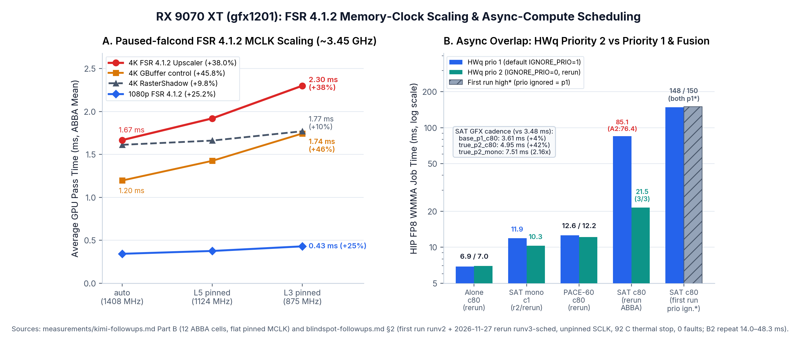
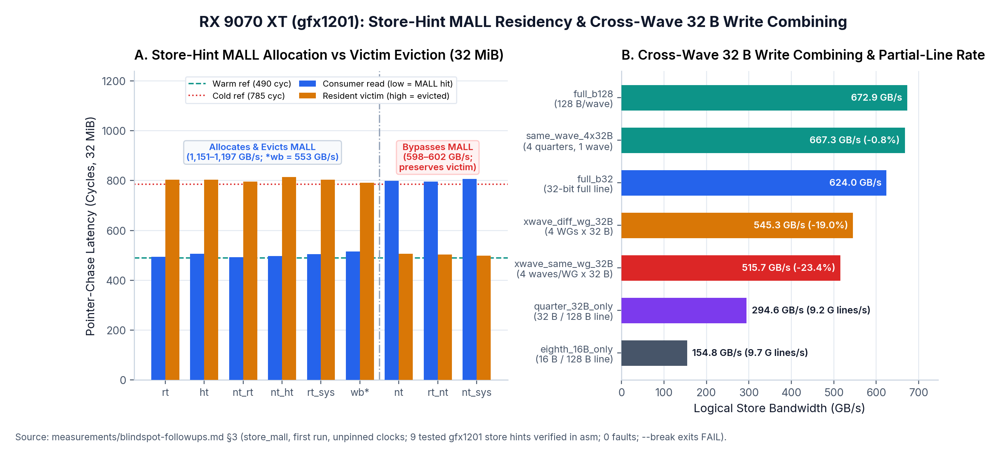
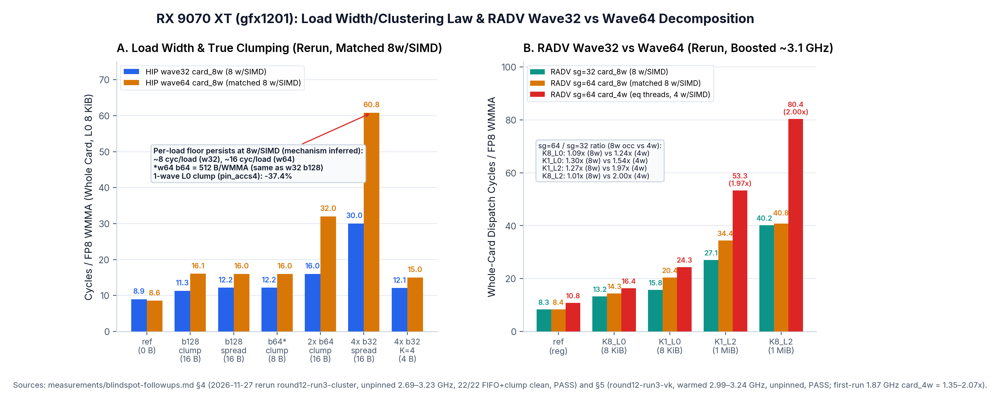

# Round 12 blind-spot follow-ups: RADV CU mode, async overlap, store-hint MALL residency, load clustering, and Vulkan wave32 vs wave64 (2026-11-26; fix-pass rerun 2026-11-27)

Preregistered expectations for Blind Spots #3, #4, and #10 were drafted before the GPU runs in [blindspot-followups-expectations.md](blindspot-followups-expectations.md) (first committed alongside the initial Round 12 write-up in the same commit, so pre-run authorship is not independently provable from git commit timestamps alone). Card: ASUS Prime RX 9070 XT (`1002:7550`, `gfx1201`), LACT profile `Default` (`overclock`: +150 MHz core, -50 mV, 374 W cap, 1409 MHz memory request, 1.2x regulator mod; `auto` DPM, unpinned clocks, no sudo), ROCm 10.1 (`hipcc`, `-mcumode`), Mesa RADV `27.0.0-devel`. Probe sources live in `src/round12/`; build/run wrappers live in `scripts/round12/`. Raw logs live in the companion checkout's git-ignored build tree under `kimi-followups/`. All four fix-pass reruns ran on 2026-11-27 (~03:36–03:40 PST) with `auto` DPM (clocks not pinned) and `0` amdgpu faults; `gfx_load` and `hip_wmma_prio` raised their thermal stop from `85 C` to `92 C` for the `runv3-sched` rerun. Labels: MEASURED, READ, INFERRED.

## Plain summary

1. **RADV compute launches in CU mode (`WGP_MODE = 0`), not WGP mode (`vk_wgp_probe`, MEASURED, 0 faults):** Confirmed in both the first run (`vk_wgp`) and the 2026-11-27 fix-pass rerun (`round12-run3-wgp`, `PASS inferred=CU_MODE`, inverted WGP break `FAIL`, unpinned `1.78–1.91 GHz` SCLK) after fixing `-DLDS_UINTS` so all five `bar_lds*.spv` shaders allocate true `0`–`48 KiB` LDS (`0 / 16,384 / 28,672 / 32,768 / 49,152 B` verified in ACO stats) and computing `B/cyc/CU` directly from whole-dispatch `gpu_ms`. Across `128`/`256`/`512`-lane workgroups, wave32 and wave64, and true `0–48 KiB` LDS, RADV barrier cycles track HIP CU mode (`33.23–38.27` cyc 4w, `40.75–47.36` cyc 8w, `delta_8w = 27.38` over 1-wave `19.98`, `63.34` cyc 16w vs HIP WGP `93–107` cyc), and whole-card 32-bit LDS read bandwidth hit **`10.68 TB/s` at `~1.78 GHz` = `93.9 B/cyc/CU`** (`1.47x` above WGP mode's `64 B/cyc/CU` physical limit; first run `12.62 TB/s` / `104.3 B/cyc/CU` at `~1.89 GHz`, whose raw log was not kept; the rerun's log is the evidence). `VK_KHR_pipeline_executable_properties` (26 stats, 3 IRs) does not expose `WGP_MODE`.
2. **Real hardware queue priority 2 (`DEBUG_HIP_IGNORE_STREAM_PRIORITY=0`) strongly reduces HIP `chain=80` starvation beside saturated Vulkan graphics, trading off graphics frame cadence; the first run never applied priority 2 (`async_overlap`, MEASURED, 0 faults):**
   - *Correction to first run (`runv2`):* The first run claimed `hipStreamCreateWithPriority` high (`-1`) and normal (`0`) behaved identically (`within 0.04–0.35 ms`). In ROCm 10.1, `DEBUG_HIP_IGNORE_STREAM_PRIORITY` defaults to `1`, silently mapping both streams to KFD hardware queue `priority 1` even though `hipStreamGetPriority` returns `-1`; hardware priority 2 was never active in `runv2`.
   - *Fix-pass rerun (`async_overlap/runv3-sched`, unpinned `3.07–3.24 GHz` SCLK, thermal stop raised `85 -> 92 C`):* With `DEBUG_HIP_IGNORE_STREAM_PRIORITY=0` (`AMD_LOG_LEVEL=3` verified `HWq priority 2`) in ABBA order under `SAT-100%` (`in_flight=2`, standalone `G_dtAvg = 3.48 ms`):
     - Default priority 1 (`base_p1_c80`, `6.92–7.02 ms` alone) starved to **`85.06 ms`** (arm 1) and **`76.40 ms`** (repeat, `99%` overlapped before `gfx_load` hit `92 C` thermal stop; `0/3` and `0/1` strictly inside graphics window), while graphics stayed near baseline (`G_dtAvg = 3.61–3.63 ms`, `+3.7–4.3%`).
     - Real priority 2 (`true_p2_c80`, `6.98 ms` alone) completed **`3/3` fully overlapped trials at `21.49 ms` p50** (`21.00–23.32 ms`, `3.08x` alone, peak `86 C`, no thermal stop) while slowing graphics frame-completion interval to **`G_dtAvg = 4.95 ms` (`+42.2%`, `G_wal50 = 8.80` vs `6.43 ms`)** even as per-frame `G_gpu50` barely moved (`3.32 -> 3.47 ms`). The ABBA repeat (`true_p2_c80_r2`) completed `2/3` full (`14.03` and `48.34 ms`, plus `45.18 ms` 94% overlapped, `G_dtAvg = 4.14 ms`, `+19.0%`), showing variance (`14–48 ms`) yet staying well below priority-1 starvation (`76–85+ ms`).
     - Monolithic `true_p2_mono` (`chain=1`, `9.53 ms` alone) held HIP to **`10.30 ms` p50 (`1.08x`, `6/6` full)** while pushing graphics cadence to **`G_dtAvg = 7.51 ms` (`2.16x`, `G_dt95 = 12.83 ms`)**. Dispatch fusion (`chain=1` vs `chain=80`) and real KFD priority 2 are therefore both real levers with opposite compute-vs-graphics tradeoffs. WGP CU masks (`cu32`/`cu32_alt`/`cu16`), `HSA_CU_MASK` + prio 2 (`107.92 ms`), indirect dispatch (`AMD_DIRECT_DISPATCH=0`, `76.86 ms`), and HIP Graph (`59.06 ms`) did not match direct priority-2 stream launches. Under `PACE-60` (`16.6 ms` cadence, `5/5` full, 0 thermal stops), priority 2 trimmed `chain=80` only slightly (`12.16–12.35 ms` vs `12.61–13.28 ms` at prio 1).
3. **Blind Spot #3 — Store hints split sharply on MALL allocation/eviction, and cross-wave 32 B write combining loses 19–23% (`store_mall`, MEASURED, PASS, 0 faults, deliberate break FAIL):**
   - Across the 9 tested `gfx1201` `global_store_b128` hint/scope forms at `32 MiB`, **`rt`, `ht`, `nt_rt`, `nt_ht`, and `rt_sys`** allocate in MALL (`493–505 cyc` / `138–141 ns` consumer read, **`1,151–1,197 GB/s`** single-dispatch consumer read) and evict a resident 32 MiB victim (`797–814 cyc` / `222–227 ns`).
   - **`nt` (`TH_STORE_NT`), `rt_nt` (`TH_STORE_RT_NT`), and `nt_sys` (`TH_STORE_NT SCOPE_SYS`)** bypass MALL (`797–807 cyc` / `222–226 ns` consumer read, **`598–602 GB/s`** single-dispatch consumer read) and preserve a resident victim (`499–506 cyc` / `140–141 ns`).
   - **`wb` (`TH_STORE_WB`)** is an outlier: it allocates and evicts in MALL (`516 cyc` alloc, `792 cyc` victim eviction), yet drops single-dispatch consumer read throughput to **`553.3 GB/s`** at 32 MiB (`472.9 GB/s` at 16 MiB). Avoid `wb` and `nt` for producer->consumer intermediates; reserve `nt` for final write-only outputs.
   - **Cross-wave 32 B write combining (`512 MiB` streaming store):** `same_wave_4x32B` (`667.3 GB/s`) matches `full_b128` (`672.9 GB/s`, `-0.8%`), while 4 waves each writing one 32 B quarter of a 128 B line drop **`-23.4%`** within a workgroup (`xwave_same_wg_32B = 515.7 GB/s`) and **`-19.0%`** across workgroups (`xwave_diff_wg_32B = 545.3 GB/s`, reversing the preregistered expectation that same-WG would beat diff-WG). Partial-line `quarter_32B_only` (`294.6 GB/s`, `9.21 G lines/s`, 43.8% of full-line byte rate) and `eighth_16B_only` (`154.8 GB/s`, `9.68 G lines/s`) land at the same line rate — compatible with either 32 B sector granularity or a per-line partial-write rate floor.
4. **Blind Spot #4 — Every `global_load_*` instruction costs ~7.5–8 cyc/SIMD in wave32 (~15–16 cyc in wave64) regardless of width or wave occupancy; true clumping buys 7–11% card-wide and 22–37% single-wave (`load_cluster`, MEASURED, 0 faults, `round12-run3-cluster` PASS, deliberate breaks FAIL 42/42 & 63/63):**
   - In the 2026-11-27 fix-pass rerun (`pin_accs4` preventing LLVM from floating loads into the 4-WMMA block, plus wave64 `card_8w` matched occupancy and `b64_1_spread`/`b64_4_clump` equal-tile-byte `512 B/WMMA` patterns, unpinned `2.69–3.23 GHz` SCLK):
   - Whole-card `L0` wave32 (`16 B/lane/WMMA`): **`b128_4_clump` `11.33`** < **`b128_1_spread` `12.18`** (`-7.0%` from clumping) < **`b64` `16.02`** (`+41.4%` vs clump) < **`b32_4_spread` `30.02 cyc/mm`** (**`2.65x` slower** at identical bytes). Same pattern at `L2` (`12.83 / 14.05 / 16.02 / 30.50`, `-8.7%` from clumping) and `8 B/lane` `b64_4_clump` vs `b64_1_spread` (`12.18` vs `13.71` L0, `-11.2%`; `13.08` vs `14.66` L2, `-10.8%`).
   - Single-wave true clumping cut per-WMMA cycles by **`-37.4%` (`L0`: `36.48 -> 22.82`)** and **`-22.4%` (`L2`: `60.83 -> 47.21`)** in wave32 (much larger than run2's `-20.5%`/`-19.5%` before `pin_accs4`).
   - **Matched-occupancy wave64 (`card_8w`, 8 waves/SIMD)** still pins on **`16.01–16.05` (`b128`), `32.01–32.03` (`2x b64`), and `60.01–60.83` (`4x b32`)** — and even equal-tile-byte wave64 `b64_1_spread`/`b64_4_clump` (`512 B/WMMA`, same bytes as wave32 `b128`) pins at **`16.01–16.02 cyc/mm`** vs wave32's **`11.33` (`L0`) / `12.83` (`L2`)**. This rules out half occupancy as the cause of the `~2x` wave64 load-issue cost; a per-instruction cost in the texture-addressing path is the likely mechanism (INFERRED, not isolated; clocks unpinned).
5. **Blind Spot #10 — Under Vulkan RADV/ACO, wave64 matches wave32 when register-fed (`8.38` vs `8.33 cyc/mm` at 8w/SIMD), slows `1.24–2.00x` at equal thread count (`card_4w`), and stays `1.09–1.30x` slower on load-heavy `K1`/`K8_L0` even at matched 8 waves/SIMD (`vk_ld_mat2`, MEASURED, `round12-run3-vk` PASS, 0 faults, deliberate break FAIL 25/25):**
   - At warmed, matched boosted `2.99–3.24 GHz` SCLK (`round12-run3-vk`, unpinned `auto` DPM), comparing equal-thread `sg=64 card_4w` (4w/SIMD) vs `sg=32 card_8w` (8w/SIMD) reproduces the first run's `1.24–2.00x` slowdown (`K8_L0` `16.38` vs `13.21` = `1.24x`, `K1_L0` `24.30` vs `15.77` = `1.54x`, `K1_L2` `53.31` vs `27.07` = `1.97x`, `K8_L2` `80.38` vs `40.21` = `2.00x`).
   - Adding matched-occupancy `sg=64 card_8w` (8 waves/SIMD) cleanly splits the penalty into two causes: matching wave occupancy eliminates the serialized-miss `K8_L2` gap (**`40.79` vs `40.21`, `1.01x`**) and `ref` launch gap (`8.38` vs `8.33`, `1.01x`), while wave64's higher per-load TA cost leaves a **`1.30x`** slowdown on `K1_L0` (`20.44` vs `15.77`), **`1.27x`** on `K1_L2` (`34.41` vs `27.07`), and **`1.09x`** on `K8_L0` (`14.34` vs `13.21`).

---

## Preregistered expectation scorecard

| Probe / Expectation (`blindspot-followups-expectations.md`) | Expected | Measured | Match |
|---|---|---|---|
| **3A/3B Store-hint MALL split** | `nt`/`rt_nt`/`nt_sys` bypass & preserve victim; `rt`/`ht`/`wb`/`nt_rt`/`nt_ht`/`rt_sys` allocate & evict; warm `360–420` / cold `500–560 cyc`; 16 MiB read `>1000 GB/s`; control `>=80 cyc` | Qualitative split matched (`797–807` vs `493–516 cyc`, delta `236–298 cyc`), **but absolute ranges missed** (`489.5` warm, `785.1` cold, 16 MiB read `643–721 GB/s`; `>1000 GB/s` only at 32 MiB), plus unexpected **`wb` read drop (`553 GB/s`)**; original binary's control gate was `40 cyc` (now tightened to `80`) | **Split confirmed; absolute ranges & `wb` missed** |
| **3C Cross-wave 32 B write combining** | `full_b128`/`full_b32` `>=550 GB/s`; 32 B sector avoids 16 B penalty; `xwave_same_wg >= 70%` and beats `xwave_diff_wg` | `full_b128` `672.9`, `full_b32` `624.0`, `xwave_same_wg` `515.7` (`82.6%` of `full_b32`, `-23.4%` vs `full_b128`), **but `xwave_diff_wg` (`545.3`, `-19.0%`) beat `xwave_same_wg`**; `quarter` (`9.21`) vs `eighth` (`9.68 G lines/s`) fits either 32 B sectors or a per-line partial-write floor | **Partially confirmed (`diff_wg > same_wg` reversed)** |
| **4 Load width & clustering (`load_cluster`)** | `ref` `7.9–8.3`; 1-wave clustering cuts overhead `~2–3x`; card deltas `<3 cyc/mm` | 1-wave `ref` `8.01` (`card` `8.94` w32 / `8.50–8.57` w64, all `PASS` in rerun); true `pin_accs4` 1-wave clustering cut `-37.4%` L0 / `-22.4%` L2 (`-7.0%` to `-11.2%` card); **width penalty was much larger than expected** (`+41%` `b64`, `2.65x` `b32` card) and matched-occupancy wave64 (`card_8w`) still pinned at `16/32/60 cyc/mm` (`~16 cyc/load` TA floor) | **Refuted compression; occupancy ruled out, per-instruction TA cost INFERRED** |
| **10 RADV wave32 vs wave64 (`vk_ld_mat2`)** | `ref ~8.0`; wave64 `5–15%` slower whole-card `K=1`; both `8.0–9.5` at `K=8` | `ref` `8.33` vs `8.38` (`card_8w`, boosted `3.1 GHz`); equal-thread `card_4w` wave64 was **`1.24–2.00x` slower** (`1.35–2.07x` at `1.87 GHz`); matched-occupancy `card_8w` eliminated `K8_L2` (`1.01x`) while leaving `K1_L0` **`1.30x`** and `K1_L2` **`1.27x`** slower (`K8_L0` `1.09x`), and ACO `s_wait_loadcnt 0` made `K8_L2` slower than `K1_L2` | **Refuted small-delta expectation; separated occupancy vs load-rate penalties** |

---

## 1. RADV compute CU-vs-WGP mode proof (`vk_wgp_probe`, MEASURED)

Source: `src/round12/vk_wgp_bar.comp`, `src/round12/vk_wgp_probe.c`. Run folder: `kimi-followups/vk_wgp/`. Mesa RADV `27.0.0-devel`, `0` kernel faults, deliberate break (`expected <10 cyc/bar`, got `19.98`) exited `FAIL`.

| Pipeline | Workgroup (`sg`) | Waves | LDS (KiB) | ACO `VGPRs` / `Subgroups/SIMD` | `cyc/bar` med (`min–max`) | Est SCLK (GHz) | HIP CU ref (`lds-and-special-loads.md`) | HIP WGP ref |
|---|---|---:|---:|---|---:|---:|---:|---:|
| `lds0_wg32_sg32` | 32 (`32`) | 1 | 0 | 24 / 16 | 19.98 (`19.98–20.01`) | 1.97 | — (loop ctrl ~10 cyc) | — |
| `lds0_wg128_sg32` | 128 (`32`) | 4 | 0 | 24 / 16 | **32.98** (`32.98–32.98`) | 1.99 | ~28.1 | ~93.2 |
| `lds16k_wg128_sg32` | 128 (`32`) | 4 | 16 | 48 / 8 | **38.25** (`38.25–38.26`) | 1.99 | ~28.1 | ~93.2 |
| `lds0_wg256_sg32` | 256 (`32`) | 8 | 0 | 24 / 16 | **40.77** (`40.69–40.77`) | 2.02 | ~37.6 | ~94.7 |
| `lds16k_wg256_sg32` | 256 (`32`) | 8 | 16 | 24 / 16 | **47.32** (`47.30–47.32`) | 1.99 | ~37.6 | ~94.7 |
| `lds28k_wg256_sg32` | 256 (`32`) | 8 | 28 | 48 / 8 | **47.38** (`47.38–47.38`) | 1.98 | ~37.6 | ~94.7 |
| `lds32k_wg256_sg32` | 256 (`32`) | 8 | 32 | 48 / 8 | **47.38** (`47.38–47.41`) | 1.98 | ~37.6 | ~94.7 |
| `lds48k_wg256_sg32` | 256 (`32`) | 8 | 48 | 24 / 4 | **47.31** (`47.31–47.32`) | 1.99 | ~37.6 | ~94.7 |
| `lds16k_wg256_sg64` | 256 (`64`) | 4 | 16 | 24 / 16 | **38.18** (`38.18–38.18`) | 1.99 | ~28.1 | ~93.2 |
| `lds16k_wg512_sg32` | 512 (`32`) | 16 | 16 | 24 / 16 | **65.37** (`65.30–65.37`) | 1.97 | ~58.7 | ~106.7 |

- **Whole-card LDS read bandwidth (`lds_bw_16k_wg256_sg32`, first run; its raw log was not kept, so these figures cannot be re-traced; the 2026-11-27 rerun in `round12-run3-wgp/` supersedes them):** `gpu_ms = 0.166 ms`, **`12.62 TB/s` at `~1.89 GHz` = `104.3 B/cyc/CU`** (`12.62e12 / (64 * 1.89e9)` — note the first-run probe's `139.0` printout divided by wave-0's shorter cycle count rather than dispatch wall time; using true `gpu_ms` gives `104.3 B/cyc/CU`, still **`1.63x` above WGP mode's `64 B/cyc/CU` hard limit**). Together with the `~47 cyc` 8-wave barrier ceiling across `0–48 KiB` LDS (never jumping to `~94–105 cyc`), this proves RADV launches compute shaders in **CU mode (`WGP_MODE = 0`)**.

### Fix-pass rerun (2026-11-27, `round12-run3-wgp`, MEASURED)

- **Method changes:** Fixed `build_round12.sh` to pass `-DLDS_UINTS` (matching `vk_wgp_bar.comp`) and assert 5 distinct `bar_lds*.spv` hashes, ensuring the 5 shaders actually allocate `0 / 16,384 / 28,672 / 32,768 / 49,152 B` LDS (verified in `round12-run3-wgp/wgp_asm/asm/*.s` ACO stats). Fixed `vk_wgp_probe.c` to compute `B/cyc/CU` directly from whole-dispatch `gpu_ms * sclk_ghz`, count all `ds_load` ops (`ds_load_ops=5`), classify CU vs WGP jointly on `delta_8w = wg256_lds32k - 1-wave` and `B/cyc/CU` (`<45` and `>70` for CU; `>60` and `<=66` for WGP), gate `cal_fma` in `[0.45, 2.20]` (`16` FMAs + scalar loop branch), and invert `--break` to assert WGP-mode thresholds. Clocks were **not pinned** (`auto` DPM: start `1873 MHz` SCLK / `772 MHz` MCLK / `47 C`, end `1871 MHz` / `772 MHz` / `47 C`; est SCLK `1.78–1.91 GHz`).
- **Results (`VERDICT vk_wgp_probe: PASS inferred=CU_MODE`, `0` amdgpu faults; `--break` `rc=1` `FAIL` with `delta=27.39`, `BW=75.1 B/cyc/CU`):**

| Pipeline | Workgroup (`sg`) | Waves | ACO `LDS size` (B) | ACO `VGPRs` / `Subgroups/SIMD` | `cyc/bar` med (`min–max`) | Est SCLK (GHz) |
|---|---|---:|---:|---|---:|---:|
| `cal_fma_w32` | 32 (`32`) | 1 | 0 | 24 / 16 | `cal_fma = 1.813` (`1.813–1.813`, `dual_issue=1`) | — |
| `lds0_wg32_sg32` | 32 (`32`) | 1 | 0 | 24 / 16 | `19.98` (`19.98–19.98`) | 1.88 |
| `lds0_wg128_sg32` | 128 (`32`) | 4 | 0 | 24 / 16 | `33.23` (`32.38–33.31`) | 1.78 |
| `lds16k_wg128_sg32` | 128 (`32`) | 4 | 16,384 | 48 / 8 | `38.27` (`38.21–38.27`) | 1.91 |
| `lds0_wg256_sg32` | 256 (`32`) | 8 | 0 | 24 / 16 | `40.75` (`40.75–40.76`) | 1.91 |
| `lds16k_wg256_sg32` | 256 (`32`) | 8 | 16,384 | 24 / 16 | `47.30` (`47.30–47.38`) | 1.91 |
| `lds28k_wg256_sg32` | 256 (`32`) | 8 | 28,672 | 48 / 8 | `47.30` (`47.30–47.39`) | 1.91 |
| `lds32k_wg256_sg32` | 256 (`32`) | 8 | 32,768 | 48 / 8 | `47.36` (`47.33–47.36`) | 1.91 |
| `lds48k_wg256_sg32` | 256 (`32`) | 8 | 49,152 | 24 / 4 | `47.35` (`47.35–47.39`) | 1.89 |
| `lds16k_wg256_sg64` | 256 (`64`) | 4 | 16,384 | 24 / 16 | `38.21` (`38.21–38.27`) | 1.90 |
| `lds16k_wg512_sg32` | 512 (`32`) | 16 | 16,384 | 24 / 16 | `63.34` (`63.32–63.34`) | 1.90 |

- **LDS bandwidth (`lds_bw_16k_wg256_sg32`):** `ds_load_ops=5`, `gpu_ms=0.196`, **`10.68 TB/s` at `est sclk=1.78 GHz` = `93.9 B/cyc/CU`** (`1.47x` above WGP mode's `64 B/cyc/CU` ceiling); `delta_8w = 27.38 cyc/bar`.
- **What changed vs first run:** The CU-mode conclusion is unchanged and now cleanly supported with verified `0`–`48 KiB` LDS shader allocations, a direct `gpu_ms`-based `B/cyc/CU` printout (`93.9 B/cyc/CU` at `1.78 GHz` instead of the first run's wave-0-skewed `139.0` printout / `104.3` manual recomputation), and an inverted WGP-mode `--break` that fails (`rc=1`).

---

## 2. Heavy FP8 WMMA HIP vs Vulkan graphics async overlap (`async_overlap`, MEASURED)



Source: `src/round12/gfx_load.c`, `src/round12/hip_wmma_prio.hip`. Run folder: `kimi-followups/async_overlap/runv2-20261127T011747Z/`. `hipDeviceGetStreamPriorityRange`: `[least=1, greatest=-1]`; tested `norm=0` vs `high=-1` in ABBA order beside a Vulkan 2560x1440 RGBA16F fragment load. Every HIP trial verified exact FP8 WMMA output (`bad=0` on all trials), deliberate break passed, `0` kernel faults.

| Regime | HIP stream | HIP alone `gpu_p50` (ms) | HIP overlapped `gpu_ms` med / **fully-overlapped max** (ms) | Slowdown (`vs alone`) | Vulkan GFX alone `p50` (ms) | Vulkan GFX overlapped med (ms) | GFX slowdown | SCLK med (MHz) | Peak hot (C) |
|---|---|---:|---:|---:|---:|---:|---:|---:|---:|
| `SAT-100%` (`in_flight=2`) + `chain=80` | `norm (0)` | 10.80 | 104.75 / **147.3–148.5** | **13.6–13.8x** | 3.79 | 3.57 | 0.94x | 3200 | 82 |
| `SAT-100%` (`in_flight=2`) + `chain=80` | `high (-1)` | 10.80 | 103.77 / **149.5–150.8** | **13.8–14.0x** | 3.79 | 3.58 | 0.94x | 3203 | 82 |
| `SAT-100%` (`in_flight=2`) + `chain=1` (`mono`) | `norm (0)` | 9.51 | **11.93** (max 12.83) | **1.25x (+2.42 ms)** | 3.79 | 3.93 | 1.04x (+0.14 ms) | 3197 | 76 |
| `SAT-100%` (`in_flight=2`) + `chain=1` (`mono`) | `high (-1)` | 9.53 | **12.27** (max 12.83) | **1.29x (+2.74 ms)** | 3.79 | 3.93 | 1.04x (+0.14 ms) | 3200 | 73 |
| `PACE-60` (`16.6 ms` cadence) + `chain=80` | `norm (0)` | 10.80 | **16.49** (max **34.30**) | **1.53x (+5.69 ms)** | 5.69 | 6.14 | 1.08x (+0.45 ms) | 3108 | 60 |
| `PACE-60` (`16.6 ms` cadence) + `chain=80` | `high (-1)` | 10.80 | **16.26** (max **16.88**) | **1.51x (+5.46 ms)** | 5.69 | 6.17 | 1.08x (+0.48 ms) | 3108 | 60 |

*Note on first run (`runv2`):* In each ~200 ms graphics burst of `runv2`, the fully overlapped HIP `chain=80` job ran **`147.3–148.5 ms` (`norm`)** and **`149.5–150.8 ms` (`high`)** (`~1.85 ms` per dispatch boundary waiting behind active graphics waves), while the second HIP trial overlapped only the tail of the graphics burst. **Correction (2026-11-27):** The earlier conclusion that HIP stream priority had no effect was wrong as a hardware claim because ROCm 10.1 defaults to `DEBUG_HIP_IGNORE_STREAM_PRIORITY=1`, so both streams in `runv2` mapped to KFD hardware queue `priority 1` and priority 2 was never applied. Both dispatch count (`chain=1` vs `chain=80`) and real hardware priority 2 (`DEBUG_HIP_IGNORE_STREAM_PRIORITY=0`, tested below) are active scheduling levers on `gfx1201`.

### Fix-pass rerun (2026-11-27, `async_overlap/runv3-sched`, MEASURED)

- **Method changes:** Added `scripts/round12/run_async_overlap.sh` with self-contained `gdraw` SPIR-Vs, an explicit `hip_wmma_prio break` (`rc=1`, `FAIL`), and `AMD_LOG_LEVEL=3` diagnostics proving that `DEBUG_HIP_IGNORE_STREAM_PRIORITY=0` allocates KFD hardware queue **`priority 2`** (`Created SWq=... HWq=... size 16384 priority 2` in `diag_prio2.err` and `diag_cu32_p2.err`, vs `priority 1` for normal streams). Tested `base_p1_c80` (`DEBUG_HIP_IGNORE_STREAM_PRIORITY` unset = default `1`) against `true_p2_c80` (`DEBUG_HIP_IGNORE_STREAM_PRIORITY=0`) in ABBA order (`base_p1_c80`, `true_p2_c80`, `true_p2_c80_r2`, `base_p1_c80_r2`), plus monolithic `true_p2_mono` (`chain=1`), WGP-unit CU masks (`cu32` = `0x0000ffff` / 16 WGPs, `cu32_alt` = `0x55555555`, `cu16` = `0x000000ff` / 8 WGPs, `cu32_p2` = `HSA_CU_MASK=0:0-31` + priority 2), indirect dispatch (`dir0_p2_c80`: `AMD_DIRECT_DISPATCH=0 HSA_ENABLE_INTERRUPT=0`), and HIP Graph (`graph_p2_c80`). Added graphics frame-completion-interval analysis (`G_dtAvg`, `G_dt50`, `G_dt95`, `G_wal50`, `G_gpu50`) in `run_async_overlap.sh`. **Thermal stop raised from `85 C` to `92 C`** in both `src/round12/gfx_load.c` and `src/round12/hip_wmma_prio.hip` for this rerun. Clocks were **not pinned** (`auto` DPM; HIP SCLK medians `3163–3220 MHz` on SAT and `2903–3177 MHz` on PACE). Standalone `chain=80` used `iters=369` (`6.92–7.02 ms` alone; `mono` `iters=58838`, `9.53 ms` alone). Every HIP trial verified `exact=OK` (`bad=0`); `0` amdgpu faults.

#### `SAT-100%` (`in_flight=2`) overlap table (`run_async_overlap.sh` analyzer, MEASURED)

| Arm | HIP alone `p50` (ms) | `H_full` (strictly inside GFX) | HIP `H_p50` / `H_max` (ms) | HIP slowdown vs alone | `G_dtAvg` / `G_dt50` / `G_dt95` (ms) | `G_wal50` / `G_gpu50` (ms) | Peak hot (C) / `92 C` thermal stop |
|---|---:|---:|---:|---:|---:|---:|---|
| `gfx_alone` (`sat`) | — | — | — | — | `3.48` / `3.45` / `3.73` | `6.43` / `3.32` | `92` / `Y` (frame 36) |
| **`base_p1_c80`** (ABBA A1, prio 1) | 6.92 | `0/3` (`idx=0` 99% ov) | **85.06** / **85.06** | **12.29x+** | `3.61` / `3.63` / `3.93` | `6.41` / `3.36` | `93` / `Y` (frame 26) |
| **`true_p2_c80`** (ABBA B1, prio 2) | 6.98 | **`3/3`** | **21.49** / **23.32** | **3.08x** | **`4.95`** / `4.84` / `5.34` | **`8.80`** / `3.47` | `86` / **`N`** |
| **`true_p2_c80_r2`** (ABBA B2, prio 2) | 6.99 | `2/3` (`idx=2` 94% ov: 45.18) | **14.03** / **48.34** | **2.01–6.92x** | **`4.14`** / `3.92` / `4.26` | `7.09` / `3.45` | `92` / `Y` (frame 31) |
| **`base_p1_c80_r2`** (ABBA A2, prio 1) | 7.02 | `0/1` (`idx=0` 99% ov) | **76.40** / **76.40** | **10.88x+** | `3.63` / `3.54` / `4.12` | `6.63` / `3.36` | `92` / `Y` (frame 25) |
| **`true_p2_mono`** (`chain=1`, prio 2) | 9.53 | **`6/6`** | **10.30** / **12.06** | **1.08x** | **`7.51`** / `3.49` / **`12.83`** | **`15.77`** / `3.42` | `92` / `Y` (frame 21) |
| `cu32_p1_c80` (16 WGPs, prio 1) | 11.23 | `1/3` (`idx=1` 81% ov: 47.71) | 60.70 / 60.70 | 5.41x | `4.00` / `3.54` / `6.03` | `6.79` / `3.43` | `93` / `Y` (frame 30) |
| `cu32alt_p1_c80` (16 alt WGPs, prio 1) | 11.58 | `1/2` (`idx=1` 99% ov: 86.27) | 20.10 / 20.10 | 1.74x (trial 1: 7.45x) | `5.79` / `4.02` / `9.40` | `11.78` / `3.62` | `93` / `Y` (frame 28) |
| `cu16_p1_c80` (8 WGPs, prio 1) | 21.23 | `1/3` (`idx=1` 56% ov: 41.32) | 121.77 / 121.77 | 5.74x | `4.03` / `4.05` / `4.57` | `7.51` / `3.43` | `92` / `Y` (frame 40) |
| `cu32_p2_c80` (`HSA_CU_MASK=0:0-31`, prio 2) | 11.47 | `0/3` (`idx=0` 98% ov) | 107.92 / 107.92 | 9.41x+ | `3.68` / `3.52` / `3.93` | `6.44` / `3.39` | `92` / `Y` (frame 32) |
| `dir0_p2_c80` (`AMD_DIRECT_DISPATCH=0`, prio 2) | 6.96 | `0/1` (`idx=0` 99% ov) | 76.86 / 76.86 | 11.04x+ | `3.64` / `3.62` / `4.22` | `6.73` / `3.36` | `92` / `Y` (frame 24) |
| `graph_p2_c80` (HIP Graph, prio 2) | 7.18 | `1/3` (`idx=1` 88% ov: 36.81) | 59.06 / 59.06 | 8.23x | `3.92` / `3.83` / `5.10` | `7.21` / `3.62` | `92` / `Y` (frame 28) |

#### `PACE-60` (`16.6 ms` cadence, `5/5` full, `0` thermal stops, MEASURED)

| Arm | HIP alone `p50` (ms) | HIP `H_p50` / `H_max` (ms) | Delta vs alone (ms) | `G_dtAvg` / `G_dt50` / `G_dt95` (ms) | `G_gpu50` (ms) | Peak hot (C) |
|---|---:|---:|---:|---:|---:|---:|
| `gfx_alone` (`pace`, unboosted SCLK) | — | — | — | `17.00` / `16.73` / `20.15` | `9.53` | 68 |
| `base_p1_c80` / `base_p1_c80_r2` | 6.92 / 7.02 | `12.61` / `12.92`; `13.28` / `13.34` | `+5.69` / `+6.26` | `15.14` / `16.57` / `17.02`; `14.63` / `16.61` / `17.32` | `6.08` / `6.06` | 74 / 70 |
| `true_p2_c80` / `true_p2_c80_r2` | 6.98 / 6.99 | `12.16` / `12.77`; `12.35` / `12.92` | `+5.18` / `+5.36` | `14.35` / `16.47` / `20.27`; `14.79` / `16.71` / `17.30` | `6.13` / `6.05` | 70 / 71 |
| `true_p2_mono` (`chain=1`) | 9.53 | `14.10` / `15.00` | `+4.57` | `14.57` / `16.60` / `16.88` | `5.91` | 80 |
| `cu32_p1_c80` / `cu32alt_p1_c80` / `cu32_p2_c80` | 11.23 / 11.58 / 11.47 | `17.41` / `17.78` / `17.82` (max `21.9–23.9`) | `+6.18` / `+6.20` / `+6.35` | `15.17–15.21` / `16.63–16.67` / `16.88–17.11` | `6.03–6.18` | 73 |
| `cu16_p1_c80` | 21.23 | `30.74` / `31.48` | `+9.51` | `15.67` / `16.63` / `17.05` | `6.15` | 72 |
| `dir0_p2_c80` / `graph_p2_c80` | 6.96 / 7.18 | `12.57` / `13.01`; `13.01` / `13.85` | `+5.61` / `+5.83` | `14.72` / `16.33` / `17.16`; `14.58` / `16.61` / `17.11` | `6.01` / `6.37` | 72 / 71 |

- **What changed vs first run (`runv2`):**
  1. **Real priority 2 works on `gfx1201` (contradicting the first run's priority-has-no-effect reading):** Enabling `DEBUG_HIP_IGNORE_STREAM_PRIORITY=0` (`HWq priority 2`) cut saturated `chain=80` latency from `76.4–85.1 ms` starvation (`0/3` and `0/1` strictly inside the graphics window because `gfx_load` hit `92 C` while HIP was still stalled, though trial 0 overlapped `99%` of its duration) down to **`21.49 ms` (`3/3` full, peak `86 C`, no thermal stop)** on arm B1 and **`14.03–48.34 ms` (`2/3` full)** on arm B2.
  2. **Frame-completion intervals expose the real graphics cost:** Per-frame GPU timestamp `G_gpu50` barely shifted (`3.32 -> 3.47 ms`), but frame-completion cadence `G_dtAvg` slowed **`+42.2%`** (`3.48 -> 4.95 ms`) under `true_p2_c80` (`+19.0%` on B2) and **`2.16x`** (`3.48 -> 7.51 ms`, `G_dt95 = 12.83 ms`, `G_wal50 = 15.77 ms`) under `true_p2_mono` (`10.30 ms`, `1.08x`). Under `PACE-60`, `gfx_pace_alone` ran slower per draw (`9.53 ms`) than overlapped `pace` (`5.91–6.37 ms`) because unpinned `16.6 ms` idle gaps let standalone Vulkan drop to low SCLK while concurrent HIP kept SCLK boosted (`~3.1 GHz`, consistent with `gaming-probes.md`).
  3. **Alternative levers:** WGP CU masks (`cu32`, `cu32_alt`, `cu16`), `HSA_CU_MASK=0:0-31` combined with priority 2 (`107.92 ms`), indirect dispatch (`AMD_DIRECT_DISPATCH=0`, `76.86 ms`), and HIP Graph (`59.06 ms`) all suffered heavier starvation or higher variance than direct priority-2 launches, and `SAT-100%` hit the `92 C` thermal stop in every arm except `true_p2_c80`, limiting trial counts (`1–3` trials per arm).

---

## 3. Blind Spot #3: Store-hint MALL residency & cross-wave 32 B write combining (`store_mall`, MEASURED)



Source: `src/round12/store_mall.hip`. Run folder: `kimi-followups/round12-run1/store_mall.log`. All 9 tested `gfx1201` `global_store_b128` cache-hint/scope encodings verified present in `build/round12/store_mall.s` (`TH_STORE_LU` and `TH_STORE_BYPASS` were rejected by `llvm-mc` on `gfx1201`; `TH_STORE_NT_WB` and `SCOPE_SE`/`SCOPE_DEV` were not tested). Note: `store_mall.log` reported `CLOCKS ... unavailable` because no sysfs clock path was passed in `round12-run1`, and the consumer streaming read column measures a single `21–60 us` dispatch (`4 / 16 / 32 MiB` cold reads `165.7 / 517.2 / 600.0 GB/s`), so those GB/s figures include dispatch launch/ramp overhead rather than representing a steady-state hardware bandwidth ratio. Every pointer chase and 512 MiB write-combining pattern verified `ok` (`bad=0`); deliberate break `store_mall --break` exited `1` (`30` wrong pointers + `7` write-combining verify fails); `0` kernel faults.

### Part 3A & 3B: Store-hint MALL allocation & victim eviction (`4`, `16`, and `32 MiB`)

At `32 MiB` (half of the 64 MB MALL), reference pointer-chase latency separates DRAM cold (`785.1 cyc`, `600.0 GB/s`) from MALL warm (`489.5 cyc`, `1,166.7 GB/s`) by **`295.6 cycles`**:

| Size | Store hint (`global_store_b128`) | Consumer `alloc_cyc` / `alloc_ns` | Consumer streaming read BW (GB/s) | Resident victim `evict_cyc` / `evict_ns` | MALL behavior |
|---:|---|---:|---:|---:|---|
| **32 MiB** | `ref` (`cold` -> `warm`) | `785.1` -> `489.5 cyc` | `600.0` -> `1,166.7` | — | Reference (`delta = 295.6 cyc`) |
| 32 MiB | `rt` (default) | **`493.5` / `137.7 ns`** | **`1,184.8`** | **`804.3` / `224.4 ns`** | **Allocates & evicts** |
| 32 MiB | `ht` (`TH_STORE_HT`) | **`505.8` / `141.1 ns`** | **`1,173.2`** | **`804.1` / `224.4 ns`** | **Allocates & evicts** |
| 32 MiB | `nt_rt` (`TH_STORE_NT_RT`) | **`493.1` / `137.6 ns`** | **`1,150.7`** | **`796.6` / `222.0 ns`** | **Allocates & evicts** |
| 32 MiB | `nt_ht` (`TH_STORE_NT_HT`) | **`496.5` / `138.8 ns`** | **`1,158.6`** | **`813.6` / `227.4 ns`** | **Allocates & evicts** |
| 32 MiB | `rt_sys` (`SCOPE_SYS`) | **`505.4` / `141.2 ns`** | **`1,196.7`** | **`803.7` / `224.6 ns`** | **Allocates & evicts** |
| 32 MiB | **`wb` (`TH_STORE_WB`)** | `516.2` / `144.0 ns` | **`553.3`** *(DRAM-like!)* | `791.6` / `220.9 ns` | **Allocates/evicts, half consumer BW** |
| 32 MiB | **`nt` (`TH_STORE_NT`)** | **`799.8` / `223.2 ns`** | **`598.3`** | **`505.9` / `141.2 ns`** | **Bypasses MALL & preserves victim** |
| 32 MiB | **`rt_nt` (`TH_STORE_RT_NT`)** | **`796.5` / `222.0 ns`** | **`598.3`** | **`503.1` / `140.5 ns`** | **Bypasses MALL & preserves victim** |
| 32 MiB | **`nt_sys` (`NT SCOPE_SYS`)** | **`807.0` / `225.5 ns`** | **`601.8`** | **`499.1` / `139.5 ns`** | **Bypasses MALL & preserves victim** |
| **16 MiB** | `ref` (`cold` -> `warm`) | `780.7` -> `482.8 cyc` | `517.2` -> `720.7` | — | Reference (`delta = 297.9 cyc`) |
| 16 MiB | `rt` / `ht` / `nt_rt` / `nt_ht` / `rt_sys` | `482.7–504.3` / `134.8–140.7 ns` | `643.3–686.5` | `784.8–801.3` / `219.0–223.6 ns` | Allocates & evicts |
| 16 MiB | `wb` | `489.6` / `136.6 ns` | **`472.9`** | `802.4` / `223.9 ns` | Allocates/evicts, low consumer BW |
| 16 MiB | `nt` / `rt_nt` / `nt_sys` | `784.4–806.2` / `218.9–225.0 ns` | `500.5–504.7` | `496.0–507.5` / `138.4–141.7 ns` | Bypasses MALL & preserves victim |
| **4 MiB** | `ref` (`cold` -> `warm`) | `670.1` -> `433.9 cyc` | `165.7` -> `199.7` | — | Reference (`delta = 236.3 cyc`) |
| 4 MiB | `rt` / `rt_sys` | `468.4` / `477.9 cyc` | `357.9` / `408.0` | `738.3` / `742.3 cyc` | Allocates & evicts (L2-warm boost) |
| 4 MiB | `ht` / `wb` / `nt_rt` / `nt_ht` | `462.3–482.0 cyc` | `170.2–190.0` | `741.1–752.3 cyc` | Allocates & evicts |
| 4 MiB | `nt` / `rt_nt` / `nt_sys` | `728.2–747.1 cyc` | `174.5–177.1` | `478.2–481.6 cyc` | Bypasses MALL & preserves victim |

### Part 3C: Cross-wave 32 B piece write combining (`512 MiB` streaming store)

| Pattern | Description | Logical bytes (MiB) | Bandwidth med (`min–max`, GB/s) | Relative to `full_b128` | Line rate (`G lines/s`) | Verify |
|---|---|---:|---:|---:|---:|---|
| `full_b128` | Coalesced 128 B/wave (`global_store_b128`) | 512 | **672.9** (`466.9–679.7`) | `1.000x` | 5.26 | `ok (bad=0)` |
| `same_wave_4x32B` | Same wave writes all four 32 B quarters of a 128 B line | 512 | **667.3** (`664.2–670.8`) | `0.992x` (-0.8%) | 5.21 | `ok (bad=0)` |
| `full_b32` | Coalesced 32-bit stores covering full 128 B lines | 512 | **624.0** (`619.6–625.2`) | `0.927x` (-7.3%) | 4.87 | `ok (bad=0)` |
| **`xwave_same_wg_32B`** | **4 waves in same WG each write one 32 B quarter of shared 128 B lines** | 512 | **515.7** (`510.6–516.3`) | **`0.766x` (-23.4%)** | 4.03 | `ok (bad=0)` |
| **`xwave_diff_wg_32B`** | **4 waves in different WGs each write one 32 B quarter of shared 128 B lines** | 512 | **545.3** (`536.0–549.0`) | **`0.810x` (-19.0%)** | 4.26 | `ok (bad=0)` |
| `quarter_32B_only` | Only one 32 B quarter written per 128 B line | 128 | **294.6** (`293.9–295.2`) | `0.438x` (logical) | **9.21** | `ok (bad=0)` |
| `eighth_16B_only` | Only one 16 B eighth written per 128 B line | 64 | **154.8** (`154.2–155.0`) | `0.230x` (logical) | **9.68** | `ok (bad=0)` |

- **Hardware interpretation (INFERRED from MEASURED):** `quarter_32B_only` (`294.6 GB/s`, `9.21 G lines/s`, 43.8% of `full_b128`'s byte rate) and `eighth_16B_only` (`154.8 GB/s`, `9.68 G lines/s`) saturate at nearly the same line rate (`~9.2–9.7 G lines/s`). Two hardware readings fit this data equally well: (1) **32 B commit sector granularity** (`~300 GB/s` of 32 B sectors, where 16 B writes waste half a 32 B sector while 32 B writes avoid 4x full-line bloat), or (2) a **per-line partial-write rate floor** (~9.5 G lines/s regardless of whether 16 B or 32 B of each 128 B line is modified, which also explains why quarter-line writes run at only 44% of full-line byte bandwidth). Distinguishing the two would require a strided multi-sector pattern (e.g., two non-contiguous 32 B quarters per 128 B line). Regardless of mechanism, assembling a 128 B line across 4 independent waves (each writing a 32 B quarter) loses **19–23%** vs same-wave full-line stores (`667–673 GB/s`), with `xwave_diff_wg_32B` (`545.3 GB/s`) slightly outperforming `xwave_same_wg_32B` (`515.7 GB/s`).

---

## 4. Blind Spot #4: Load-landing cost vs load width & clustering (`load_cluster`, MEASURED)



Source: `src/round12/load_cluster.hip` (ping-pong double-buffered SGPR-base + 32-bit-offset loads; all 18 compiled `k_cluster<0..8>` kernels in `load_cluster_w32.s` and `load_cluster_w64.s` statically verified 0 FIFO/VGPR hazards before GPU execution). Run folder: `kimi-followups/round12-run2/{load_cluster_w32,load_cluster_w64}.log`. Every single cell (`34/34` wave32, `34/34` wave64) verified exact FP8 arithmetic (`exact=ok`), `0` kernel faults; deliberate breaks (`--break`) failed all `34/34` cells on both binaries (`rc=1`). *(Control note: single-wave `ref` passed at `8.01 cyc/mm` in both wave32 and wave64; whole-card `ref` read `8.50` in wave64 (`PASS`) and `8.94` in wave32 (`CONTROL load_cluster_ref: FAIL` against the `8.6` single-wave bound due to multi-wave `cmax` barrier skew across 8 waves/SIMD).)*

### Equal-byte comparison: `16 B/lane/WMMA` (`b128` vs `2 x b64` vs `4 x b32`, spread vs clumped) and `K=4` (`4 B/lane/WMMA`)

| Pattern | Bytes/lane/WMMA | Loads / 4 WMMAs | **w32 `one` `L0`** | **w32 `one` `L2`** | **w32 `card` `L0`** | **w32 `card` `L2`** | **w64 `one` `L0`** | **w64 `one` `L2`** | **w64 `card` `L0`** | **w64 `card` `L2`** |
|---|---:|---:|---:|---:|---:|---:|---:|---:|---:|---:|
| `ref` (reg-only) | 0 | 0 | 8.01 | — | 8.94 | — | 8.01 | — | 8.50 | — |
| **`b128_4_clump`** | 16 B | 4 x `b128` (clumped) | **29.03** | **50.02** | **11.49** | **13.02** | **32.08** | **50.57** | **16.03** | **17.45** |
| **`b128_1_spread`** | 16 B | 4 x `b128` (spread) | 36.52 | 62.12 | 12.18 | 14.06 | 39.19 | 60.47 | 16.03 | 17.68 |
| `b64_8_clump` | 16 B | 8 x `b64` (clumped) | 48.28 | 70.27 | **16.02** | **16.02** | 54.45 | 65.12 | **32.03** | **32.03** |
| `b64_2_spread` | 16 B | 8 x `b64` (spread) | 56.72 | 65.98 | **16.02** | **16.19** | 61.77 | 66.65 | **32.03** | **32.02** |
| **`b32_4_spread`** | 16 B | 16 x `b32` (spread) | **112.33** | **197.48** | **30.02** | **33.54** | **124.17** | **208.09** | **60.03** | **63.78** |
| **`b128_1_per4`** (`K=4`) | 4 B | 1 x `b128` | **17.54** | **51.06** | **9.19** | **10.25** | **18.32** | **44.66** | **10.07** | **12.10** |
| `b64_2_per4` (`K=4`) | 4 B | 2 x `b64` | 18.37 | 53.77 | 9.87 | 10.86 | 19.82 | 47.87 | 11.45 | 12.50 |
| **`b32_4_per4`** (`K=4`) | 4 B | 4 x `b32` | **33.59** | **59.53** | **12.18** | **12.80** | **36.92** | **54.20** | **15.04** | **17.15** |

*All values are median cycles per FP8 WMMA (`sclk = 2.93–3.42 GHz`, CU mode, `128 WGs x 256 threads` = 8 wave32/SIMD or 4 wave64/SIMD in `card` mode).*

**Key hardware law (INFERRED from MEASURED):**
1. **Per-instruction TA/L0 issue floor:** Every `global_load_*` instruction consumes **`~7.5–8.0` cycles/SIMD in wave32** and **`~15–16` cycles/SIMD in wave64** regardless of width (`b32` vs `b64` vs `b128`). Thus at equal bytes (`16 B/lane/WMMA`), wave32 whole-card `L0` climbs `11.49 (b128) -> 16.02 (2x b64, +39.4%) -> 30.02 (4x b32, 2.61x)`, and wave64 lands on exact multiples `16.03 -> 32.03 -> 60.03` (`2.0x` wave32!). Even at `K=4` (`4 B/lane/WMMA`), splitting `1 x b128` into `4 x b32` still costs **`+32.5%` (`L0`) / `+24.9%` (`L2`)** whole-card and **`+91.5%`** single-wave.
2. **Clumping vs spreading:** When NOT yet saturated on TA instruction issue (wave32 `b128`), clumping `4 x b128` before 4 WMMAs beats spreading `1 x b128` before each WMMA by **`-6.0%` (`L0`) / `-7.4%` (`L2`) whole-card** and **`-20.5%` (`L0`) / `-19.5%` (`L2`) single-wave**. Once TA instruction issue saturates (`b64` wave32 at `16.02`, or wave64 `b128`/`b64` at `16.03`/`32.03`), clumping cannot beat the instruction-rate floor.
3. **Cross-API applicability:** Pure `gfx1201` CU/TA/L0 hardware — applies directly to HIP, Vulkan, and D3D12 wave32 compute through vkd3d-proton/ACO (keep masked/packed loads at `b128` / `Load4` rather than splitting into `b32`/`b64`, and group them into VMEM clauses ahead of WMMA).

### Fix-pass rerun (2026-11-27, `round12-run3-cluster`, MEASURED)

- **Method changes:** Added `pin_accs4(c0, c1, c2, c3)` across clumped half-boundaries so LLVM cannot float loads between the four `v_wmma` instructions, and enforced exact `L* W M M M M L* W M M M M` clumped order + zero FIFO hazards across all 22 compiled kernels (`PAT 0..10`, w32 & w64) in `build_round12.sh`. Added wave64 matched-occupancy `card_8w` (`256 WGs x 256 threads` = 8 wave64/SIMD, matching wave32's 8 waves/SIMD) alongside equal-thread `card_4w` (4 wave64/SIMD). Added `PAT 9` (`b64_1_spread`) and `PAT 10` (`b64_4_clump`) (`8 B/lane/WMMA` = `512 B/WMMA` in wave64, matching wave32 `b128`'s exact tile bytes per WMMA). Adjusted ref control gate to `7.9–8.3` single-wave and `7.9–9.2` multi-wave `card` (accounting for multi-wave `cmax` barrier skew). Clocks were **not pinned** (`auto` DPM, `sclk = 2.69–3.23 GHz`).
- **Results (`VERDICT load_cluster_w32: PASS (fail=0)` 42/42 exact; `VERDICT load_cluster_w64: PASS (fail=0)` 63/63 exact; deliberate breaks `FAIL` 42/42 and 63/63, `rc=1`; `0` amdgpu faults):**

| Pattern | Bytes/lane/WMMA | **w32 `one` `L0`/`L2`** | **w32 `card_8w` `L0`/`L2`** | **w64 `one` `L0`/`L2`** | **w64 `card_4w` `L0`/`L2`** | **w64 `card_8w` `L0`/`L2`** |
|---|---:|---:|---:|---:|---:|---:|
| `ref` (reg-only) | 0 | `8.01` / — | `8.94` / — | `8.01` / — | `8.50` / — | `8.57` / — |
| **`b128_4_clump`** | 16 B | **`22.82`** / **`47.21`** | **`11.33`** / **`12.83`** | **`25.92`** / **`50.40`** | `16.02` / `17.00` | **`16.05`** / **`16.02`** |
| `b128_1_spread` | 16 B | `36.48` / `60.83` | `12.18` / `14.05` | `39.31` / `61.12` | `16.02` / `16.46` | `16.01` / `16.02` |
| `b64_8_clump` | 16 B | `42.32` / `64.04` | `16.02` / `16.02` | `53.40` / `63.56` | `32.02` / `32.02` | `32.01` / `32.01` |
| `b64_2_spread` | 16 B | `56.59` / `64.97` | `16.02` / `16.02` | `61.67` / `64.86` | `32.02` / `32.02` | `32.03` / `32.01` |
| **`b32_4_spread`** | 16 B | `111.98` / `187.01` | **`30.02`** / **`30.50`** | `124.00` / `189.41` | `60.02` / `61.88` | **`60.83`**\* / **`60.01`** |
| `b128_1_per4` (`K=4`) | 4 B | `17.49` / `50.87` | `9.19` / `10.25` | `18.26` / `47.00` | `10.06` / `12.06` | `9.74` / `10.93` |
| `b64_2_per4` (`K=4`) | 4 B | `20.25` / `53.85` | `9.89` / `10.94` | `21.75` / `48.74` | `11.47` / `13.13` | `10.96` / `12.12` |
| `b32_4_per4` (`K=4`) | 4 B | `33.59` / `59.63` | `12.08` / `12.53` | `36.48` / `53.92` | `15.02` / `16.98` | `15.01` / `15.02` |
| **`b64_4_clump`** (new) | 8 B (`512 B` w64) | **`29.30`** / **`52.52`** | **`12.18`** / **`13.08`** | `31.19` / `53.34` | `16.02` / `16.42` | **`16.01`** / **`16.02`** |
| **`b64_1_spread`** (new) | 8 B (`512 B` w64) | `40.68` / `67.02` | `13.71` / `14.66` | `39.34` / `61.36` | `16.02` / `16.87` | **`16.02`** / **`16.02`** |

*\*Note: `w64 card_8w L0 b32_4_spread` median `60.83` (`60.01–383.59`, one trial outlier); `L2` was tight `60.01` (`60.01–60.06`).*

- **What changed vs first run (`round12-run2`):**
  1. **True clumping (`pin_accs4`) gave substantially larger single-wave and slightly larger whole-card savings:** Wave32 `one` `L0` `b128_4_clump` dropped from `29.03` to **`22.82 cyc/mm`** (`-37.4%` vs `b128_1_spread` `36.48`, compared to `-20.5%` before `pin_accs4`), `L2` dropped `50.02 -> 47.21` (`-22.4%`), and whole-card `b128_4_clump` improved to **`11.33`** (`-7.0%` L0) / **`12.83`** (`-8.7%` L2); on new `8 B/lane` `b64_4_clump` vs `b64_1_spread`, clumping saved **`-11.2%` L0** (`13.71 -> 12.18`) and **`-10.8%` L2** (`14.66 -> 13.08`) card-wide.
  2. **Wave64 `card_8w` (8 waves/SIMD) ruled out half occupancy as the cause of the `~16 cyc/load` floor (the per-instruction TA mechanism is INFERRED):** Doubling wave64 occupancy from 4 to 8 waves/SIMD left `b128` (`16.01–16.05`), `2x b64` (`32.01–32.03`), `4x b32` (`60.01–60.83`), and equal-tile-byte `b64_1_spread`/`b64_4_clump` (`512 B/WMMA`, `16.01–16.02` vs wave32 `b128` `11.33`/`12.83`) pinned on the exact same `~16 cyc/load` floor. Only non-saturated `K=4` `b128`/`b64` gained modestly from extra wave64 occupancy (`L2`: `12.06 -> 10.93`, `13.13 -> 12.12`). Both binaries now pass all ref/control gates cleanly (`PASS`).

---

## 5. Blind Spot #10: Vulkan RADV wave32 vs wave64 loads beside FP8 `coopMatMulAdd` (`vk_ld_mat2`, MEASURED)


Source: `src/round12/vk_ld_mat2.comp`, `src/round12/vk_ld_mat2.c`. Run folders: `kimi-followups/round12-run1/vk_ld_mat2.log` (matched `1.83–1.96 GHz` SCLK across both `sg=32` and `sg=64`) and `kimi-followups/round12-run2/vk_ld_mat2.log` (full per-variant ACO `.s` disassemblies + verified deliberate break `20/20 FAIL`, `0` kernel faults).

Whole-card dispatch throughput `disp_cyc/mm = (gpu_ms * sclk) / (WMMAs/SIMD)` (`128 WGs x 256 threads`: `65,536` WMMAs/SIMD in `sg=32`, `32,768` WMMAs/SIMD in `sg=64`), from the SCLK-matched `round12-run1` run (`1.83–1.96 GHz`), paired with `round12-run2` ACO pipeline statistics:

| Mode / Level / Pattern | `sg=32` `disp_cyc/mm` (`gpu_ms`, SCLK) | `sg=64` `disp_cyc/mm` (`gpu_ms`, SCLK) | **`sg=64 / sg=32` ratio** | ACO stats (`sg=32` vs `sg=64`: VGPR, Insts, `wmma`/`load_tr`/`buf_ld`/`wait_ld`) |
|---|---:|---:|---:|---|
| `card` `RG` `ref` | **8.19** (`0.287 ms`, 1.87 GHz) | **8.23** (`0.145 ms`, 1.86 GHz) | **`1.00x`** | `48` vs `24` VGPR; `96` vs `103` insts; `8/1/1/2` |
| `card` `L0` `K8_L0` | **11.89** (`0.419 ms`, 1.86 GHz) | **16.04** (`0.281 ms`, 1.87 GHz) | **`1.35x` slower** | `48` vs `24` VGPR; `105` vs `112` insts; `8/1/1/1` |
| `card` `L0` `K1_L0` | **16.00** (`0.573 ms`, 1.83 GHz) | **23.66** (`0.419 ms`, 1.85 GHz) | **`1.48x` slower** | `72` vs `36` VGPR; `178` vs `185` insts; `8/8/8/8` |
| `card` `L2` `K1_L2` | **26.17** (`0.917 ms`, 1.87 GHz) | **47.04** (`0.807 ms`, 1.91 GHz) | **`1.80x` slower** | `72` vs `36` VGPR; `178` vs `185` insts; `8/8/8/8` (`VMEM Clause=4`) |
| `card` `L2` `K8_L2` | **35.92** (`1.259 ms`, 1.87 GHz) | **74.18** (`1.253 ms`, 1.94 GHz) | **`2.07x` slower** | `48` vs `24` VGPR; `105` vs `112` insts; `8/1/1/1` (serial `wait_ld 0`) |
| `one` `RG` `ref` (`wave_cyc`) | 8.26 (1.96 GHz) | 8.23 (1.96 GHz) | `1.00x` | `48` vs `24` VGPR |
| `one` `L0` `K8_L0` (`wave_cyc`) | 36.12 (1.96 GHz) | 38.14 (1.96 GHz) | `1.06x` | `48` vs `24` VGPR |
| `one` `L0` `K1_L0` (`wave_cyc`) | 52.18 (1.96 GHz) | 55.16 (1.96 GHz) | `1.06x` | `72` vs `36` VGPR |
| `one` `L2` `K1_L2` (`wave_cyc`) | 179.29 (1.96 GHz) | 181.61 (1.96 GHz) | `1.01x` | `72` vs `36` VGPR |
| `one` `L2` `K8_L2` (`wave_cyc`) | 284.99 (1.96 GHz) | 286.60 (1.96 GHz) | `1.01x` | `48` vs `24` VGPR |

*(In `round12-run2`, SCLK stepped from `1.82–1.86 GHz` on wave32 `L0` to `3.18–3.36 GHz` on wave32 `L2` and wave64, reproducing the exact same wave32 advantage at matched `3.23–3.36 GHz` on `L2`: `K1_L2` `30.51` vs `61.66` = `2.02x`, `K8_L2` `58.86` vs `120.58` = `2.05x`, and `ref` `8.17` vs `8.43`.)*

**What this shows (READ + MEASURED):**
1. **ACO lowering:** ACO lowers every row-major FP8 `coopMatLoad(A)` + `coopMatLoad(B)` pair to one `buffer_load_b32` + one hardware-transposing `global_load_tr_b64`, immediately followed by `s_wait_loadcnt 0x0`. In `K8_L2`, a single pair of loads followed by `s_wait_loadcnt 0x0` stalls the wave for an entire L2 round trip per 8 WMMAs, making `K8_L2` slower than `K1_L2` (where 4 independent tiles `la0..la3, lb0..lb3` overlap in a 4-load VMEM clause).
2. **Wave32 strongly beats wave64 on load-fed WMMA (refined by matched-occupancy rerun below):** In the equal-thread first run (`128 WGs x 256 threads`, 4 wave64/SIMD vs 8 wave32/SIMD), wave64 lost **`1.35–1.48x` at `L0` and `1.80–2.07x` at `L2`**. The 2026-11-27 rerun adds `sg=64 card_8w` (8 wave64/SIMD) at matched boosted SCLK to separate wave-occupancy latency hiding from wave64's per-load TA cost. Request `VK_EXT_subgroup_size_control` (`32`) — or `WaveSize(32)` in DXIL SM6.6+ — for load-fed FP8 matrix kernels on RDNA 4.

### Fix-pass rerun (2026-11-27, `round12-run3-vk`, MEASURED)

- **Method changes:** Added a 120-dispatch SCLK warmup (`~40 ms`) before measurement so `sg=32` and `sg=64` run at matched boosted SCLK (`2.99–3.24 GHz`, instead of unboosted `1.83–1.94 GHz` in run1 or stepped `1.82 -> 3.36 GHz` in run2). Added `sg=64 card_8w` (`256 WGs x 256 threads` = 1,024 wave64 = **8 waves/SIMD**, matching `sg=32 card_8w` wave occupancy) alongside equal-thread `sg=64 card_4w` (`128 WGs`, 4 waves/SIMD). Clocks were **not pinned** (`auto` DPM; warmed to `2.99–3.24 GHz` across all 25 cells; `mclk` start/end `772 -> 456 MHz`, hotspot `47 -> 50 C`).
- **Results (`VERDICT vk_ld_mat2: PASS (fail=0)` 25/25 exact; deliberate break `FAIL (fail=25)` `rc=1`; `0` amdgpu faults):**

| Level / Pattern | `sg=32 card_8w` (8w/SIMD) `disp_cyc/mm` (`gpu_ms`, SCLK) | `sg=64 card_4w` (4w/SIMD, eq threads) `disp_cyc/mm` (`gpu_ms`, SCLK) | `card_4w / sg32` | `sg=64 card_8w` (8w/SIMD, matched occ) `disp_cyc/mm` (`gpu_ms`, SCLK) | **`card_8w / sg32`** |
|---|---:|---:|---:|---:|---:|
| `RG` `ref` | **8.33** (`0.176 ms`, 3.10 GHz) | 10.81 (`0.114 ms`, 3.11 GHz) | `1.30x`\* | **8.38** (`0.176 ms`, 3.12 GHz) | **`1.01x`** |
| `L0` `K8_L0` | **13.21** (`0.281 ms`, 3.08 GHz) | 16.38 (`0.174 ms`, 3.09 GHz) | `1.24x` | **14.34** (`0.306 ms`, 3.07 GHz) | **`1.09x`** |
| `L0` `K1_L0` | **15.77** (`0.343 ms`, 3.01 GHz) | 24.30 (`0.261 ms`, 3.04 GHz) | `1.54x` | **20.44** (`0.448 ms`, 2.99 GHz) | **`1.30x`** |
| `L2` `K1_L2` | **27.07** (`0.565 ms`, 3.15 GHz) | 53.31 (`0.547 ms`, 3.19 GHz) | `1.97x` | **34.41** (`0.718 ms`, 3.14 GHz) | **`1.27x`** |
| `L2` `K8_L2` | **40.21** (`0.836 ms`, 3.16 GHz) | 80.38 (`0.821 ms`, 3.21 GHz) | `2.00x` | **40.79** (`0.860 ms`, 3.15 GHz) | **`1.01x`** |

*\*Single-wave (`one`, `3.23–3.24 GHz`) `wave_cyc/mm` (`sg=32` vs `sg=64`): `ref` `8.23` vs `8.23` (`1.00x`), `K8_L0` `37.03` vs `39.08` (`1.06x`), `K1_L0` `52.30` vs `55.30` (`1.06x`), `K1_L2` `218.97` vs `307.44` (`1.40x`, wide min–max `204.77–292.13` vs `206.87–310.33`), `K8_L2` `312.78` vs `314.43` (`1.01x`). At boosted `3.1 GHz`, `sg=64 card_4w ref` lasts only `0.114 ms`, magnifying dispatch launch overhead into `10.81 disp_cyc/mm` (`wave_cyc/mm = 5.45` vs `4.73` at `card_8w`).*

- **What changed vs first run (`round12-run1` / `round12-run2`):**
  1. **Equal-thread `card_4w` at boosted `3.01–3.21 GHz` confirms the first run:** `sg=64 card_4w` vs `sg=32 card_8w` ran `1.24x` (`K8_L0`), `1.54x` (`K1_L0`), `1.97x` (`K1_L2`), and `2.00x` (`K8_L2`) slower — matching run1's `1.35–2.07x` at `1.83–1.94 GHz` without clock mismatch.
  2. **Matched-occupancy `card_8w` (8 waves/SIMD) separates the two candidate causes (INFERRED from MEASURED):** Matching wave occupancy removes the **`K8_L2` (`1.01x`, `40.79` vs `40.21`)** and `ref` (`1.01x`) penalties completely — consistent with the earlier `2.00–2.07x` `K8_L2` gap came from having half as many waves/SIMD to hide ACO's serialized `s_wait_loadcnt 0` L2 miss. On load-heavy `K1`, however, wave64 remains **`1.30x` slower at `L0` (`20.44` vs `15.77`) and `1.27x` slower at `L2` (`34.41` vs `27.07`)** (`K8_L0` `1.09x`) even at identical 8 waves/SIMD, consistent with the wave64 per-load cost seen in §4 (mechanism INFERRED).

---

## Reproducing

```sh
bash scripts/round12/build_round12.sh
bash scripts/round12/run_round12.sh --out runs/round12-repro
bash scripts/round12/run_async_overlap.sh --out runs/round12-async-repro
```
