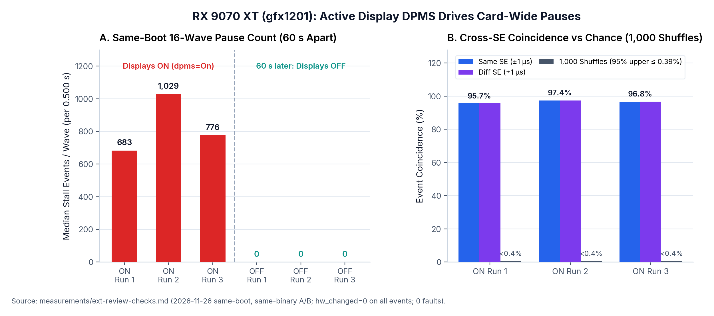

# Three no-card checks raised by an outside review

Worker run `20261126T024857-extcheck` (raw output in `runs/20261126T024857-extcheck/`, not committed). Labels: MEASURED
(a program run here, CPU only), READ (from a file or document), INFERRED (reasoning), COMPILER (a compiler listing).
**No GPU was used for the three checks in this no-card run; card behaviour was not measured there.** The RX 9070 XT was not installed for that run. The dated section at the end is a later card run and is not part of `20261126T024857-extcheck`.

## Plain summary

1. **Compiler gap at a call (check 1).** ROCm 10.1 still reproduces the study's listing: a non-inlined function that ends
   on a matrix instruction returns with no V_NOP, and the caller's next matrix instruction (reading that result as A)
   follows the call directly. ROCm 10.2 gives the same listing at -O3 and -O1. Fedora's upstream clang 22.1.8 also
   leaves the callee without a V_NOP, but in the two caller shapes tested it happens to put an address-add (a VALU
   instruction) between the call and the matrix instruction, so that caller is not flagged. The same gap shape
   appears for gfx1200 and, with the gfx11 matrix builtins, for gfx1150/gfx1151. The per-lane `if` keeps the matrix
   instruction inside the branch in every build. Whether the *card* misbehaves for these listings was not measured
   here (the 64-of-256 result is the study's earlier card run). On 2026-11-26 the same probes ran on the RX 9070 XT
   under ROCm 10.2; that card run is the hardware follow-up section at the end of this file.
2. **The two arithmetic models agree (check 2).** On the same inputs, AMD's rocjitsu `rj_arith` (bit-exact mode,
   built unmodified) and the study's `arith_model.h` give identical bits for all 11 dense gfx12 forms and all 9 sparse
   forms tried (8 float, IU8), more than a million outputs per form, including NaN/Infinity cases and the study's
   edge cases; both also match every card output recorded in the study's runs (278,635 elements). Controls
   (a deliberately wrong study model) report disagreements. One difference: for the 8-bit integer sparse form
   with *invalid* index values (which AMD's header calls unspecified), AMD's SIMD paths disagree with the study's model
   (which matched the card in the study's runs); AMD's own scalar path agrees with the study there.
   The three descriptions of the FP8 rule (study, AMD source, pips issue 17) agree in every point I compared.
3. **Chance level of the 96 % coincidence (check 3): closed by a 2026-11-26 card A/B run.** In the no-card run the raw
   event times of the 16-wave `multi` run were not on disk (`sched_share multi` printed summaries only), so only the
   two-wave `pair small small` proxy was computed (real 98.8 %, 1,000-shuffle chance 0.16 %, 95 % range 0.0 to 0.6 %).
   On 2026-11-26, the same 16-wave binary (`r102-sched_share_dump`) recorded raw event times in three runs with both
   displays on (`dpms=On`), followed 60 seconds later by three runs after the screensaver blanked both displays
   (`dpms=Off`):
   - **Displays on:** 683, 1,029, and 776 median events per wave in 0.500 s (`hw_changed=0` on every event); real
     ±1 us coincidence median **95.70 % to 97.46 %** (same SE) and **95.71 % to 97.42 %** (different SE), against
     **0.23 % to 0.27 %** after 1,000 independent circular shuffles (95 % upper bound at most **0.39 %**; same-offset
     break PASS; `VERDICT multi_chance: PASS` 3 of 3).
   - **Displays off (60 seconds later, same boot, driver, profile, and binary):** **0 events** across all 16 waves in
     all three runs, reproducing the unattended Slot 1 result (0 events when `dpms=Off`). Active display DPMS drives
     these card-wide pauses on this setup.



## Check 1: matrix hazard at a call boundary (listings only)

Sources: `src/study/haz_hazard.hip`, `src/study/haz_mask.hip` (unchanged); scans `scripts/haz_hazscan.py` and
`scripts/haz_maskscan.py` with the study's expect files (unchanged). New: `scripts/extcheck/c1_build.sh` (builds the
listings), `scripts/extcheck/c1_scan.py` (the table and the self-test), `src/extcheck/haz_gfx11.hip` (the same two shapes
with the gfx11 matrix builtins, because the gfx12 builtins do not compile for gfx115x).

**Baseline (ROCm 10.1, gfx1201, -O3): reproduces.** All 20 expect lines of `hazscan-haz_hazard.txt` and
`maskscan-haz_mask.txt` PASS (COMPILER). Listing of the missed case:

```
first_mm_tied:  v_wmma_f16_16x16x16_f16 v[0:3], v[4:7], v[8:11], v[0:3]
                s_setpc_b64 s[30:31]
h_call4:        s_swappc_b64 s[30:31], s[0:1]
                v_wmma_f32_16x16x16_f16 v[12:19], v[0:3], v[20:23], v[12:19]
```

Commands (exact): ROCm: `<rocm>/bin/hipcc -x hip --cuda-device-only -S -O3 -std=c++17 --offload-arch=<tgt>
-DHARNESS_ARCH="<tgt>" -Isrc -Isrc/study <src> -o <out>.s`. Fedora clang: `/usr/bin/clang++ --rocm-path=~/.local/opt/rocm-10.1.0
-nogpulib -Wno-unused-command-line-argument -x hip --cuda-device-only -S -O3 ...` (same other flags). ROCm 10.1 is
AMD clang 24.0.0git d6f6cb69, ROCm 10.2 is AMD clang 24.0.0git bdc35841, Fedora clang is 22.1.8-4.fc44.
`-O1` only for ROCm 10.2, as asked. All 24 builds compiled.

| Target | Compiler | Opt | V_NOP between the pair, call shape (COMPILER) | Straight-line control: hazards | Masked matrix op kept inside the per-lane branch (k_ifload / k_early / k_loop) |
|---|---|---|---|---|---|
| gfx1201 | ROCm 10.1 | O3 | **none** (callee ends on the matrix op; caller's matrix op follows the call) | 0 | yes / yes / yes (1 / 1 / 1) |
| gfx1201 | ROCm 10.2 | O3 | **none** | 0 | 1 / 1 / 1 |
| gfx1201 | ROCm 10.2 | O1 | **none** | 0 | 1 / 1 / 1 |
| gfx1201 | Fedora clang 22.1.8 | O3 | callee: none before the return; caller: a VALU (`v_add_co_u32`) sits after the call, so no gap in these two shapes | 0 | 1 / 1 / 1 |
| gfx1200 | ROCm 10.1 | O3 | **none** | 0 | 1 / 1 / 1 |
| gfx1200 | ROCm 10.2 | O3 | **none** | 0 | 1 / 1 / 1 |
| gfx1200 | ROCm 10.2 | O1 | **none** | 0 | 1 / 1 / 1 |
| gfx1200 | Fedora clang 22.1.8 | O3 | callee: none; caller: incidental VALU as for gfx1201 | 0 | 1 / 1 / 1 |
| gfx1151 | ROCm 10.1 | O3 | **none** (gfx11 port) | 0 | 1 (k_ifload only in the port) |
| gfx1151 | ROCm 10.2 | O3 / O1 | **none** | 0 | 1 |
| gfx1151 | Fedora clang 22.1.8 | O3 | **none** | 0 | 1 |
| gfx1150 | ROCm 10.1, 10.2 (O3, O1), Fedora 22.1.8 | | **none** (same as gfx1151) | 0 | 1 |

The ROCm 10.1 and 10.2 gfx1201 listings of `haz_hazard.hip` are identical after dropping comment and directive lines
(first 400 lines compared). Notes: (a) the Fedora caller result is a scheduling accident (an address add landed there),
not a fix; the callee still returns right after its matrix instruction, so a caller with nothing between would still
have the gap. (b) For gfx115x I ran the study's gfx12 rule unchanged: that the gfx11 hazard rule is the same is not
established here (INFERRED only from the identical shape). (c) "Kept inside the branch" means the mask scan counts the
matrix instruction as possibly run with a partial EXEC, as in the study.

**Deliberate break (PASS):** `c1_scan.py --selftest` removes the `v_nop` from the hand-written `h_asm_nop` listing:
hazard count 0 -> 1 (scan sees the gap). It also adds a `v_nop` before the return of `first_mm_tied`: return count
1 -> 0 (scan sees the gap closed). Run it: `python3 scripts/extcheck/c1_scan.py <dir> --selftest`.

## Check 2: study model against AMD's rocjitsu `rj_arith`, bit for bit

**Source:** ROCm/rocm-systems `emulation/rocjitsu/lib/arith`, commit `09ba9dce211595227e02efffefb2f4b4cc461ed7` (READ from
`SOURCE-COMMIT.txt`). **Licence:** MIT, copyright Advanced Micro Devices, Inc. (READ: `SPDX-License-Identifier: MIT` in every
header, and the README's "Licensed under the MIT license"; the download holds no LICENSE file). Not copied into this repo.
Built unmodified with `src/extcheck/rj_build/` (a 5-line stand-in for rocjitsu's own `rj_configure_target` CMake helper
and a wrapper `CMakeLists.txt`; g++ 16.2.1, C++23, Release): 368 files in about 30 s. AMD's header calls the FP8
exact path "two native DOT8 steps from the borrowed gfx1201 empirical model": AMD's bit-exact mode is itself an empirical
copy of gfx1201 behaviour, so agreement is partly expected; what the harness adds is an independent check of the
implementation and of the study's model against each other.

**Harness:** `src/extcheck/rj_vs_model.cpp` (links `librj_arith.a` and the study's `arith_model.h`). Study generators and
register layouts are not rewritten: `scripts/extcheck/c2_extract.py` cuts them by name out of `src/study/arith_gpu.h` and
`arith_more.hip` into a generated header (`ad::make` in all distributions, `ad::adversarial`, `make16`, `make_int`,
`make_sparse`, the six quoted edge cases and the 45,056-product BF16 sweep). Both models get the same register images
(study layout; one wave per problem; D poisoned before the call). AMD runs in `BIT_EXACT_EMPIRICAL_NO_FP_STATUS` (mode 2).
My own addition, labelled: `special` mode drops NaN/Inf/max/zero codes into the same problems (about 46 to 74 % of the
outputs are NaN or Inf); and invalid sparse indices (below).

### Dense gfx12 Wave32 forms (MEASURED, CPU)

| Form | Outputs compared | Bit-for-bit disagreements (random + adversarial) | Special values (NaN/Inf/max/zero), outputs / disagreements |
|---|---:|---:|---|
| f16 (FP32 acc) | 1,000,960 | 0 | 1,024,000 / 0 |
| bf16 | 1,000,960 | 0 | 1,024,000 / 0 |
| fp8_fp8 | 1,001,472 | 0 | 1,024,000 / 0 |
| fp8_bf8 | 1,001,472 | 0 | 1,024,000 / 0 |
| bf8_fp8 | 1,001,472 | 0 | 1,024,000 / 0 |
| bf8_bf8 | 1,001,472 | 0 | 1,024,000 / 0 |
| f16 into f16 | 1,000,960 | 0 | 1,024,000 / 0 |
| bf16 into bf16 | 1,000,960 | 0 | 1,024,000 / 0 |
| iu8 (8 sign/clamp settings) | 1,024,000 | 0 | n/a |
| iu4 K=16 (8 settings) | 1,024,000 | 0 | n/a |
| iu4 K=32 (8 settings) | 1,024,000 | 0 | n/a |

Run at every AMD CPU level (`EXTCHECK_CPU=baseline|v3|v4|zen4`; baseline is the scalar path): 0 disagreements in dense,
special, and valid-index sparse at all four. Distribution detail per form is in `c2/dense.log` (wide, narrow, cancel,
bigsmall, allcodes, adversarial). The 16-bit-accumulator rows use `make16` and the study's measured rounding
(FP16: nearest even every step; BF16: FP32 then toward zero).

### Sparse (SWMMAC, Wave32) (MEASURED, CPU)

Valid indices (each group of four names two increasing positions), `index_key` 0 and 1, 2 x 2,000 problems: 1,024,000
outputs per form, **0 disagreements** for f16, bf16, fp8_fp8, fp8_bf8, bf8_fp8, bf8_bf8, f16_f16, bf16_bf16 and iu8 (all four CPU levels).
Not covered: the sparse 4-bit forms (the study's layout for them is in `left_mat.hip`, not reused here), wave64.

Invalid indices (AMD: "unspecified"; the study found invalid values are used as given and its model matched the card
on random indices for every form, 500,224 elements per key and form in `arith_more-sparse.log`), 256,000 outputs each:

| Form | random | equal-position pairs | decreasing pairs |
|---|---|---|---|
| the 8 float forms | 0 | 0 | 0 |
| iu8, AMD scalar path | 0 | 0 | 0 |
| **iu8, AMD v3 / v4 / zen4 SIMD paths** | **255,675** | **255,991** | **255,997** |

INFERRED reading: AMD's SIMD implementation of the integer sparse form assumes valid pairs and gives something else for
invalid ones; its scalar path matches the study (and, through the study's log, the card). This matters only if software
feeds invalid indices. First disagreeing case (the first 20 are in `c2/sparse.log`): problem 0, row 0, column 0,
random index key 0: study `0xc52550d4`, AMD `0xc524eb8a`, A = `7f 33 e9 70 ed c1 80 4b 7e 64 67 5f 2d 6d 2c 16`,
C = `c5250de9`, index lanes (r, r+16) = `11fb9b75 f57c019f`.

### Controls

| Control | Result |
|---|---|
| Each model against the study's recorded card outputs (`build/arith/explore/*.in/.out`: 24 files, 278,635 elements, forms f16, bf16, fp8_fp8, bf8_bf8, bf16 into bf16; mod 0, MODE 0) | study 0 differ, AMD 0 differ: **PASS** |
| The six edge cases quoted in `matrix-arithmetic.md` against the card values recorded in the logs | study 6/6, AMD 6/6 equal the card: **PASS** |
| The 45,056-product BF16 subnormal sweep (card log: study matches 45,056/45,056) | AMD vs study 0 differences: **PASS** |
| Deliberate break: study model with each product truncated toward zero instead of the run sums floored (`prod_each`, `prod_trunc`; integer clamp only at the end; sparse with the other index key) | dense 1,865,841 disagreements (every float form 23,457 to 456,402 of about 1.0M; iu8 342, iu4 179 and 311); sparse 753,800 to 1,023,999 per form; against the card outputs 23,263 study differences (AMD 0); edge: 2 quoted cases and 2,128 sweep outputs differ. Each reports disagreements: **PASS** |

Rerun: `scripts/extcheck/c2_build.sh runs/<stamp>-extcheck`, then `c2/rj_vs_model dense|special|sparse|edge|gpu DIR [--break]`
(`gpu` DIR = the study's `build/arith/explore`; `EXTCHECK_CPU` selects the AMD CPU level).

### The three descriptions of the FP8 arithmetic in words

Sources: the study (`matrix-arithmetic.md` summary, `arith_model.h` header); AMD (READ from `src/dot/dot.h`,
`gfx12_dot_detail::dot_bits`, and the `rj_arith_wmma.h` comments); pearl-research-labs/pips issue 17 (READ with `gh issue
view`; the single comment only links the PIP draft, PR 18, which I did not read). I compared the issue's formula with
the others in words; I did not implement it as a third model.

| Point | Study | AMD rocjitsu | pips issue 17 | Agree? |
|---|---|---|---|---|
| Steps | two steps of 8 products (K 0-7 carrying C, then 8-15) | "two native DOT8 steps", each a DOT8 of two quads | two chained groups of 8 (G8) | yes |
| Quad pre-sum | each product floored to the quad's own unit, quad sum added exactly | products aligned to the quad's own largest grid (floor), summed | each quad floored at 2^(eta_Q - 24), eta_Q = the quad's largest exponent | yes |
| Step unit | 2^(E - 26), E = max(running-sum exponent, ea + eb + 2) = 2^(max(ea+eb, E(c)-2) - 24) | grid = max(product grids (ea + eb - 24), max(-126, exponent of C) - 26) | 2^(eta - 24), eta = max(max exponent of the 8 products, E(c) - 2) | yes (same unit; different bookkeeping of the +2) |
| Quad sums into the step | floored once to the step unit | floored (aligned) to the step grid | floored to 2^(eta - 24) | yes |
| Rounding | floor everywhere inside, then round to nearest even to FP32 | arithmetic floor; "pack" rounds to nearest even | floor, then RNE_FP32 | yes |
| Running sum / C below the unit | contributes 0 (also when negative) | an accumulator losing all bits contributes 0, also when negative | c dropped if E(c) < eta - 24 | yes |
| Exact zero | +0; all-zero products leave C unchanged | zero result positive | +0 if S = 0; c unchanged if all products zero (-0 becomes +0) | yes |
| Smallest unit | never below 2^-152 | -126 - 26 = -152 | not stated (the issue reports 93/93 suites bit-exact incl. FP32-subnormal carries) | likely, not checkable from the text |
| 16-bit inputs | pairs, 4 steps of 4 | group size 2 in a chain of DOT4 steps | not covered (FP8 only) | n/a |
| NaN payloads | handled per step | factor NaN 0xffc00a3d, invalid product 0xffc00000 | not stated | AMD and study agree bit for bit (`special` mode) |

Differences found: none in the FP8 rule. The issue's "one bit narrower window" remark (24 vs 25) concerns B200, not the
other two. The issue's own measurements (RX 9070 XT and 9060 XT, 93 suites) cannot be checked here.

### Open

The study's model is only checked on finite and NaN/Inf inputs through this harness; MODE bits other than FP16_OVFL,
wave64, EXEC and the 4-bit sparse forms were not compared. AMD's FP16_OVFL-set behaviour was not tried (`RJ_ARITH_FP16_OVFL`
left clear). The iu8 invalid-index finding needs the card to say which implementation of AMD's is right (the study's earlier
card runs favour the scalar path and the study's model).

## Check 3: chance level of the 96 % pause coincidence (stopped; proxy only)

**Baseline cannot be recomputed.** `mode_multi` (`src/study/sched_share.hip`) detects events, counts coincidences in
the process and prints only `RESULT multi wave=... events=...` and the pair-share distributions. No trace file is written;
`spin-events.csv` and `spin-windows.csv` are the single-wave `spin` run. The published 0.962 (same engine) matches
`runs/20261117T165519Z-sched/spin-multi.log` (median of 48 pairs), the other two logged runs give 0.956 and 0.964, so the
figure is real; it was just computed on the card and the events were not kept. Recomputing needs the card, so per the
stop rule I did not go further on `multi`.

**Chance level from the published numbers (INFERRED, arithmetic only):** each wave logged about 200 events in 0.5 s (400 per
second); a +-1 us window is 201 ticks of 10 ns; for independent events the chance that one lands within the window of
another wave's event is about 200 x 201 / (0.5 s / 10 ns) = 0.08 %.

**Proxy on saved raw data (MEASURED, CPU):** `scripts/extcheck/c3_chance.py <study repo> <run dir>` takes the two-wave
`pair small small` run (two processes, one wave each, different WGPs), extracts events with the study's own
`sched_pair.events()`, and compares A's events with B's within +-100 ticks (1 us). Shuffle: an independent random circular
offset over the run length for each wave, distance taken circularly, 1,000 shuffles, seed 1.

| Run | A / B events | Real share | Shuffled mean | Shuffled 95 % range | Max of 1,000 | Break: same offset for both waves |
|---|---|---:|---:|---|---:|---|
| `20261117T165519Z-sched` (the published 98.8 %) | 1,246 / 1,282 | 98.80 % | 0.16 % | 0.00 to 0.64 % | 1.2 % | always 98.88 % (the circular real value): PASS |
| `20261117T171514Z-sched` (rerun of the same job) | 1,084 / 1,082 | 97.88 % | 0.15 % | 0.00 to 1.85 % | 3.7 % | always 97.97 %: PASS |

The recomputed real share matches the published 98.8 % exactly for the first run (the study's `--shift` control gives the
same 0.9880). The study already ran a fixed-shift control on this pair (`sched_pair.py --shift`: largest shifted share
0.4 %); the table above adds the requested random-circular-shift distribution. What stays open: the same control on
the 16-wave `multi` data (same engine vs different engines), which needs the card to record the event times (a one-line change
to write `ev[g]` to a file would suffice). Two 2026-11-26 card reruns below recorded those times: the unattended displays-off run had 0 events, and the later same-session displays-on vs displays-off A/B run closed the 16-wave chance figure.

## Hardware follow-up on the RX 9070 XT (2026-11-26, Slot 1, OC profile)

This section is a later card run. It is not part of the no-card run `20261126T024857-extcheck` above.

**Setup (READ from `env-manifest.json`, generated 2026-11-26T12:51:01Z).** RX 9070 XT, PCI vendor:device `1002:7550`, VBIOS `115-G295BP00-100`. LACT track `overclock`: core offset +150 MHz, voltage offset -50 mV, memory-clock request 1409 MHz, performance level `auto`, power cap 374 W, power profile `BOOTUP_DEFAULT`. Linux 7.3.4-202. The manifest's toolchain record is ROCm 10.1.0 (AMD clang `d6f6cb69`, HIP 7.16.26385). The two jobs below were compiled with ROCm 10.2, AMD clang 24.0.0git `bdc35841`. A 1.2x regulator-level power-limit mod is installed on this card, so reported watts are low on the main rail. The correctness counts in this section do not depend on the clock. Raw logs are in the companion checkout's git-ignored build tree, folder `afk-r13/slot1-results/`, recorded 2026-11-26.

### Check 1 hardware verification (ROCm 10.2.0, gfx1201, MEASURED)

Folder `afk-r13/slot1-results/compiler-r102/`. Binaries match the recorded SHA256 sums. Listing scans PASS (haz_hazard 12 of 12 expect lines at -O3 and at -O1; haz_mask 8 of 8 at -O3, and 7 of 8 at -O1, the one difference being `k_asm_time` not unrolled, called harmless). Card id `0x7550`, hotspot 31 C and 14 GB available at the start. The four probe jobs exited 0. Both deliberate-break jobs exited 1, which is what the band checker requires. `kernel-faults.txt`: no amdgpu fault lines in the kernel log since 2026-11-26 04:51:01.

**Call-boundary hazard (`haz_hazard`).** The same counts at -O3 and at -O1:

| Result line | -O3 and -O1 |
|---|---|
| `hazard_asm_vnop` | PASS, 0 of 256 differ from the model |
| `hazard_call_miss`, empty asm that only orders the loads | PASS, 64 of 256 differ from the model; 0 of 256 differ from the no-V_NOP inline-assembly result |
| `hazard_call_miss`, plain C++ | PASS, 64 of 256 differ from the model; 0 of 256 differ from the no-V_NOP inline-assembly result |
| `hazard_asm_no_vnop` | INFO, 64 of 256 differ from the model; repeat equal: yes |

The other `haz_hazard` value checks at both opts are PASS with 0 wrong (straight line, bsrc, ordinary call, tied call, both branch flags, mixed FP16-as-BF16, loop n=1, 2 and 5, SGPR lanes, cmpx/permlane). Timing lines are not the claim of this check. At -O3 they read 47.01 cycles per compiler iteration, 41.36 for `asm_wait`, and 33.69 for `asm_nowait`. At -O1 they read 48.38, 41.33, and 32.32.

**Per-lane `if` (`haz_mask`).** `mask_ifload` and `mask_early` print the same wrong counts at -O3 and at -O1. Partial masks are not deterministic over 3 runs. n=32 is.

| n | Stored results that differ (`mask_ifload` and `mask_early`) | Deterministic over 3 runs |
|---:|---|---|
| 8 | 64 of 64 | no |
| 16 | 128 of 128 | no |
| 20 | 144 of 160 | no |
| 31 | 23 of 248 | no |
| 32 | 0 of 256 | yes |

`mask_sink` stores 0 wrong at all five n, deterministic yes, at both opts. `mask_select`, `mask_uniform`, and `mask_loop_uniform` are PASS, 0 of 256 wrong. `mask_loop_perlane` is INFO: lanes 0-15 differ from "all lanes run 2" in 126 of 128, and lanes 16-31 equal the two-lane-group stale result in 128 of 128. `mask_asm_rule` is PASS for all 7 EXEC masks (off lanes are written: 0, 128, 128, 128, 192, 248, and 256).

**Deliberate breaks (the checker PASSes because the probes print FAIL).**

| Break | What the log printed |
|---|---|
| `hazard_asm_no_vnop` judged as if it must be right | FAIL, 64 of 256. Band `break-reports-FAIL`: PASS |
| `mask_asm_rule_break`, full EXEC `0xffffffff` | PASS, 0 of 256 differ; off lanes written 0 of 0 |
| six partial EXEC masks, including `0x00000000` | FAIL. Off lanes written 128, 128, 128, 192, 248, and 256 of those widths. The band line is "6 of 7 FAIL", and that band PASSes |

### Check 3 hardware follow-up (16-wave `multi`, event times saved, MEASURED; display hypothesis UNCONFIRMED)

Folder `afk-r13/slot1-results/multipause/`. Started 2026-11-26T12:51:06Z, same ROCm 10.2 clang `bdc35841`. SHA256 match. The chance-control self-test PASSed (independent data fails the check, synchronised data passes, the same-offset break reproduces, 32-bit wrap is handled). The band-checker self-test also PASSed. Hotspot 30 C at the start. `kernel-faults.txt`: no amdgpu fault lines since 2026-11-26 04:51:11.

Three runs, each 16 waves on shader engines 0, 1, 2, and 3, each about 0.500 s:

| Run | Exit | Events per wave (min, median, max) | Run length | Ticks | Pairs | `multi_chance` |
|---|---:|---|---|---:|---:|---|
| 1 | 0 | 0, 0, 0 | 0.500 s | 49999965 | 0 | FAIL |
| 2 | 0 | 0, 0, 0 | 0.500 s | 49999973 | 0 | FAIL |
| 3 | 0 | 0, 0, 0 | 0.500 s | 49999961 | 0 | FAIL |

Each `runN-multi-events.csv` is the header only (`wave,se,rt_ticks,start_us,dur_us,extra_cycles,hw_changed`). `run1.log` has 16 `RESULT multi` lines, waves 0-15, `events=0`, and `raw_events_written=yes`. Its own verdict is `VERDICT sched_share multi: PASS`. Same-engine and different-engine medians are `nan` because there are 0 pairs. The analytic chance line is about 0.0000. `multi_chance` FAILs because a PASS needs the real share to beat the shuffled upper bound by more than 0.5, and there is nothing to compare. The same-offset break still PASSes (it matches the circular real medians, which are also empty).

The historical event-count bands FAIL on these three runs, and the summary ends `SOMETHING FAILED` for that reason. The bands expect 150 to 260 events per wave (the earlier logged runs were 188 to 227) and same-engine / different-engine medians in 0.93-0.99 / 0.90-0.98. Zero events is outside those bands. That is the measurement. It is not a detector crash: the detector's verdict line is PASS, and the event file was written.

**Displays (READ, not a file in `multipause/`).** The slot run sheet's 05:05 PST note says both connected outputs, `card1-DP-1` and `card2-HDMI-A-2`, were `enabled=disabled` and `dpms=Off` during this unattended run. The manifest at 12:51:01Z lists those two connectors as `connected` and does not record DPMS. Display-pipeline or DPMS activity was therefore a candidate for the pauses this repository reports at 380 to 1,023 per second; the same-session A/B check immediately below tests it directly.

### Check 3 displays-on vs displays-off A/B follow-up (2026-11-26, same boot and binary, MEASURED)

Folders `kimi-next/multipause-displays-on/` (started 2026-11-26T19:58:36Z) and `kimi-next/multipause-displays-off-ab/` (started 2026-11-26T20:01:12Z) in the companion checkout's git-ignored build tree. Same RX 9070 XT (`1002:7550`, LACT track `overclock`, Linux 7.3.4-202), same ROCm 10.2 binary (`r102-sched_share_dump`, SHA256SUMS PASS), same `slot1_bands.py` and `multi_chance.py` self-tests PASS. Both runs recorded `/sys/class/drm/card*-*/{status,enabled,dpms}` before and after the run in `dpms.txt`, and `env-manifest.json` before launch. Both kernel-log fault checks were clean (0 amdgpu faults).

The displays were active (`card1-DP-1` and `card2-HDMI-A-2`: `enabled=enabled`, `dpms=On`) at the start of the first run (19:58:36Z); the desktop screensaver blanked both outputs to `enabled=disabled`, `dpms=Off` between run 3 (20:00:03Z) and the post-run snapshot (20:00:42Z). The second run started 30 seconds later (20:01:12Z) with both outputs `dpms=Off` before and after.

| Run | UTC start | `card1-DP-1` & `card2-HDMI-A-2` DPMS | Hotspot start | Events/wave in 0.500 s (min / med / max) | Real ±1 us median (same SE / diff SE) | 1,000-shuffle mean & 95 % range (same SE / diff SE) | Same-offset break | `multi_chance` |
|---|---|---|---|---|---|---|---|---|
| Displays-on 1 | 19:58:40Z | `On` (pre) | 44 C | 667 / **683** / 708 | **95.70 % / 95.71 %** | 0.23 % (0.15-0.30 %) / 0.24 % (0.15-0.29 %) | PASS | **PASS** |
| Displays-on 2 | 19:59:21Z | `On` | ~44 C | 1,006 / **1,029** / 1,052 | **97.46 % / 97.42 %** | 0.27 % (0.19-0.39 %) / 0.27 % (0.20-0.34 %) | PASS | **PASS** |
| Displays-on 3 | 20:00:03Z | `On` (Off by 20:00:42Z) | ~44 C | 756 / **776** / 804 | **96.50 % / 96.77 %** | 0.26 % (0.13-0.38 %) / 0.26 % (0.25-0.26 %) | PASS | **PASS** |
| Displays-off 1 | 20:01:15Z | `Off` (pre & post) | 37 C | **0 / 0 / 0** | `nan` (0 pairs) | n/a | PASS | FAIL (0 events) |
| Displays-off 2 | 20:01:55Z | `Off` (pre & post) | ~37 C | **0 / 0 / 0** | `nan` (0 pairs) | n/a | PASS | FAIL (0 events) |
| Displays-off 3 | 20:02:35Z | `Off` (pre & post) | ~37 C | **0 / 0 / 0** | `nan` (0 pairs) | n/a | PASS | FAIL (0 events) |

Raw-event details (MEASURED from `run{1,2,3}-multi-events.csv` in `multipause-displays-on/`):
- **Total event rows across 16 waves (4 SEs):** 10,948 (run 1), 16,468 (run 2), 12,496 (run 3). **`hw_changed=0` on every row** (waves stalled in place without migration).
- **Single-event duration (`dur_us`):** median 1.44 / 0.56 / 0.64 us, p90 5.08 / 4.52 / 3.28 us, max 20.20 / 19.08 / 154.00 us. Total stalled time per 0.500 s window: 1.45 / 1.50 / 1.20 ms (0.24 % to 0.30 % of wall time).
- **Inter-event spacing on wave 0:** bimodal, with tight bursts under 50 us apart (298 / 487 / 374 gaps) separated by 0.5 to 2.9 ms intervals (max gap 2.27 / 2.89 / 2.83 ms; zero gaps above 5 ms).
- **Band note:** `slot1_bands.py` printed `BAND steps-3.5M: FAIL` in both the displays-on and displays-off runs because 15 of 16 waves ran ~3.34M to 3.35M spin steps in 0.500 s while one wave reached the 3,500,000-step buffer cap; in the displays-on runs `events-per-wave` also printed `WARN` (667-1,052 against the quieter historical 150-260 band). `VERDICT sched_share multi: PASS` held on all 6 runs.

**Conclusion (MEASURED):** This closes Check 3's open 16-wave chance control (95.70 % to 97.46 % real coincidence within ±1 us across all 4 shader engines against a 1,000-shuffle chance upper bound of 0.30 % to 0.39 %, roughly 350x to 400x above chance) and gives a same-boot, same-binary, 60-second-apart A/B confirmation that active display DPMS causes the card-wide pauses on this card and driver stack. Which display-pipeline mechanism (scanout, DCN/MCLK switching, or compositor frames) triggers them inside the active-DPMS state was not isolated here.
