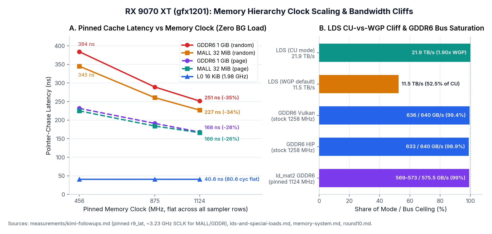
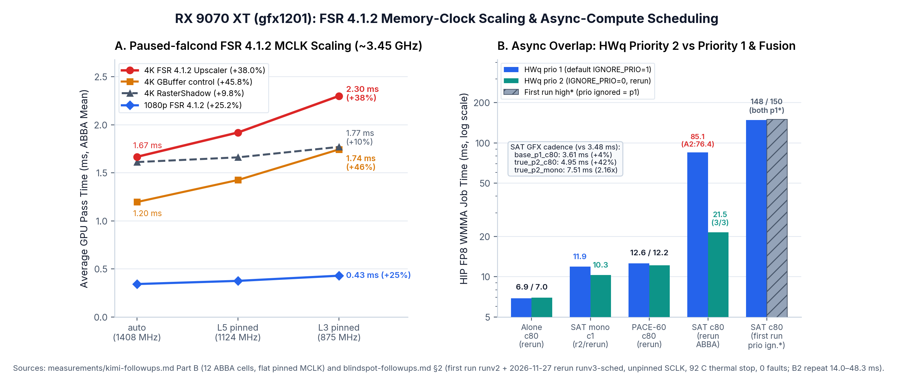
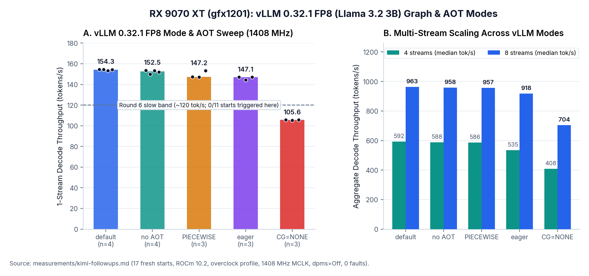

# Follow-up measurements: pinned cache latency, paused-`falcond` FSR 4.1.2 MCLK scaling, vLLM 0.32.1 sweep, and warmed Item 3 (2026-11-26)

Preregistered expectations were written before the GPU runs in [kimi-followups-expectations.md](kimi-followups-expectations.md). Card: ASUS Prime RX 9070 XT (`1002:7550`, `gfx1201`), LACT profile `Default` (`overclock`: +150 MHz core, -50 mV, 374 W cap, 1409 MHz memory request, 1.2x regulator mod). Raw logs live in the companion checkout's git-ignored build tree under `kimi-followups/pinned-lat-fsr-1/`, `kimi-followups/vllm-sweep-2/`, and `kimi-followups/pinned-fsr-item3-1/`. Labels: MEASURED, READ, INFERRED.

## Plain summary

1. **Part A — Pinned cache latency vs memory clock (`r9_lat`, MEASURED, PASS):** Pinning `pp_dpm_mclk` via `scripts/round10/pin_mclk.sh` held `uclk_cur_MHz` flat at `456`, `875`, and `1124 MHz` with zero background load (`RESTORE-OK level=auto mask=all` on all three levels, 100% `pointer=ok`, 0 kernel faults).
   - **L0 (16 KiB)** is completely invariant in cycles (**`80.6 cycles`** at 456, 875, 1124 MHz, and `auto`).
   - **MALL (32 MiB)** and **GDDR6 (1 GiB)** both scale strongly with memory clock at matched `~3.22–3.29 GHz` SCLK: MALL random drops **`345.07 -> 260.44 -> 226.88 ns`** (`-118.2 ns`), MALL page drops **`224.84 -> 183.96 -> 166.27 ns`**, GDDR6 random drops **`384.04 -> 289.10 -> 251.32 ns`** (`-132.7 ns`), and GDDR6 page drops **`231.68 -> 191.13 -> 167.73 ns`** across `456 -> 875 -> 1124 MHz`.
   - **Unpinned `auto` control** jumped across `456`, `875`, `1124`, and `1408 MHz` inside a single run, directly illustrating why unpinned cache-latency sweeps were confounded.
2. **Part B — FSR 4.1.2 MCLK scaling (unpaused `RESTORE-FAILED` + clean paused-`falcond` ABBA sweep, MEASURED for retained runs; `falcond` daemon-journal attribution INFERRED / not re-traceable):**
   - **Unpaused attempt (`pinned-lat-fsr-1/fsr/r1-L5`, MEASURED):** On the first pinned FSR 4 attempt, `pin_mclk.sh` wrote `manual` and level `5` (`1124 MHz`), `r9_sampler` read `1124 MHz` for the first 44 rows (`0.00–0.43 s` from the first sample) before `uclk_cur_MHz` jumped to `1408 MHz` on row 45 (`+0.440 s`), and the restore write failed (`exit=21`, `RESTORE-FAILED level now 'auto', mask 'all'` in `pinned-lat-fsr-1/summary.log:17-18`). The `journalctl -u falcond` excerpt from that session was not retained in the run folders, so daemon-side log lines and timing cannot be re-traced here; pausing `falcond.service` in the rerun (`FALCOND_STOPPED=1`) allowed all four pinned windows to hold `manual` and finish `RESTORE-OK` (making `falcond.service` an INFERRED cause for both this failure and Round 8's failed `profile_standard` test on `FidelityFX_FSR.exe`).
   - **Clean paused-`falcond` ABBA sweep (`pinned-fsr-item3-1/fsr/`, 12 cells across `auto -> L5 -> L3 -> L3 -> L5 -> auto`, `RESTORE-OK` on all 4 pinned windows, `falcond.service` restored `active` on exit, 0 kernel faults):** Every pinned cell held `uclk_cur_MHz` **100% flat** (`[1124]` or `[875]` across `790–1,327` busy 10 ms samples per cell) at matched `3.37–3.49 GHz` SCLK:
     - **`3840x2160` Quality (`2560x1440 -> 3840x2160`):** FSR 4.1.2 upscaler slowed **`1.667 ms` (`auto 1408`) -> `1.920 ms` (`1124 MHz`, `+15.2%`) -> `2.300 ms` (`875 MHz`, `+38.0%`)**, while GBuffer scaled `+45.6%` (`1.197 -> 1.744 ms`), RasterShadow scaled `+9.8%` (`1.612 -> 1.770 ms`), and Lighting stayed flat (`0.348 -> 0.352 ms`, `+1.2%`).
     - **`1920x1080` Quality (`1280x720 -> 1920x1080`):** FSR 4.1.2 upscaler slowed **`0.343 ms` (`auto 1408`) -> `0.376 ms` (`1124 MHz`, `+9.6%`) -> `0.430 ms` (`875 MHz`, `+25.2%`)**.
     - Across `1408 -> 875 MHz` (`1.61x` MCLK ratio), 4K FSR 4.1.2 carries a **`~62%` memory/fabric-clock-sensitive share** (confirming and quantifying Round 8's unpinned observation and explaining why titles that park MCLK at `875 MHz` pay a large upscaler penalty).
3. **Part C — vLLM 0.32.1 FP8 17-start mode, cudagraph, and AOT sweep (MEASURED, 17/17 PASS, 0 faults, `dpms=Off`):** At `1408 MHz` MCLK and `3.28–3.46 GHz` SCLK across all 17 fresh starts:
   - `default` (`FULL_AND_PIECEWISE` + cached AOT, 4 starts): **`153.3–154.5 tok/s`** at 1 stream (`<0.8%` spread).
   - `no_aot_nocache` (`VLLM_USE_AOT_COMPILE=0`, `VLLM_USE_STANDALONE_COMPILE=0`, `VLLM_DISABLE_COMPILE_CACHE=1`, fresh `VLLM_CACHE_ROOT`, 4 starts, genuine cold compiles `13.1–28.6 s`): **`149.8–153.6 tok/s`**.
   - `cg_piecewise` (`VLLM_COMPILE` + `CUDAGraphMode.PIECEWISE`, 3 starts): **`147.0–153.3 tok/s`**.
   - `eager` (`enforce_eager=True`, 3 starts): **`144.3–147.1 tok/s`** (only ~5% below `default` on 1-stream decode of this 3B model).
   - `cg_none_compiled` (`VLLM_COMPILE` + `CUDAGraphMode.NONE`, 3 starts): **`105.3–105.7 tok/s`** (`<0.4%` spread) — **31% slower than `default` and 28% slower than `eager`**, isolating the launch/dispatch penalty of running `torch.compile` without cudagraph replay.
   - **Bimodal split status:** None of the 11 graph-enabled starts reproduced Round 6's ~120 tok/s slow band during this `dpms=Off` session (and re-checking all 6 Round 6 FP8 logs confirmed both cold `SAVED_AOT` and cached `LOAD_AOT` starts landed in both fast and slow bands). Because the ~120 band did not trigger in the `default` baseline here, this run measures the mode hierarchy cleanly without claiming that `no_aot_nocache` or `PIECEWISE` fixes the intermittent split.
4. **Part D — Warmed 3-repeat pinned `1124 MHz` Item 3 Step 1 (`r10_cl3 warm=150`, MEASURED for HIP; Vulkan env-var miss):**
   - Adding `warm=150` to `src/round10/item3/r10_cl3.hip` completely eliminated Round 10's `cell_clock` drift failure: across all 3 repeats (`s1-hip-r1..3`, flat `1124 MHz` MCLK, `dpms=Off`, `RESTORE-OK`, 0 faults), `hip-base-r` held `3218–3226 MHz` (`<0.1%` spread) at **`812.1 / 812.5 / 810.3 cyc` (`252.2 / 252.4 / 251.2 ns`)**, and `hip-base-p` held `3252–3255 MHz` (`<0.1%` spread) at **`545.8 / 548.5 / 550.3 cyc` (`167.7 / 168.7 / 169.1 ns`)** — matching Part A's `r9_lat` `1124 MHz` GDDR6 baselines (`251.32 ns` random, `167.73 ns` page) within `1.4 ns`. (The legacy `690–720 cyc` `hip_base_cold_r` gate in `analyse_item3.py` assumed `1408 MHz` MCLK.)
   - **Vulkan leg not collected in this run:** `s1-vk-r1..3` exited `1` (`cannot read spv/r9_evict.spv`) because the wrapper passed `VK_SPV_DIR` instead of `VKG_SPV` (causing `item3/analysis.txt` to abort with a Python traceback on the missing Vulkan rows). Full Vulkan-vs-HIP Item 3 Step 1 causal closure therefore remains open until `vkr10` is rerun with `VKG_SPV`.

---

## Part A: Pinned cache latency versus memory clock (`r9_lat`, MEASURED)

Folder: `kimi-followups/pinned-lat-fsr-1/lat/{pin-L1,pin-L3,pin-L5,auto}/`. Binary: `build/round9/bin/r9_lat lat 16,1024,32768,1048576 5 both`. Pinned levels used `scripts/round10/pin_mclk.sh --level {1,3,5} --cap-s 180` (all 3 exited 0 with `RESTORE-OK level=auto mask=all`); `auto` ran under `flock` on the shared GPU lock. Sampler (`r9_sampler`, 50 ms) confirmed flat `uclk_cur_MHz` on every pinned run: `pin-L1` = `62` rows all `456 MHz`; `pin-L3` = `51` rows all `875 MHz`; `pin-L5` = `46` rows all `1124 MHz`; `auto` = `49` rows jumping across `[456, 875, 1124, 1408] MHz`. Every row printed `pointer=ok`; peak hotspot `50 C`; 0 amdgpu faults. Implied `SCLK (GHz)` = `cycles / ns` (INFERRED).

| Buffer / Walk | `456 MHz` (`pin-L1`) cyc / ns (SCLK) | `875 MHz` (`pin-L3`) cyc / ns (SCLK) | `1124 MHz` (`pin-L5`) cyc / ns (SCLK) | `auto` (unpinned) cyc / ns (`uclk0->uclk1`) | `456 -> 1124` delta (ns) |
|---|---:|---:|---:|---:|---:|
| L0 `16 KiB` random | `80.6` / `40.62` (`1.98`) | `80.6` / `40.63` (`1.98`) | `80.6` / `40.62` (`1.98`) | `80.6` / `27.32` (`875->875`, `2.95 GHz`) | `0.00` (0.0%) |
| L0 `16 KiB` page | `80.6` / `40.61` (`1.99`) | `84.8` / `42.76` (`1.98`) | `80.6` / `40.62` (`1.98`) | `80.6` / `27.33` (`875->875`, `2.95 GHz`) | `+0.01` (0.0%) |
| L2 `1 MiB` random | `339.7` / `171.33` (`1.98`) | `332.7` / `167.71` (`1.98`) | `283.7` / `143.02` (`1.98`) | `236.6` / `80.23` (`875->875`, `2.95 GHz`) | `-28.31` (-16.5%) |
| L2 `1 MiB` page | `370.7` / `138.97` (`2.67`) | `335.6` / `160.08` (`2.10`) | `300.0` / `139.07` (`2.16`) | `296.1` / `96.89` (`875->875`, `3.06 GHz`) | `+0.10` (SCLK differs) |
| MALL `32 MiB` random | **`1110.9` / `345.07`** (`3.22`) | **`840.1` / `260.44`** (`3.23`) | **`732.0` / `226.88`** (`3.23`) | `752.8` / `233.29` (`875->875`) | **`-118.19` (-34.3%)** |
| MALL `32 MiB` page | **`732.6` / `224.84`** (`3.26`) | **`593.5` / `183.96`** (`3.23`) | **`539.2` / `166.27`** (`3.24`) | `527.1` / `162.68` (`875->1124`) | **`-58.57` (-26.0%)** |
| GDDR6 `1 GiB` random | **`1248.9` / `384.04`** (`3.25`) | **`932.9` / `289.10`** (`3.23`) | **`810.7` / `251.32`** (`3.23`) | `865.6` / `266.93` (`1124->875`) | **`-132.72` (-34.6%)** |
| GDDR6 `1 GiB` fresh | `650.7` / `197.51` (`3.30`) | `559.0` / `171.23` (`3.27`) | `513.1` / `157.73` (`3.25`) | `479.3` / `146.41` (`875->875`) | **`-39.78` (-20.1%)** |
| GDDR6 `1 GiB` page | **`761.2` / `231.68`** (`3.29`) | **`621.9` / `191.13`** (`3.25`) | **`544.0` / `167.73`** (`3.24`) | `541.8` / `166.75` (`1408->875`) | **`-63.95` (-27.6%)** |

**What this settles (INFERRED from MEASURED rows):**
- Both `MALL` (`32 MiB`) and `GDDR6` (`1 GiB`) sit in the memory/fabric clock domain (`uclk`/FCLK): at matched `~3.22–3.29 GHz` SCLK, raising pinned MCLK from `456` to `1124 MHz` cuts `MALL` random latency by `118.2 ns` (-34.3%) and `GDDR6` random latency by `132.7 ns` (-34.6%). The incremental `GDDR6 - MALL` random delta also shrinks monotonically with MCLK (`38.97 -> 28.66 -> 24.44 ns`).
- `L0` (`16 KiB`) is strictly SCLK-bound (`80.6 cycles` at every MCLK). `L2` (`1 MiB` random) ran at matched `1.984 GHz` SCLK on all three pinned levels and fell `339.7 -> 332.7 -> 283.7 cycles` (`-28.3 ns`), indicating partial fabric-clock sensitivity at low SCLK.

---

## Part B: FSR 4.1.2 MCLK scaling (retained sweep MEASURED, PASS) & `falcond` as the likely cause of the lost pin (INFERRED)

### B1. First pinned attempt lost its pin (`pinned-lat-fsr-1/fsr/{r1-auto,r1-L5}/`; daemon journal not retained)
- **Retained logs (MEASURED):** On the first attempt (`r1-L5`), `pin-run/events.log` records `pin_mclk.sh` writing `manual` and `5` (`1124 MHz`), then at exit failing the `pp_dpm_mclk` restore write (`status 1`) and halting safely with `exit=21 restore=RESTORE-FAILED level now 'auto', mask 'all'` (`pinned-lat-fsr-1/summary.log:17-18`). In `1920x1080/sampler/samples.csv`, `r9_sampler` read `1124 MHz` for the first 44 rows (`0.00–0.43 s` from the first sample) and jumped to `1408 MHz` on row 45 (`+0.440 s` from the first sample).
- **Daemon attribution (INFERRED; not re-traceable):** The `journalctl -u falcond` excerpt inspected during the live session was not saved in the run folders, so any daemon-side match message, profile path, or daemon timestamp cannot be re-traced from retained files. In the rerun below (`pinned-fsr-item3-1/summary.log`), stopping `falcond.service` (`FALCOND_STOPPED=1`) let all four pinned windows hold `level_now=manual` and finish `RESTORE-OK`, which points to `falcond.service` as an inferred cause for both the `r1-L5` pin loss and Round 8's failed `profile_standard` test on `FidelityFX_FSR.exe` ([round8.md](round8.md)).

### B2. Clean paused-`falcond` ABBA MCLK sweep (`pinned-fsr-item3-1/fsr/`, 12 cells, 0 faults)
- Setup: AMD FidelityFX SDK sample `Release240` (`FidelityFX_FSR.exe`, DX12 via Proton / RADV `27.0.0-devel`), Quality preset (`1280x720 -> 1920x1080` and `2560x1440 -> 3840x2160`), FG off, 1500 frames per cell, `dpms=Off`, `falcond.service` stopped for the sweep and restored `active` via `trap EXIT`. Mirror ABBA order: `r1-auto -> r1-L5 (1124) -> r1-L3 (875) -> r2-L3 (875) -> r2-L5 (1124) -> r2-auto`. All 4 pinned windows exited `0` with `RESTORE-OK level=auto mask=all`, `LEVEL_NOW=auto`, `FALCOND_AFTER=active`, `ZERO_AMDGPU_FAULTS`.

| Resolution | Window (MCLK) | Busy `uclk` MHz (unique set) | Busy SCLK med (MHz) | **FSR 4.1.2 (`avg_ms`)** | GBuffer (`avg_ms`) | RasterShadow (`avg_ms`) | Lighting (`avg_ms`) | Avg FPS | Peak hot (C) |
|---|---|---|---:|---:|---:|---:|---:|---:|---:|
| `1920x1080` | `r1-auto` (`1408`) | `1408` (`[96..1408]`, n=752) | 3370 | **0.3360** | 0.7040 | 1.6616 | 0.0954 | 207.8 | 59 |
| `1920x1080` | `r2-auto` (`1408`) | `1408` (`[96..1408]`, n=763) | 3478 | **0.3508** | 0.7039 | 1.6266 | 0.0961 | 204.3 | 70 |
| `1920x1080` | `r1-L5` (`1124`) | **`1124` (`[1124]` flat, n=790)** | 3448 | **0.3743** | 0.8450 | 1.7093 | 0.0964 | 196.4 | 65 |
| `1920x1080` | `r2-L5` (`1124`) | **`1124` (`[1124]` flat, n=799)** | 3488 | **0.3783** | 0.8429 | 1.6912 | 0.0973 | 192.7 | 68 |
| `1920x1080` | `r1-L3` (`875`) | **`875` (`[875]` flat, n=861)** | 3469 | **0.4296** | 1.0470 | 1.8445 | 0.0995 | 179.8 | 65 |
| `1920x1080` | `r2-L3` (`875`) | **`875` (`[875]` flat, n=862)** | 3466 | **0.4306** | 1.0454 | 1.8186 | 0.0996 | 179.2 | 65 |
| `3840x2160` | `r1-auto` (`1408`) | `1408` (`[96..1408]`, n=1104) | 3429 | **1.6510** | 1.1947 | 1.6143 | 0.3446 | 140.0 | 74 |
| `3840x2160` | `r2-auto` (`1408`) | `1408` (`[96..1408]`, n=1115) | 3423 | **1.6830** | 1.1985 | 1.6105 | 0.3518 | 137.7 | 79 |
| `3840x2160` | `r1-L5` (`1124`) | **`1124` (`[1124]` flat, n=1198)** | 3441 | **1.9169** | 1.4267 | 1.6593 | 0.3478 | 128.3 | 74 |
| `3840x2160` | `r2-L5` (`1124`) | **`1124` (`[1124]` flat, n=1188)** | 3440 | **1.9233** | 1.4246 | 1.6638 | 0.3515 | 129.1 | 76 |
| `3840x2160` | `r1-L3` (`875`) | **`875` (`[875]` flat, n=1327)** | 3475 | **2.3069** | 1.7469 | 1.7685 | 0.3519 | 115.8 | 72 |
| `3840x2160` | `r2-L3` (`875`) | **`875` (`[875]` flat, n=1325)** | 3473 | **2.2936** | 1.7412 | 1.7721 | 0.3526 | 115.7 | 72 |

**Mean ABBA scaling summary (INFERRED from MEASURED table above):**

| Pass / Resolution | `auto (1408 MHz)` | `L5 (1124 MHz)` (`vs auto`) | `L3 (875 MHz)` (`vs auto`) | Implied MCLK-bound share (`875/1408` = `1.609x` ceiling) |
|---|---:|---:|---:|---:|
| **4K FSR 4.1.2 Upscaler** | **1.6670 ms** | **1.9201 ms (+15.2%)** | **2.3003 ms (+38.0%)** | **~62%** |
| 4K GBuffer (BW-bound control) | 1.1966 ms | 1.4257 ms (+19.1%) | 1.7441 ms (+45.8%) | ~75% |
| 4K RasterShadow (compute/geom control) | 1.6124 ms | 1.6616 ms (+3.1%) | 1.7703 ms (+9.8%) | ~16% |
| 4K Lighting (SCLK-bound control) | 0.3482 ms | 0.3497 ms (+0.4%) | 0.3523 ms (+1.2%) | ~2% |
| **1080p FSR 4.1.2 Upscaler** | **0.3434 ms** | **0.3763 ms (+9.6%)** | **0.4301 ms (+25.2%)** | **~41%** |

The internal scene controls (`GBuffer` `+45.8%`, `RasterShadow` `+9.8%`, `Lighting` `+1.2%`) confirm SCLK stayed matched (`3.42–3.48 GHz` at 4K; `3.37–3.49 GHz` overall) while MCLK moved cleanly. At 4K, FSR 4.1.2 is strongly memory-clock sensitive (`+38.0%` slower at `875 MHz` vs `1408 MHz`; `r1`/`r2` repeat spread was `0.33–0.58%` on pinned 4K, `0.23–1.07%` on pinned 1080p, `1.94%` on unpinned 4K `auto`, and `4.40%` on unpinned 1080p `auto` — the unpinned 1080p pair exceeded the preregistered 3% repeat bound), directly validating Round 8's observation and explaining why titles whose workload parks MCLK at `875 MHz` pay a large upscaler tax.

---

## Part C: vLLM 0.32.1 FP8 mode, cudagraph, and AOT sweep (MEASURED, `dpms=Off`)

Folder: `kimi-followups/vllm-sweep-2/`. Stack: ROCm `10.2.0`, `toolchains/vllm-rocm102-venv` (`vllm 0.32.1.dev0+g5df63a720.d20261119`), model `llama32-3b-redhat-fp8`, `scripts/llm4_vllm.py bench --prefill 512 --streams 1 4 8 --steps 128 --reps 2`. Gated under the shared GPU lock, `MemoryMax=10G` / `MemorySwapMax=0`, 95 C hotspot / 100 C memory guard, and `r9_sampler` (200 ms). Monitors were blanked (`dpms=Off`) throughout. All **17 / 17** fresh engine starts exited `0`, with `0` amdgpu faults, `uclk_med = 1408 MHz` on every job, `gfx_med = 3281–3462 MHz`, and peak hotspot `83.0 C`.

| Start | Condition | Decode 1 (tok/s) | Decode 4 (tok/s) | Decode 8 (tok/s) | Prefill 512 (tok/s) | `compile_s` | Graph / AOT log | `uclk` / `gfx` (MHz) | Peak hot (C) |
|---|---|---:|---:|---:|---:|---:|---|---:|---:|
| `vllm-default-s1` | Default (`FULL_AND_PIECEWISE`, AOT cache) | 154.5 | 584.1 | 962.1 | 21,471 | 0.26 | `FULL,PIECEWISE` / `LOAD_AOT` | 1408 / 3333 | 70.0 |
| `vllm-default-s2` | Default | 154.4 | 596.0 | 963.4 | 21,446 | 0.22 | `FULL,PIECEWISE` / `LOAD_AOT` | 1408 / 3347 | 73.0 |
| `vllm-default-s3` | Default | 153.3 | 596.3 | 965.4 | 21,227 | 0.16 | `FULL,PIECEWISE` / `LOAD_AOT` | 1408 / 3379 | 76.0 |
| `vllm-default-s4` | Default | 154.2 | 588.1 | 955.5 | 22,333 | 0.14 | `FULL,PIECEWISE` / `LOAD_AOT` | 1408 / 3405 | 71.0 |
| `vllm-noaot-s1` | `AOT=0`, `STANDALONE=0`, `DISABLE_CACHE=1`, fresh dir | 153.6 | 590.8 | 963.0 | 21,630 | 28.61 | `FULL,PIECEWISE` / cold compile | 1408 / 3389 | 78.0 |
| `vllm-noaot-s2` | `no_aot_nocache` | 149.8 | 587.4 | 957.7 | 21,876 | 13.09 | `FULL,PIECEWISE` / cold compile | 1408 / 3391 | 76.0 |
| `vllm-noaot-s3` | `no_aot_nocache` | 153.2 | 588.8 | 959.1 | 21,660 | 13.86 | `FULL,PIECEWISE` / cold compile | 1408 / 3362 | 75.0 |
| `vllm-noaot-s4` | `no_aot_nocache` | 151.8 | 586.1 | 954.5 | 21,990 | 13.20 | `FULL,PIECEWISE` / cold compile | 1408 / 3414 | 69.0 |
| `vllm-piecewise-s1` | `VLLM_COMPILE` + `CUDAGraphMode.PIECEWISE` | 147.2 | 585.5 | 903.8 | 21,147 | 14.98 | `PIECEWISE` / saved AOT | 1408 / 3281 | 80.0 |
| `vllm-piecewise-s2` | `cg_piecewise` | 147.0 | 585.7 | 957.0 | 21,782 | 0.18 | `PIECEWISE` / `LOAD_AOT` | 1408 / 3375 | 77.0 |
| `vllm-piecewise-s3` | `cg_piecewise` | 153.3 | 590.8 | 959.3 | 21,869 | 0.15 | `PIECEWISE` / `LOAD_AOT` | 1408 / 3418 | 78.0 |
| `vllm-cgnone-s1` | `VLLM_COMPILE` + `CUDAGraphMode.NONE` | **105.7** | 406.9 | 695.3 | 18,925 | 15.05 | `SKIP_CG` / saved AOT | 1408 / 3440 | 69.0 |
| `vllm-cgnone-s2` | `cg_none_compiled` | **105.3** | 414.3 | 708.9 | 18,992 | 0.22 | `SKIP_CG` / `LOAD_AOT` | 1408 / 3457 | 65.0 |
| `vllm-cgnone-s3` | `cg_none_compiled` | **105.6** | 407.7 | 704.4 | 18,972 | 0.13 | `SKIP_CG` / `LOAD_AOT` | 1408 / 3462 | 66.0 |
| `vllm-eager-s1` | `--eager` (`enforce_eager=True`) | **147.1** | 567.2 | 918.0 | 21,551 | n/a | `EAGER` (no compile, no CG) | 1408 / 3434 | 72.0 |
| `vllm-eager-s2` | `eager` | **144.3** | 532.4 | 836.7 | 18,962 | n/a | `EAGER` | 1408 / 3425 | 80.0 |
| `vllm-eager-s3` | `eager` | **147.1** | 534.6 | 924.5 | 18,688 | n/a | `EAGER` | 1408 / 3386 | 83.0 |

### Round 6 AOT-cache cross-check (READ from `runs/20261120T161509Z-r6cmp/r6b*-fp8.log`)

Re-checking all 6 Round 6 FP8 logs rules out a simple cold-compile vs cached-AOT split:

| Round 6 log | ROCm | Decode 1 (tok/s) | Band | AOT cache state | `compile_s` |
|---|---|---:|---|---|---:|
| `r6b-101-3b-fp8.log` | 10.1 | 158.8 | fast | `SAVED_AOT` (cold) | 12.21 |
| `r6b-102-3b-fp8.log` | 10.2 | 118.2 | slow | `SAVED_AOT` (cold) | 12.84 |
| `r6b2-101-3b-fp8.log` | 10.1 | 120.0 | slow | `LOAD_AOT` (cached) | 0.17 |
| `r6b2-102-3b-fp8.log` | 10.2 | 158.6 | fast | `LOAD_AOT` (cached) | 0.16 |
| `r6b3-101-3b-fp8.log` | 10.1 | 119.8 | slow | `LOAD_AOT` (cached) | 0.16 |
| `r6b3-102-3b-fp8.log` | 10.2 | 158.5 | fast | `LOAD_AOT` (cached) | 0.17 |

### What Part C establishes and what stays open

- **Established (MEASURED):** On this 3B FP8 model under vLLM `0.32.1`, disabling cudagraphs while leaving `torch.compile` (`VLLM_COMPILE`) active drops 1-stream decode from **`153–155`** to **`105.3–105.7 tok/s`** (-31%), whereas plain `--eager` (disabling both compile and cudagraphs) runs at **`144.3–147.1 tok/s`** (+38% faster than `VLLM_COMPILE + CG=NONE`, within ~5% of `default`). Disabling AOT and the compile cache (`no_aot_nocache`, genuine fresh compile `13–29 s`) matches `default` within ~1–3% (`149.8–153.6 tok/s`).
- **Open:** Round 6's ~120 tok/s slow band did not trigger in any of the 11 graph-enabled starts (`default`, `no_aot_nocache`, `PIECEWISE`) during this `dpms=Off` session (0 of 11). Because the baseline `default` control stayed tightly clustered at `153.3–154.5 tok/s` (`<0.8%` spread), this sweep does not prove whether any flag suppresses the intermittent ~120 band when that state occurs.

---

## Part D: Warmed 3-repeat pinned `1124 MHz` Item 3 Step 1 (`r10_cl3 warm=150`, MEASURED for HIP)

Folder: `kimi-followups/pinned-fsr-item3-1/item3/pinned/`. Pinned flat at `1124 MHz` via `scripts/round10/pin_mclk.sh --level 5`, `dpms=Off`, `RESTORE-OK level=auto mask=all`, 0 kernel faults.

| Repeat | Cell | Walk | `uclk` (`start->end`, MHz) | Core clock med (`min–max`, MHz) | `cyc/step` med | `ns/step` med | `pointer_ok` | `cell_clock` verdict |
|---|---|---|---:|---:|---:|---:|---:|---|
| `s1-hip-r1` | `hip-base-r` | random | `1124 -> 1124` | `3220` (`3219–3221`) | **812.1** | **252.2** | 19/19 | **PASS** |
| `s1-hip-r2` | `hip-base-r` | random | `1124 -> 1124` | `3219` (`3218–3221`) | **812.5** | **252.4** | 19/19 | **PASS** |
| `s1-hip-r3` | `hip-base-r` | random | `1124 -> 1124` | `3225` (`3225–3226`) | **810.3** | **251.2** | 19/19 | **PASS** |
| `s1-hip-r1` | `hip-base-p` | page | `1124 -> 1124` | `3253` (`3252–3255`) | **545.8** | **167.7** | 19/19 | **PASS** |
| `s1-hip-r2` | `hip-base-p` | page | `1124 -> 1124` | `3253` (`3252–3255`) | **548.5** | **168.7** | 19/19 | **PASS** |
| `s1-hip-r3` | `hip-base-p` | page | `1124 -> 1124` | `3253` (`3252–3254`) | **550.3** | **169.1** | 19/19 | **PASS** |

- **HIP result:** `warm=150` completely eliminated Round 10's SCLK ramp (`<0.1%` clock spread across all 19 counted repetitions on every repeat; `0.82%` repeat-to-repeat spread on `hip-base-p` cycles, `0.83%` in ns). Both `hip-base-r` (`251.2–252.4 ns`) and `hip-base-p` (`167.7–169.1 ns`) agree within `1.4 ns` with Part A's independent `r9_lat` `1124 MHz` GDDR6 measurements (`251.32 ns` random, `167.73 ns` page). Note that `analyse_item3.py`'s legacy `690–720 cyc` `hip_base_cold_r` reference band was calibrated at `1408 MHz` MCLK rather than `1124 MHz`.
- **Vulkan gap (open):** In the same pinned window, `s1-vk-r1..3` failed immediately (`VERDICT vkgame spv: FAIL cannot read spv/r9_evict.spv`) because the wrapper set `VK_SPV_DIR` instead of `VKG_SPV`, and `item3/analysis.txt` consequently exited with a Python traceback on the missing Vulkan rows. Full Vulkan-vs-HIP Item 3 Step 1 causal closure therefore remains open until `vkr10` is rerun with `VKG_SPV`.
