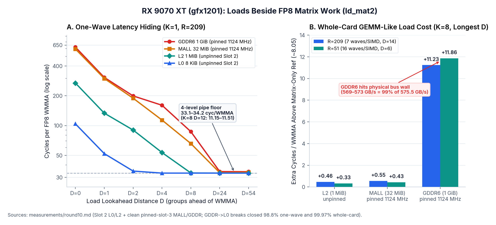

# Round 10: loads beside FP8 matrix work, and an unpinned cold-read bisect (2026-11-26)

Card RX 9070 XT (`1002:7550`, gfx1201), RADV, ROCm. Raw logs are in the companion checkout's git-ignored build tree: Slot 1 part 2 in `afk-r13/slot1-results/ld_mat2-nopin/` and `afk-r13/slot1-results/item3-bisect/`, Slot 2 item 1 in `afk-r13/slot2-results/ld_mat2-nopin/`. Labels: MEASURED (a number in one of those logs), READ (a file or an earlier note of this study), INFERRED (worked out from those, not printed by the probe).

**Profile (READ, Slot 2 `env-manifest.json`, generated 2026-11-26T14:39:42Z).** LACT track `overclock`: core offset +150 MHz, voltage offset -50 mV, memory-clock request 1409 MHz, performance level `auto`, power cap 374 W, power profile `0 BOOTUP_DEFAULT*:`. VBIOS `115-G295BP00-100` build `00150471`. Host: Ryzen 7 9700X, Linux 7.3.4-202. Toolchain: ROCm 10.1.0, AMD clang `d6f6cb69`, HIP 7.16.26385. Vulkan package recorded in the manifest: `mesa-vulkan-drivers-git-freeworld-26.4.0-1.git.20261029.1c3a936.fc44.x86_64`. Git commit is null. Connected outputs in that manifest: `card1-DP-1` and `card2-HDMI-A-2`. The manifest does not record DPMS. A 1.2x regulator-level power-limit mod is installed on this card (READ, earlier notes of this study; this manifest has no field for it), so reported watts are low on the main rail and are not board power. Slot 1's manifest (2026-11-26T12:51:01Z) records the same overclock fields.

The memory clock was not pinned. Every `CLOCKS` line below is the card's own choice. Cycle counts per `v_wmma_f32_16x16x16_fp8_fp8` do not depend on the clock. Wall-clock watts and the GHz printed beside a burst do.

## Plain summary

1. **Slot 1 part 2 stopped on the one-wave reference (MEASURED).** With 128 matrix instructions per iteration, `ref_one_R209` read 8.109 cycles per WMMA on all 3 bursts. The band is 7.9-8.1, so the job exited 3 and nothing else ran (`jobs.txt`: `one-L0L2 exit 3` at 13:06:22 UTC). The expectation file records why (READ): the loop edge is 14 cycles, and `(128 x 8 + 14) / 128 = 8.109`.
2. **Slot 2 raised the iteration to 256 instructions and the reference landed inside the same bands (MEASURED).** The band was not widened. One wave, R=209: 8.055. Whole card, R=209 (7 waves per SIMD): 8.043. Whole card, R=51 (16 waves per SIMD): 8.054. Expectation arithmetic (READ): `(256 x 8 + 14) / 256 = 8.055`.
3. **Whole-card L0 and L2 controls all passed (MEASURED).** Both register counts, both cache levels, the two aim-breaks included: `c7_counters`, `c8_hot`, `c9_placed`, `c10_agree`, and the reference gates. The wrapper still exited 1, because the one-wave job missed `c10_agree` on 7 cells.
4. **Those 7 misses are one-wave L2 at short lookahead (MEASURED).** L0 and the long-lookahead L2 cells in the same job agreed. The 7 cells' burst medians differ by more than 5% of the cell median. No burst was flagged by the counter checks. MALL (32 MiB) and GDDR6 (1 GiB) were not run.
5. **The Vulkan-versus-HIP bisect on Slot 1 does not support a closure claim (MEASURED).** Step 1 was skipped (`--no-pin`). The analysis has 23 verdicts: 17 PASS, 6 FAIL. Its last line says the closure is not interpreted.

## Item 1: `ld_mat2`, whole-card and one-wave loads beside FP8 matrix work at L0 and L2 (MEASURED)

Runner `scripts/round10/run_ld_mat2_nopin.sh`. Slot 2 console: `PASS: 65 kernels checked`, jobs 14:43:06 through 14:43:22 UTC (16 s), each job process exit 0, then `controls: 139 PASS, 7 FAIL`, wrapper exit 1. Those UTC stamps are 06:43:06-06:43:22 PST. Slot 1's listing check had been `PASS: 55 kernels checked` before the iteration length changed.

Each cell is 3 bursts. The cell number is `cyc_per_mm_median_of_bursts`. Penalty in the tables is that median minus the reference of the same job (INFERRED). `c10_agree` passes when the highest burst median minus the lowest is at most 5% of the cell median (READ, the probe: `(hi - lo) <= 0.05 * median`, printed as `agree5pct`). `min` and `max` on a burst line are the SIMD cycle spread inside that burst, not a second pair of bursts.

R=209 is 7 waves per SIMD and R=51 is 16. The burst lines print `W 7` and `W 16`. The jobs asked for `1:max` and `8:max` on the 209-register card; the result lines record D=60 and D=14.

### Why Slot 1 stopped, and what 256 instructions changed

`afk-r13/slot1-results/ld_mat2-nopin/one-L0L2.log`, reference only. Three bursts, each `cyc_per_mm_med 8.109`, `min 8.109`, `max 8.109`, iters 55458, clocks 3.042, 3.226, 3.226 GHz, hotspot 30 C, 1 SIMD, flagged 0. `CONTROL ref_one_R209 FAIL matrix-only 8.109 against 7.9-8.1`. `controls.txt` also has two `c6_aim` lines, `FAIL missing cell`, because the wrapper stopped before `break-one` and `break-card` existed. Those two lines are not a break that ran.

The copied expectation (`expect-ld_mat2.md`, copied 2026-11-26T14:43:04Z) names the edge ops: `v_mov`, `v_add_nc`, `v_and`, the counter, the compare, and the branch. 14 cycles over 128 matrix instructions is 0.109 per instruction. The generator change keeps K=32 at 512 instructions per iteration and uses 256 for K=1, 4, 8, and the reference. The one-wave band stays 7.9-8.1. The whole-card band stays 7.9-8.3.

Slot 2 references, all three bursts identical, flagged 0, `agree5pct 1`:

| Job | Reference control | Cycles per WMMA |
|---|---|---:|
| `one-L0L2` | `ref_one_R209 PASS` against 7.9-8.1 | 8.055 |
| `card209-L0` and `card209-L2` | `ref_card_R209 PASS` against 7.9-8.3 | 8.043 |
| `card51-L0` and `card51-L2` | `ref_card_R51 PASS` against 7.9-8.3 | 8.054 |

### Whole card, R=209, 7 waves per SIMD

`card209-L0.log` and `card209-L2.log`. Clocks are unpinned.

| Job | CLOCKS start | CLOCKS end | THERMAL line |
|---|---|---|---|
| L0 | sclk 1850 MHz, mclk 875 MHz, 37 W, hotspot 39 C | sclk 2246 MHz, mclk 96 MHz, 93 W, hotspot 55 C | 55 C |
| L2 | sclk 1943 MHz, mclk 875 MHz, 44 W, hotspot 42 C | sclk 2420 MHz, mclk 96 MHz, 102 W, hotspot 48 C | 48 C |

The THERMAL line matches CLOCKS end. Timed bursts also print `hot_max` from the launch guard. That figure reached 65 C on L0 (`k1_d8` rep 1) and 67 C on L2. `c8_hot` is the start temperature: L0 `30 of 30` and L2 `54 of 54` launches, calibration included, started at or below 58 C. `c7_counters`: 0 bursts flagged in each job. `c9_placed` passed on every cell.

| Level | K | D | Median | The 3 burst medians | Penalty over 8.043 |
|---|---:|---:|---:|---|---:|
| L0 | 1 | 0 | 15.082 | 15.082, 15.082, 15.082 | 7.039 |
| L0 | 1 | 2 | 10.274 | 10.274, 10.274, 10.274 | 2.231 |
| L0 | 1 | 8 | 10.100 | 10.100, 10.100, 10.100 | 2.057 |
| L0 | 1 | 60 | 10.025 | 10.018, 10.025, 10.040 | 1.982 |
| L2 | 1 | 0 | 38.530 | 38.532, 38.530, 38.528 | 30.487 |
| L2 | 1 | 2 | 12.922 | 12.922, 12.930, 12.906 | 4.879 |
| L2 | 1 | 8 | 10.025 | 10.025, 10.024, 10.036 | 1.982 |
| L2 | 1 | 60 | 9.904 | 9.904, 9.909, 9.902 | 1.861 |
| L2 | 8 | 0 | 11.387 | 11.388, 11.386, 11.387 | 3.344 |
| L2 | 8 | 2 | 8.682 | 8.682, 8.682, 8.682 | 0.639 |
| L2 | 8 | 8 | 8.507 | 8.507, 8.507, 8.506 | 0.464 |
| L2 | 8 | 14 | 8.504 | 8.504, 8.504, 8.504 | 0.461 |

Every cell: `agree5pct 1`, `bursts_used 3 of 3`, flagged 0.

SIMD spread inside a burst is wider than the burst-to-burst column. L0 K=1 D=2 is 10.027-10.522 on all three bursts around the 10.274 median. L0 K=1 D=8 is 9.664-10.522, 9.810-10.522, and 9.661-10.522. L0 K=1 D=60 is 9.660-10.522, 9.677-10.522, and 9.671-10.522. L2 K=1 D=0 is 35.967-40.459, 35.967-40.452, and 35.966-40.455 around 38.530. L2 K=1 D=2 is 12.090-13.589, 12.106-13.577, and 12.086-13.589 around 12.922. The deep K=8 cells sit in a few hundredths of a cycle.

At the longest K=1 lookahead the extra cost is 1.861 (L2 D=60) and 1.982 (L0 D=60, and L2 D=8). At K=1 D=0 the extra cost is still 7.039 on L0 and 30.487 on L2. At the longest K=8 lookahead it is 0.461 (D=14) and 0.464 (D=8).

### Whole card, R=51, 16 waves per SIMD

`card51-L0.log` and `card51-L2.log`. D=6 is the largest lookahead this register count holds (READ, the runner header).

| Job | CLOCKS start | CLOCKS end | THERMAL line |
|---|---|---|---|
| L0 | sclk 1773 MHz, mclk 875 MHz, 37 W, hotspot 42 C | sclk 1909 MHz, mclk 96 MHz, 74 W, hotspot 59 C | 59 C |
| L2 | sclk 1850 MHz, mclk 875 MHz, 40 W, hotspot 43 C | sclk 2162 MHz, mclk 96 MHz, 82 W, hotspot 59 C | 59 C |

Timed-burst `hot_max` reached 67 C on L0 and 63 C on L2. `c8_hot`: L0 `24 of 24`, L2 `42 of 42`, all starts at or below 58 C. `c7_counters`: 0 flagged in each job. `c9_placed` passed on every cell.

| Level | K | D | Median | The 3 burst medians | Penalty over 8.054 |
|---|---:|---:|---:|---|---:|
| L0 | 1 | 0 | 10.027 | 10.027, 10.027, 10.026 | 1.973 |
| L0 | 1 | 2 | 9.989 | 9.989, 10.004, 9.987 | 1.935 |
| L0 | 1 | 6 | 9.989 | 9.972, 9.994, 9.989 | 1.935 |
| L2 | 1 | 0 | 16.903 | 16.900, 16.905, 16.903 | 8.849 |
| L2 | 1 | 2 | 12.760 | 12.749, 12.760, 12.761 | 4.706 |
| L2 | 1 | 6 | 10.020 | 10.020, 10.020, 10.018 | 1.966 |
| L2 | 8 | 0 | 8.948 | 8.949, 8.941, 8.948 | 0.894 |
| L2 | 8 | 2 | 8.442 | 8.442, 8.442, 8.443 | 0.388 |
| L2 | 8 | 6 | 8.382 | 8.382, 8.382, 8.382 | 0.328 |

Every cell: `agree5pct 1`, 3 of 3 bursts, flagged 0. On this occupancy, L0 K=1 D=0 is already 1.973 over the reference. The longest L2 K=1 lookahead (D=6) is 1.966 over it. The longest L2 K=8 lookahead (D=6) is 0.328 over it.

### One wave, R=209, L0 and L2

`one-L0L2.log`. CLOCKS start: sclk 895 MHz, `mclk=?`, 24 W, hotspot 39 C. CLOCKS end: sclk 1295 MHz, mclk 96 MHz, 11 W, hotspot 39 C. THERMAL line 39 C. Timed-burst `hot_max` reached 40 C. `c8_hot PASS 186 of 186`. `c7_counters`: 0 flagged. `c9_placed` passed on every cell, including the seven below. Anchors in this job, all PASS: L2 K=1 D=54 is 33.129 against 33.65 +- 1.00; L2 K=4 D=12 is 14.287 against 14.40 +- 0.50; L2 K=8 D=12 is 11.149 against 11.40 +- 0.40.

L0, all `agree5pct 1`. Penalty is over 8.055.

| K | D | Median | Burst medians where they differ | Penalty |
|---:|---:|---:|---|---:|
| 1 | 0 | 104.084 | 104.084, 104.083, 104.086 | 96.029 |
| 1 | 1 | 52.077 | 52.077, 52.076, 52.084 | 44.022 |
| 1 | 2 | 34.732 | three equal | 26.677 |
| 1 | 4 | 33.064 | 33.066, 33.064, 33.064 | 25.009 |
| 1 | 8 | 33.064 | 33.064, 33.063, 33.065 | 25.009 |
| 1 | 24 | 33.063 | three equal | 25.008 |
| 1 | 54 | 33.071 | three equal | 25.016 |
| 4 | 0 | 32.041 | 32.038, 32.041, 32.041 | 23.986 |
| 4 | 2 | 14.276 | three equal | 6.221 |
| 4 | 6 | 14.274 | 14.274, 14.275, 14.274 | 6.219 |
| 4 | 12 | 14.274 | three equal | 6.219 |
| 8 | 0 | 20.035 | 20.035, 20.035, 20.036 | 11.980 |
| 8 | 2 | 11.150 | 11.150, 11.149, 11.150 | 3.095 |
| 8 | 6 | 11.149 | three equal | 3.094 |
| 8 | 12 | 11.149 | three equal | 3.094 |

L2 cells that passed `c10_agree`:

| K | D | Median | The 3 burst medians | Spread of those three | Penalty |
|---:|---:|---:|---|---:|---:|
| 1 | 8 | 33.195 | 33.216, 33.195, 33.156 | 0.181% | 25.140 |
| 1 | 24 | 33.137 | 33.137, 33.072, 33.145 | 0.220% | 25.082 |
| 1 | 54 | 33.129 | 33.129, 33.192, 33.071 | 0.365% | 25.074 |
| 4 | 6 | 14.357 | 14.349, 14.358, 14.357 | 0.063% | 6.302 |
| 4 | 12 | 14.287 | 14.288, 14.282, 14.287 | 0.042% | 6.232 |
| 8 | 2 | 13.533 | 13.533, 13.334, 13.970 | 4.700% | 5.478 |
| 8 | 6 | 11.181 | 11.181, 11.149, 11.183 | 0.304% | 3.126 |
| 8 | 12 | 11.149 | 11.149, 11.149, 11.149 | 0 | 3.094 |

K=8 D=2 passed at 4.700%, just under the 5% line. Spread is `(highest - lowest) / median` (INFERRED from the printed bursts).

**Seven L2 cells failed `c10_agree`.** Each burst's own SIMD min and max equal that burst's median, flagged 0, so the spread is from burst to burst. `controls.txt` names the same seven. Order is rep 0, 1, 2.

| Cell | Median | Rep 0 | Rep 1 | Rep 2 | Spread | Median minus 8.055 |
|---|---:|---:|---:|---:|---:|---:|
| K=1 D=0 | 268.869 | 258.812 | 287.116 | 268.869 | 10.527% | 260.814 |
| K=1 D=1 | 133.451 | 138.931 | 131.978 | 133.451 | 5.210% | 125.396 |
| K=1 D=2 | 90.106 | 90.106 | 90.465 | 83.544 | 7.681% | 82.051 |
| K=1 D=4 | 53.435 | 52.133 | 56.608 | 53.435 | 8.375% | 45.380 |
| K=4 D=0 | 75.256 | 77.626 | 73.587 | 75.256 | 5.367% | 67.201 |
| K=4 D=2 | 23.854 | 23.854 | 25.366 | 23.507 | 7.793% | 15.799 |
| K=8 D=0 | 41.186 | 41.186 | 42.593 | 39.858 | 6.641% | 33.131 |

On all 21 of these bursts the printed clock is 2.943 to 2.985 GHz and both hotspot fields are 39 C. The medians are what the log recorded. They are not a latency result, because the agreement control failed.

### Deliberate breaks: label L2, loads aimed at L0, K=1 D=0

`c6` asks the aimed cell to close at least 90% of the L2 minus L0 gap (READ, the expectation). Both controls print `moved 1.000`.

`break-card.log`, whole card, R=209. Reference 8.043. Aimed cell median 15.083, bursts 15.082, 15.083, 15.083, `agree5pct 1`. CLOCKS start sclk 2010 MHz, mclk 875 MHz, 41 W, hotspot 41 C. End sclk 2075 MHz, mclk 96 MHz, 68 W, hotspot 55 C. THERMAL 55 C. Timed-burst `hot_max` 57 C. `c8_hot` 12 of 12. The true L0 cell is 15.082 and the true L2 cell is 38.530, and that L2 cell agreed (38.532, 38.530, 38.528). Gap 38.530 - 15.082 = 23.448. The break sits 23.447 of the way from 38.530 to 15.082 (INFERRED), which is the control's printed 1.000.

`break-one.log`, one wave. Reference 8.055. Aimed cell median 104.083, bursts 104.084, 104.083, 104.082, `agree5pct 1`. CLOCKS start sclk 2095 MHz, mclk 1124 MHz, 45 W, hotspot 44 C. End sclk 1359 MHz, mclk 772 MHz, 27 W, hotspot 41 C. THERMAL 41 C. Timed-burst `hot_max` reached 43 C on the reference bursts. `c8_hot` 12 of 12. The control uses L0 104.084, L2 268.869, break 104.083, and prints 1.000. The L2 number is the cell that failed `c10_agree` (10.527% across 258.812, 287.116, 268.869). The aimed bursts themselves agree and land on the L0 value. Gap 268.869 - 104.084 = 164.785; the break is 0.001 under the L0 value, so the fraction is 164.786 / 164.785 (INFERRED), which rounds to the printed 1.000.

### Controls, faults, and what was left out

`controls.txt` is 146 lines: 139 PASS, 7 FAIL. The 7 FAILs are only the `c10_agree` lines in the table above, all from `one-L0L2`. Every job's `c7_counters` line is `0 bursts flagged`. Every `c8_hot` line is a full pass, so no launch started above 58 C. Seven `.faults` files are empty. Seven `.kernlog` files each contain the line `-- No entries --`.

MALL (32 MiB) and GDDR6 (1 GiB) are in the binary and refuse to start without `--pinned` (READ, the runner header and the expectation). They wait for item 2a. The runner also does not run whole-card K=4 or K=32, or R=90 and R=167.

## Item 3: Vulkan versus HIP cold-read bisect, `--no-pin` (MEASURED, controls failed)

Folder `afk-r13/slot1-results/item3-bisect/`. Console first line: steps 2-6, `STEP 1 SKIPPED (--no-pin)`, the pinned rerun waits for sudo. Jobs from 12:53:04 UTC, `jobs finished in 173 s, exit 0, failed jobs 6`. Six job lines print `exit=1` (`s3-vk-r1`, `s5-vk-r1`, `s6-vk-r1`, `s3-vk-r2`, `s6-vk-r2`, `s3-vk-r3`). The analysis header is `STEP 1 NOT RUN (--no-pin)`.

23 `VERDICT` lines: 17 PASS, 6 FAIL. The last line names the six and says no part of the closure is interpreted:

`CONTROLS FAILED (repeats, hip_base_cold_r, vk_noevict_break_r, vk_noevict_break_p, hip_noevict_break_r, hip_noevict_break_p)`

Passing verdicts, named only: `start_temp` (225 cells at or below 58 C, highest start 42 C, 0 not run), `pointer_ok`, `hip_base_cold_p` (505.744140625, band 470-560), `vk_base_cold_r` (775.45556640625, band 740-900), `vk_base_cold_p` (789.041015625, band 720-880), both HIP fused (230.7255859375, band 200-270), both Vulkan fused (293.9150390625 and 294.75390625, band 260-340), both loop-8 breaks, both placement breaks, both stride-128 checks, both stride-order checks.

**No closure claim.** The analysis marks every closure line `not an answer`. This note does not repeat those percentages.

**Raw diagnostic, controls failed, not interpreted.** `repeats` prints spreads vk-base-r 25.5%, vk-baseg-r 21.8%, vk-v1-r 32.5%, vk-v1n-r 8.7%, vk-base-p 7.0%, vk-baseg-p 23.7%. `hip_base_cold_r` prints 688.5966796875 against band 690-720. The four no-evict breaks print a pair and the rule "at most 60% of cold": vk-noev-r 1179 vs 775, vk-noev-p 1106 vs 789, hip-noev-r 447 vs 689, hip-noev-p 359 vs 506. Those ratios are 152.1%, 140.2%, 64.9%, and 70.9% (INFERRED from the printed integers). The analysis text does not say MALL and does not name a byte size on those verdict lines. The sampler CSVs in the folder (24 files, 9907 rows with `gfxclk_cur_MHz` and `uclk_cur_MHz`) show shader clocks from 0 to 3415 MHz and memory clocks at 96, 456, 772, 875, 1124, and 1408 MHz. The sysfs CSVs (11 files, 3994 rows) show `cur_gfxclk_MHz` from 15 to 3415 and `sclk_MHz` from 78 to 3415. The matched-clock section of the analysis labels repetitions at 772, 875, 1124, and 1408 MHz. A pinned memory clock (item 2a) is still required before any of this is read as a cause.

## Pinned memory-clock follow-up (`1124 MHz` flat, 2026-11-26, OC track, displays on, MEASURED)

Folder `kimi-next/pinned-slot-3/` in the companion checkout's git-ignored build tree (25 s total). This clean run supersedes an earlier `pinned-slot-1/` pass during which Cyberpunk 2077 was briefly active; `pinned-slot-3/` ran with the game closed under the fixed `scripts/round10/pin_mclk.sh --level 5 --cap-s 2400` on the RX 9070 XT (`1002:7550`, LACT track `overclock`, monitors on). Across all **1,247** `r11_sampler` rows (**108** across the 8 `ld_mat2` jobs + **1,139** across the 4 Item 3 Step 1 jobs), `uclk_cur_MHz` held flat at **`1124 MHz`** (`min=1124`, `max=1124`, `4: 1124Mhz *`). At exit, `pin_mclk.sh` logged **`RESTORE-OK level=auto mask=all`** (`restore status 0`), with no `RESTORE-FAILED`, lock free, and **0 amdgpu faults** in `journalctl -k` (see [round10-p0.md](round10-p0.md)).

### Item 1 pinned: one-wave `MALL` (32 MiB) and `GDDR` (1 GiB) (`one-MALL-GDDR`, `--pinned L5_1124MHz`)



`one-MALL-GDDR.log` (exit 0) and `break-one-GDDR-L0.log` (exit 0). References passed on both jobs (`ref_one_R209 = 8.096` in `one-MALL-GDDR`, `8.078` in `break-one-GDDR-L0`, both against `7.9-8.1`), `c7_counters` = 0 bursts flagged, `c9_placed` PASS on every cell, `c8_hot` = `186 of 186` and `12 of 12` starts `<= 58 C` (highest hotspot `49 C` and `50 C`). Penalty is over `8.096` (INFERRED).

| K | D | `MALL` (32 MiB) cyc/mm (`agree5pct`) | `MALL` penalty | `GDDR` (1 GiB) cyc/mm (`agree5pct`) | `GDDR` penalty |
|---:|---:|---:|---:|---:|---:|
| 1 | 0 | 593.506 (0, FAIL) | +585.410 | 620.404 (1) | +612.308 |
| 1 | 1 | 298.907 (1) | +290.811 | 306.578 (1) | +298.482 |
| 1 | 2 | 188.979 (1) | +180.883 | 199.326 (0, FAIL) | +191.230 |
| 1 | 4 | 113.679 (1) | +105.583 | 160.415 (0, FAIL) | +152.319 |
| 1 | 8 | 65.774 (0, FAIL) | +57.678 | 86.837 (0, FAIL) | +78.741 |
| 1 | 24 | **33.354** (1) | +25.258 | **34.348** (1) | +26.252 |
| 1 | 54 | **33.689** (1) | +25.593 | **34.169** (1) | +26.073 |
| 4 | 0 | 221.302 (1) | +213.206 | 218.122 (1) | +210.026 |
| 4 | 2 | 52.927 (1) | +44.831 | 53.304 (1) | +45.208 |
| 4 | 6 | 22.321 (0, FAIL) | +14.225 | 25.712 (0, FAIL) | +17.616 |
| 4 | 12 | **14.502** (1) | +6.406 | 15.130 (0, FAIL) | +7.034 |
| 8 | 0 | 83.009 (0, FAIL) | +74.913 | 101.443 (0, FAIL) | +93.347 |
| 8 | 2 | 27.685 (1) | +19.589 | 27.755 (1) | +19.659 |
| 8 | 6 | 12.178 (0, FAIL) | +4.082 | 11.995 (1) | +3.899 |
| 8 | 12 | **11.491** (1) | +3.395 | **11.513** (1) | +3.417 |

- **Four-level one-wave lookahead plateau (MEASURED across Slot 2 `L0`/`L2` + `pinned-slot-3` `MALL`/`GDDR`):**
  - `K=1 D=54`: `L0 33.071`, `L2 33.129`, `MALL 33.689`, `GDDR 34.169` cyc/mm (all `agree5pct 1`).
  - `K=8 D=12`: `L0 11.149`, `L2 11.149`, `MALL 11.491`, `GDDR 11.513` cyc/mm (all `agree5pct 1`).
  - Deep lookahead hides even a ~620-cycle GDDR6 round trip down to the same ~25–26 cyc/load-group pipe floor seen at L0 and L2.
- **Why 11 one-wave cells (5 MALL, 6 GDDR) failed `c10_agree`:** unpinned SCLK jumped between `~1.98 GHz` and `~3.22 GHz` across the 3 bursts (for example `MALL K=1 D=0` read `862.147 @ 3.222 GHz = 267.6 ns` vs `593.506 @ 1.977 GHz = 300.2 ns` and `582.674 @ 1.987 GHz = 293.2 ns`). Because `MALL`/`GDDR` latency is partly fixed in nanoseconds (`uclk=1124 MHz`), SCLK jumps move `cyc/mm` proportionally; at deep lookahead (`D=24/54`, `K=8 D=12`), the wave is pipe-bound rather than latency-bound, so `cyc/mm` stays invariant (`33.58–33.78` and `11.49–11.53` across `1.97–3.22 GHz` SCLK!).
- **One-wave deliberate aim break (`break-one-GDDR-L0`, PASS):** `GDDR` label aimed at `L0` (`K=1 D=0`) measured **`110.406 cyc/mm`** (`110.406, 109.262, 110.489`, `agree5pct 1`) against `620.404` (`GDDR`) and `104.084` (`L0` Slot 2) — closing **98.8% (`0.988`)** of the `516.320`-cycle `GDDR - L0` gap (`>= 0.90` PASS).

### Item 1 pinned: whole-card `MALL` (32 MiB) and `GDDR` (1 GiB) (`ld_mat2`, `--pinned L5_1124MHz`)

**Whole-card references (`c1_ref_8`, `c7_counters`, `c8_hot`, `c9_placed` all PASS):** `R=209` ref `8.048` (`MALL`), `8.048` (`GDDR`), `8.049` (`break-card`); `R=51` ref `8.056` (`MALL`), `8.056` (`GDDR`). All launches started at or below `58 C`, 0 bursts flagged, peak probe hotspot `57 C` (sampler peak `65 C`).

**MALL (32 MiB) whole-card (`card209-MALL`, `card51-MALL`, both exit 0):**

| Cell | `R=209` (7 waves/SIMD) cyc/mm (`agree5pct`) | `R=209` extra over `8.048` | `R=51` (16 waves/SIMD) cyc/mm (`agree5pct`) | `R=51` extra over `8.056` |
|---|---:|---:|---:|---:|
| `ref` | 8.048 (1) | 0 | 8.056 (1) | 0 |
| `K=1 D=0` | 64.367 (1) | +56.319 | 28.101 (1) | +20.045 |
| `K=1 D=2` | 21.314 (1) | +13.266 | 10.490 (1) | +2.434 |
| `K=1 D=6 / D=8` | 10.256 (`D=8`, 1) | +2.208 | 11.830 (`D=6`, 1) | +3.774 |
| `K=1 D=60` | 17.536 (0, FAIL) | +9.488 | n/a | n/a |
| `K=8 D=0` | 9.111 (1) | +1.063 | 9.732 (0, FAIL) | +1.676 |
| `K=8 D=2` | 9.298 (1) | +1.250 | 8.775 (1) | +0.719 |
| `K=8 D=6 / D=8` | 8.614 (`D=8`, 1) | +0.566 | **8.487** (`D=6`, 1) | **+0.431** |
| `K=8 D=14` | **8.602** (1) | **+0.554** | n/a | n/a |

- At `K=8` (GEMM-like compute density), 32 MiB `MALL` loads add only **`+0.431` (`R=51 D=6`) to `+0.554` (`R=209 D=14`) cycles/WMMA** (all `agree5pct 1`) — nearly hidden behind FP8 WMMA.
- In `card209-MALL K=1 D=60`, `cyc/mm` varied with SCLK (`14.670 @ 2.322 GHz = 6.32 ns/mm` vs `19.515 @ 3.154 GHz = 6.19 ns/mm`, ~5.2–5.3 TB/s), reflecting a fixed-clock-domain ceiling independent of SCLK.

**GDDR6 (1 GiB) whole-card (`card209-GDDR`, `card51-GDDR`, exit 3 on `c11` — memory-bus bound at `1124 MHz`):**

| Job / Cell | Burst `cyc/mm` (rep 0 / 1 / 2) | Burst `SCLK` GHz (rep 0 / 1 / 2) | Burst `ns/mm` (rep 0 / 1 / 2) | Implied card GB/s (`128*256*GHz/(cyc*K)`) | Controls |
|---|---|---|---|---|---|
| `R=209 K=1 D=0` | 147.31 / 172.32 / 178.24 | 2.558 / 2.993 / 3.096 | **57.59 / 57.57 / 57.57** | **569.0 / 569.2 / 569.2** | `c10`/`c11` FAIL |
| `R=209 K=1 D=2` | 149.05 / 178.99 / 184.86 | 2.595 / 3.113 / 3.214 | **57.44 / 57.50 / 57.52** | **570.5 / 569.9 / 569.7** | `c10`/`c11` FAIL |
| `R=209 K=1 D=8` | 147.79 / 171.23 / 169.28 | 2.573 / 2.980 / 2.947 | **57.44 / 57.46 / 57.44** | **570.5 / 570.3 / 570.5** | `c10`/`c11` FAIL |
| `R=209 K=1 D=60` | 147.07 / 160.69 / 173.64 | 2.565 / 2.812 / 3.030 | **57.34 / 57.15 / 57.31** | **571.5 / 573.4 / 571.8** | `c10`/`c11` FAIL |
| `R=209 K=8 D=0..8` | 17.70..22.03 | 2.451..3.069 | **7.18..7.27** | **563.2..570.5** | `c10` FAIL |
| `R=209 K=8 D=14` | 17.01 / 19.28 / 19.98 | 2.432 / 2.751 / 2.818 | **7.00 / 7.01 / 7.09** | **577.8..585.5** | `c10` FAIL |
| `R=51 K=1 D=0` | 163.26 / 164.96 / 166.87 | 2.815 / 2.843 / 2.872 | **58.00 / 58.02 / 58.10** | **564.0..565.0** | `c10` PASS, `c11` FAIL |
| `R=51 K=1 D=2 / D=6` | 151.73..178.27 | 2.742..3.070 | **55.34..58.08** | **564.2..592.2** | `c10`/`c11` FAIL |
| `R=51 K=8 D=0..6` | 17.39..23.00 | 2.453..3.158 | **7.09..7.30** | **561.5..577.8** | `c10` FAIL |

- **Why `c10_agree` and `c11_bandwidth_bound_GDDR` failed (INFERRED from raw bursts):** at pinned `1124 MHz` MCLK (theoretical 256-bit GDDR6 bus = `575.5 GB/s`), every `R=209 K=1` burst ran at **`569.0 to 573.4 GB/s` (98.9% to 99.6% of bus)** with **0.03% to 0.33% spread in `ns/mm`**. Two other rows (`R=209 K=8 D=14` at `577.8–585.5 GB/s` and `R=51 K=1 D=2` at `579.7–592.2 GB/s`, up to 102.9% of theoretical bus) read slightly above `575.5 GB/s` in this formula (`128*256*clock_ghz/(cyc*K)`), reflecting short-burst `clock_ghz` sampling vs bus traffic and residual MALL/L2 reuse rather than exceeding the physical bus. Because SCLK was unpinned and ramped `2.43 -> 3.21 GHz` across bursts, `cyc/mm` scaled linearly with `SCLK / MCLK`, tripping `c10_agree`'s 5% cycle-spread check and exceeding `c11`'s `130-155` band (which assumed `1408 MHz` MCLK).
- **Whole-card deliberate aim break (`break-card-GDDR-L0`, PASS):** `GDDR` label aimed at `L0` (`R=209 K=1 D=0`) measured **`15.132 cyc/mm`** (`15.148, 15.132, 15.107`, `agree5pct 1`) against `172.316` (`GDDR`) and `15.082` (`L0` Slot 2) — closing **99.97% (`1.000`)** of the `157.234`-cycle `GDDR - L0` gap.

### Item 3 Step 1 pinned (`1124 MHz` MCLK, `item3-pinned/`, CONTROLS FAILED)

Ran two repeats (`s1-vk-r1`, `s1-hip-r1`, `s1-vk-r2`, `s1-hip-r2`; `uclk_start=uclk_end=1124 MHz` on every counted repetition and across all 1,139 watch-sampler rows, `pointer_ok` PASS 19/19 on every cell, `start_temp` PASS <= 56 C, 0 faults). `s1-hip-r2` exited `1` on `hip-base-p` `cell_clock` (`2598–3226 MHz` across reps), stopping repeat 3. Analysis verdict: `CONTROLS FAILED (verdict_line, repeats, hip_base_cold_r, vk_base_cold_r)` — no closure percentage is claimed.

| Cell (repeat) | `uclk` (MHz) | `sclk` med (min–max MHz) | `cell_clock` | Median cyc/step | Median ns/step | Band verdict |
|---|---:|---|---|---:|---:|---|
| `vk-base-r` (r1 / r2) | 1124 flat | 3227 (3163–3227) / 3188 (3091–3231) | PASS / PASS | 855.3 / 957.3 | **265.0 / 302.1** | `vk_base_cold_r` FAIL (`906.3` vs `740–900`); `repeats` 11.3% FAIL |
| `vk-base-p` (r1 / r2) | 1124 flat | 3226 (3176–3227) / 3193 (3071–3232) | PASS / PASS | 820.7 / 939.2 | **254.4 / 295.0** | `vk_base_cold_p` PASS (`880.0` vs `720–880`); `repeats` 13.5% FAIL |
| `hip-base-p` (r1 / r2) | 1124 flat | 3216 (3083–3227) / 3215 (2598–3226) | PASS / FAIL | 526.4 / 527.4 | **163.6 / 164.9** | `hip_base_cold_p` PASS (`526.9` vs `470–560`) |
| `hip-base-r` (r1 / r2) | 1124 flat | 1976 (1921–1977) / 1975 (1920–1977) | PASS / PASS | 575.2 / 584.3 | 294.0 / 295.9 | `hip_base_cold_r` FAIL (`579.7` vs `690–720`; unwarmed ~1.98 GHz SCLK) |

- **Raw observation under failed controls (MEASURED, no causal reading claimed):**
  1. In repeat 1 (`s1-vk-r1`/`s1-hip-r1`, where `cell_clock` passed on both cells at `1124 MHz` MCLK and `~3.22 GHz` SCLK), `hip-base-p` read **`163.6 ns`** against `vk-base-p` **`254.4 ns`** (`90.8 ns` lower). In repeat 2, `hip-base-p` read `164.9 ns` (with `cell_clock FAIL`, `2598–3226 MHz`) against `vk-base-p` `295.0 ns`. Because overall controls failed (`verdict_line`, `repeats`, `hip_base_cold_r`, `vk_base_cold_r`), no causal reading or closure is claimed from this run.
  2. `hip-base-r` stayed stably at `1975–1976 MHz` SCLK (`cell_clock PASS`) because `r10_cl3` has no warm-up spin (unlike Vulkan's `150 ms` warm-up), which shifted its cycle count below the `690–720` band written for ~3 GHz SCLK.
  3. Full causal closure of `walk=page` and warmed `hip-base-r` remains open for a 3-repeat pinned run with a HIP warm-up spin and `dpms=Off` (to eliminate the active-display repeat variance seen in `s1-vk-r2`).

## Parked

- **Item 2a / 2b.** `scripts/round10/pin_mclk.sh` is validated on real hardware (Level 1 and Level 5 idle plus clean Level 5 under load across 1,247 flat `1124 MHz` sampler rows returning `RESTORE-OK`, with `listing()` trailing-space fix and `pin-attempt` kill-window narrowing; **47 PASS / 0 FAIL / 0 stderr** in `selftest-p0.sh`). One-wave and whole-card `MALL`/`GDDR` are now measured cleanly; remaining open pinned work is a warmed 3-repeat `dpms=Off` Item 3 Step 1 + `walk=page` bisect (and SCLK-matched `GDDR` cycle-control check).
- **Item 4a.** Overnight idle watch. Parked until the owner says to run it.
- **Item 4b.** Displays on against DPMS off, same pause binary — **COMPLETED** on 2026-11-26 (683/1,029/776 median events/wave when `dpms=On` vs 0/0/0 sixty seconds later when `dpms=Off`, closing Check 3's 16-wave chance control). See [ext-review-checks.md](ext-review-checks.md).

## Rerun

These commands take the GPU lock. This write-up did not launch them.

```sh
scripts/round10/run_ld_mat2_nopin.sh --plan
scripts/round10/run_ld_mat2_nopin.sh --cpu-checks
scripts/round10/run_ld_mat2_nopin.sh [run folder]
scripts/round10/run_item3_bisect.sh --plan
scripts/round10/run_item3_bisect.sh --cpu-checks
scripts/round10/run_item3_bisect.sh --no-pin --steps 2-6
scripts/round10/run_item3_bisect.sh --pin LEVEL --steps 1
```

`run_ld_mat2_nopin.sh` exits 0 when every control passes and 1 when a job or a control fails. The Slot 2 wrapper's exit 1 is that second case. `--no-pin` is the item 3 default and skips step 1. `--pin` calls `scripts/round10/pin_mclk.sh`, which refuses without the owner's own switch.
